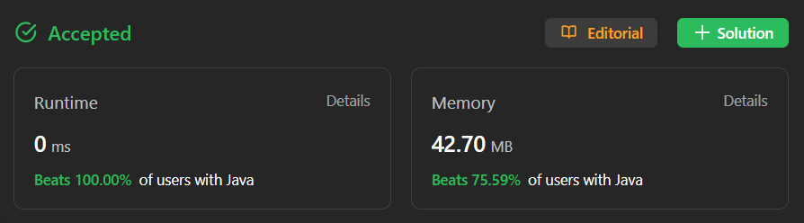

# ✅ Multiple Approaches Step By Step ✅ Brute-Better-Optimal ✅ Explanation ✅ Video

**Author:** millenium103
**Votes:** 88
**Link:** [https://leetcode.com/problems/min-cost-climbing-stairs/solutions/4163085/](https://leetcode.com/problems/min-cost-climbing-stairs/solutions/4163085/)

---



# YouTube Video Explanation:

[https://youtu.be/NNNFTGMqquU]()

## \u2B50\uFE0F Subscribe URL
[https://www.youtube.com/channel/UCZPTGQ_15IeIcrpcZL62Pww](https://www.youtube.com/channel/UCZPTGQ_15IeIcrpcZL62Pww)
**Subscribers: 64**
**My initial goal is 1000**
**Thank you for your support!**

# Approaches to the problem
Have look at my solution from brute to better to optimal in the following approaches:

## Step by Step from Recursion: (Time Limit Exceeded)

In this approach, we identify a recurrence relation between subproblems and use recursion to find the minimum cost. It's not efficient and has an exponential time complexity.
```java
class Solution {
    //time limit exceeded
    //recursive approach
    public int minCostClimbingStairs(int[] cost) {
	    int n = cost.length;
	    return Math.min(minCost(cost, n-1), minCost(cost, n-2));
    }
    private int minCost(int[] cost, int n) {
	    if (n < 0) return 0;
	    if (n==0 || n==1) return cost[n];
	    return cost[n] + Math.min(minCost(cost, n-1), minCost(cost, n-2));
    }
}
```

## Top-Down DP with Memoization:

We optimize the recursive approach by adding memoization to reduce the time complexity from exponential to linear. We create an array to store previously computed values.

1. Top-Down DP with Memoization (O(n) time, O(n) space):
```java
int[] dp;
public int minCostClimbingStairs(int[] cost) {
    int n = cost.length;
    dp = new int[n];
    return Math.min(minCost(cost, n - 1), minCost(cost, n - 2));
}

private int minCost(int[] cost, int n) {
    if (n < 0) return 0;
    if (n == 0 || n == 1) return cost[n];
    if (dp[n] != 0) return dp[n];
    dp[n] = cost[n] + Math.min(minCost(cost, n - 1), minCost(cost, n - 2));
    return dp[n];
}
```

## Bottom-Up DP - Tabulation:

This approach further optimizes the problem by converting recursion to iteration and getting rid of the recursive stack. We use an array to store intermediate results and iteratively calculate the minimum cost.

2. Bottom-Up DP - Tabulation (O(n) time, O(n) space):
```java
public int minCostClimbingStairs(int[] cost) {
    int n = cost.length;
    int[] dp = new int[n];
    for (int i = 0; i < n; i++) {
        if (i < 2) dp[i] = cost[i];
        else dp[i] = cost[i] + Math.min(dp[i - 1], dp[i - 2]);
    }
    return Math.min(dp[n - 1], dp[n - 2]);
}
```

## Fine Tuning - Reduce Space to O(1):

In this final optimization, we reduce the space complexity from O(n) to O(1). We only keep track of the minimum cost for the current step and the previous step since we don't need the entire DP array.


3. Fine Tuning - Reduce Space to O(1) (O(n) time, O(1) space):
```java
public int minCostClimbingStairs(int[] cost) {
    int n = cost.length;
    int first = cost[0];
    int second = cost[1];
    if (n <= 2) return Math.min(first, second);
    for (int i = 2; i < n; i++) {
        int curr = cost[i] + Math.min(first, second);
        first = second;
        second = curr;
    }
    return Math.min(first, second);
}
```

These approaches provide a step-by-step progression from naive recursion to highly optimized solutions, addressing the problem efficiently.


# Code
<iframe src="https://leetcode.com/playground/SrNfKZQf/shared" frameBorder="0" width="1000" height="350"></iframe>

# Please upvote if you find this useful


