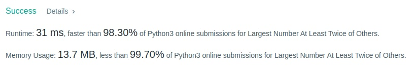

# Python Elegant & Short | O(n) time one pass | O(1) space | 98.3% faster | 99.7% memory

**Author:** Kyrylo-Ktl
**Votes:** 30
**Link:** [https://leetcode.com/problems/largest-number-at-least-twice-of-others/solutions/2383331/](https://leetcode.com/problems/largest-number-at-least-twice-of-others/solutions/2383331/)

---



```
def dominantIndex(self, nums: List[int]) -> int:
	first_max = second_max = -1
	max_ind = 0

	for i, num in enumerate(nums):
		if num >= first_max:
			first_max, second_max = num, first_max
			max_ind = i
		elif num > second_max:
			second_max = num

	if first_max < 2*second_max:
		max_ind = -1

	return max_ind
```

If you like this solution remember to **upvote it** to let me know.

