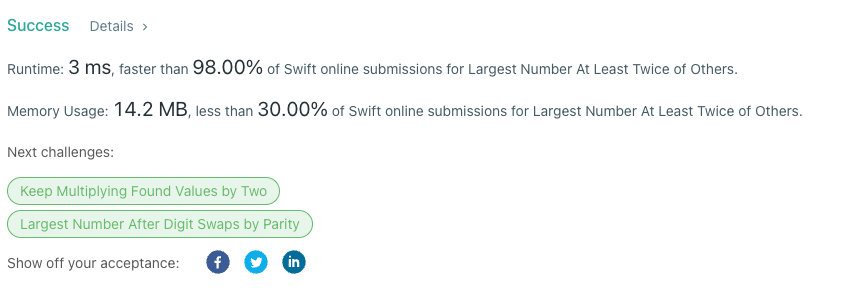

# Swift 3ms solution

**Author:** giorfasolinii
**Votes:** 1
**Link:** [https://leetcode.com/problems/largest-number-at-least-twice-of-others/solutions/2469146/](https://leetcode.com/problems/largest-number-at-least-twice-of-others/solutions/2469146/)

---



```
class Solution {
    
    // Time Complexity: O(N)
    // Space Complexity: O(1)
    
    func dominantIndex(_ nums: [Int]) -> Int {
        
        let maxNum = nums.max() ?? 0
        var isTwice: Bool = true
        
        for num in nums {
            
            // So that we dont iterate on the max number
            if num != maxNum {
                if num * 2 > maxNum {
                    isTwice = false
                    return -1
                } else {
                    if num * 2 <= maxNum {
                        isTwice = true
                    } else {
                        isTwice = false
                        return -1
                    }
                }
             }
        }
        
        
        if isTwice {
            return nums.firstIndex(of: maxNum) ?? -1
        }
        
        return -1
    }
}
```