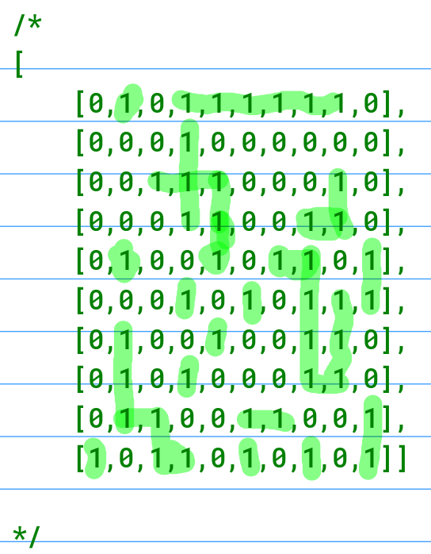
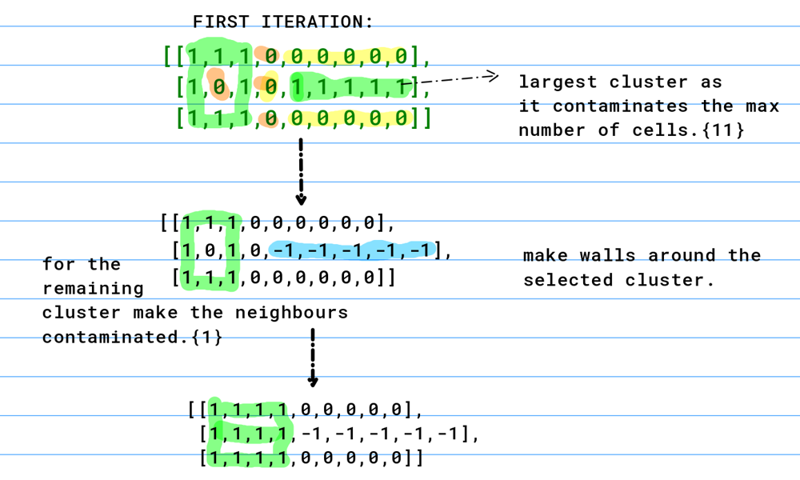
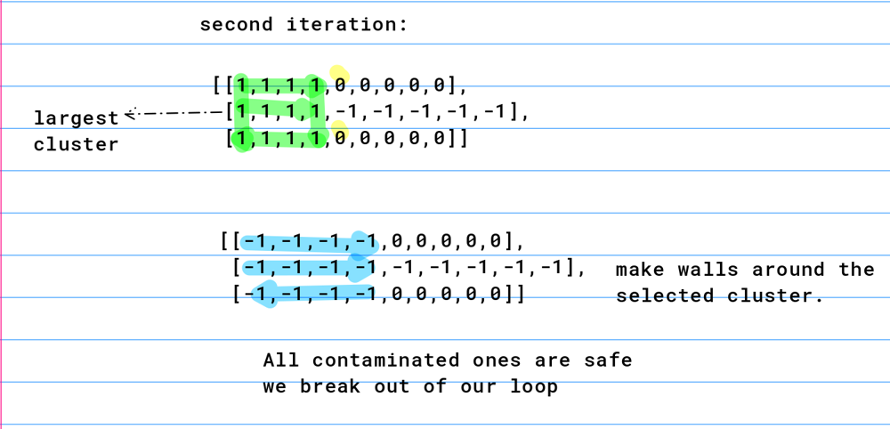

# CPP DFS solution explained

**Author:** rai02
**Votes:** 95
**Link:** [https://leetcode.com/problems/contain-virus/solutions/847507/](https://leetcode.com/problems/contain-virus/solutions/847507/)

---

I recently got this in an assessment. 

get clusters in every step. 

deal with the largest clusters and expand all the other clusters.

lets take the sample case




```
class cluster
{
    public:
        set<pair<int,int>> c; // set of cells that are contaminated
        set<pair<int,int>> uc; // set of cells that are next to this cluster and are uncontaminated
        int wcnt = 0;       // walls required to contain this structure 
    
};
class Solution {
public:
    
    void dfs(vector<vector<int>> &grid, int i, int j, vector<vector<bool>> &vis, cluster &cl)
    {
        if(i == grid.size() || i < 0 || j < 0 || j == grid[0].size()||vis[i][j]||grid[i][j] == -1)
        {
            // if the current src is out of grid bounds or if the cell is already visited  or current cell is already walled that is -1
            return;
        }
        if(grid[i][j] == 0)
        {
            // if cell is uncontaminated then add to the uncontaminatd cells (uc) and increment wall cnt 
            cl.wcnt++;
            cl.uc.insert({i,j});
            return;
        }
        // if current cell is contaminated add to contaminated and mark vis = true
        cl.c.insert({i,j});
        vis[i][j] = true;
        // call dfs in all directions
        dfs(grid,i+1,j,vis,cl); // above
        dfs(grid,i-1,j,vis,cl); // below
        dfs(grid,i,j+1,vis,cl); // right
        dfs(grid,i,j-1,vis,cl); // left
        
    }

    int containVirus(vector<vector<int>>& grid) {
    
        // row ka size
        int n = grid.size();
        // col ka size
        int m = grid[0].size();
        int ans = 0;
        while(1)
        {
            // visisted matrix
            vector<vector<bool>> vis(n,vector<bool>(m));
            // comparator for pq to sort it according to size of uncontaminated cells in cluster
            auto comp=[](const cluster& A,const cluster& B)
            { 
                return A.uc.size()<B.uc.size();
            };
            // initialise priority queue
            priority_queue<cluster,vector<cluster>, decltype(comp)> pq(comp);
            // search for a contaminated cell in the grid
            for(int i = 0; i<n; i++)
            {
                for(int j = 0; j<m; j++)
                {
                    if(!vis[i][j]&&grid[i][j] == 1)
                    {
                        // create a cluster
                        cluster c;
                        // call dfs
                        dfs(grid,i,j,vis,c);
                        pq.push(c);

                    }
                }
            }
            // if size of priority queue is 0 the termination condition is reached ie all contaminated cells are contained.
            if(pq.size()==0)
            break;
            // get the biggest cluster is found make em all -1 and add the walls reqd to contain them 
            cluster k = pq.top();
            pq.pop();
            for(auto x: k.c)
            {
                grid[x.first][x.second] = -1;
            }
            ans += k.wcnt;

            // for the rest of the clusters make their uncontaminated cells as contaminated
            while(!pq.empty())
            {
                cluster k1 = pq.top();
                pq.pop();
                for(auto x: k1.uc)
                {
                    grid[x.first][x.second] = 1;
                }   
            }
         
        }
        
        return ans;
    }
};

```