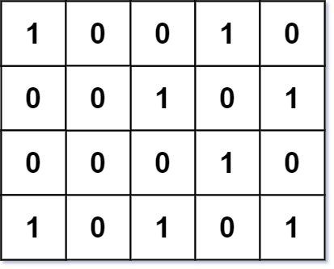
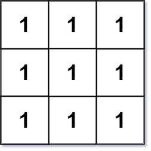
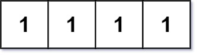

# [750. Number Of Corner Rectangles](https://leetcode.com/problems/number-of-corner-rectangles/)

| Category | Difficulty | Likes | Dislikes |
| :------: | :--------: | :---: | :------: |
| Algorithms | Medium | 632 | 92 |

**Tags:** [`array`](https://leetcode.com/tag/array), [`math`](https://leetcode.com/tag/math), [`dynamic-programming`](https://leetcode.com/tag/dynamic-programming), [`matrix`](https://leetcode.com/tag/matrix)

**Companies:** `facebook`

## Description

Given an `m x n` integer matrix `grid` where each entry is only `0` or `1`, return *the number of **corner rectangles***.

A **corner rectangle** is four distinct `1`'s on the grid that forms an axis-aligned rectangle. Note that only the corners need to have the value `1`. Also, all four `1`'s used must be distinct.

 

**Example 1:**


```

Input: grid = [[1,0,0,1,0],[0,0,1,0,1],[0,0,0,1,0],[1,0,1,0,1]]
Output: 1
Explanation: There is only one corner rectangle, with corners grid[1][2], grid[1][4], grid[3][2], grid[3][4].

```

**Example 2:**


```

Input: grid = [[1,1,1],[1,1,1],[1,1,1]]
Output: 9
Explanation: There are four 2x2 rectangles, four 2x3 and 3x2 rectangles, and one 3x3 rectangle.

```

**Example 3:**


```

Input: grid = [[1,1,1,1]]
Output: 0
Explanation: Rectangles must have four distinct corners.

```

 

**Constraints:**

	- `m == grid.length`

	- `n == grid[i].length`

	- `1 <= m, n <= 200`

	- `grid[i][j]` is either `0` or `1`.

	- The number of `1`'s in the grid is in the range `[1, 6000]`.

---

**Links:** [Submissions](https://leetcode.com/problems/number-of-corner-rectangles/) | [Solutions](https://leetcode.com/problems/number-of-corner-rectangles/)
