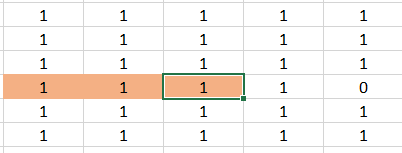
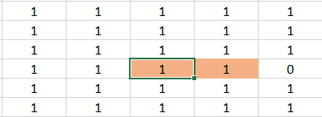
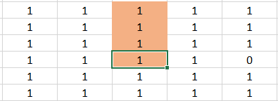
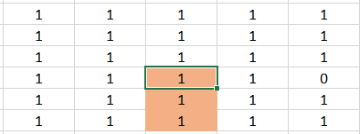
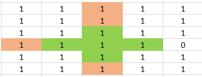

# Intuitive| Explained with image | Short and Clean | C++

**Author:** av1shek
**Votes:** 125
**Link:** [https://leetcode.com/problems/largest-plus-sign/solutions/1453636/](https://leetcode.com/problems/largest-plus-sign/solutions/1453636/)

---

**Step 1:** Create n x n matrix having all values 1 and assign the mines values as 0.
**Step 2:** Create another 4 matrix (say lef, rig, top, bot).
* ``` lef``` means left and ```lef[i][j]``` will represent no of continious block in left having values 1
		```lef[ 3 ][ 2 ] = 3```
		 

* ``` rig``` means right and ```rig[i][j]``` will represent no of continious block in right having values 1
		```rig[ 3 ] [ 2 ] = 2```
		

* ``` top``` means top and ```top[i][j]``` will represent no of continious block in top having values 1
		```top[ 3 ] [ 2 ] = 4```
		

* ``` bot``` means bottom and ```bot[i][j]``` will represent no of continious block in bottom having values 1
		```bot[ 3 ] [ 2 ] = 3```
		

**Step 3:** Fill the above four matrix 
* If values inside a cell is equal to 0, means that cell can not be center of the plus sign, so just ignore those cells.
* If values inside a cell is equal to 1, so value of this cell will be 1 more that other adjacent cells in different direction of corresponding matrix.
* **Note:** For matrix ```bot```, ```rig``` we need the value of the cells from the bottom cell and right cell. But as we are moving ``` i = 0 to n```, ```j = 0 to n``` means from left to right and top to bottom so those cells are not filled yet. So we have to fill these two matrix from right to left and bottom to top. And in order to so, we just have to change the index ``` x = n - 1 - i```, ```y = n - 1 - j```.

**Step 4:** For each index check what is maximum size of "+" symbol we can find. 
To create  "+" from a given index we have to choose all fours arms of equal length. So by selecting minimum of all the four arms we can get "+" sign of maximum size from that index.

```min({3, 2, 4, 3}) = 2```


**Code:** 
```
int orderOfLargestPlusSign(int n, vector<vector<int>>& mines) {

    vector<vector<int>> mat(n, vector<int>(n, 1));
    for(auto it : mines)
    {
        int x = it[0] ;
        int y = it[1] ;
        mat[x][y] = 0;
    }

    vector<vector<int>> lef, rig, top, bot;
    lef = rig = top = bot = mat;

    for(int i=0;i<n;i++)
    {
        for(int j=0;j<n;j++)
        {
            int x = n - i - 1;
            int y = n - j - 1;
            if( (i>0)   && top[i][j] ) top[i][j] += top[i-1][j];
            if( (j>0)   && lef[i][j] ) lef[i][j] += lef[i][j-1];
            if( (x<n-1) && bot[x][y] ) bot[x][y] += bot[x+1][y];
            if( (y<n-1) && rig[x][y] ) rig[x][y] += rig[x][y+1];
        }
    }

    int ans = 0;
    for(int i=0;i<n;i++)
        for(int j=0;j<n;j++)
            ans = max(ans, min({lef[i][j], rig[i][j], top[i][j], bot[i][j]}));

    return ans;
}
```