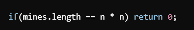
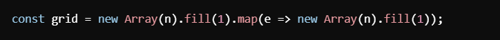
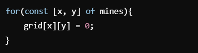
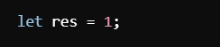
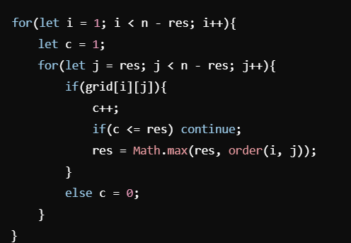
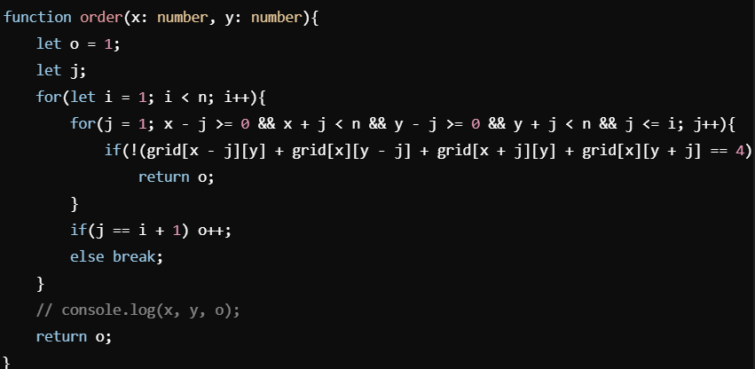
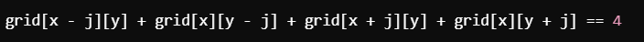
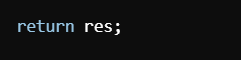
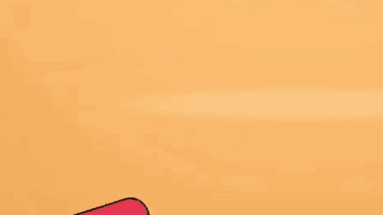

# Beat 100 % | simple and easy to understand | step by step explained in brief.

**Author:** afhamfardeen98
**Votes:** 0
**Link:** [https://leetcode.com/problems/largest-plus-sign/solutions/5897594/](https://leetcode.com/problems/largest-plus-sign/solutions/5897594/)

---

# Approach
1. Initial Check for All Cells Being Mines.
  

**Purpose:** If every cell in the grid is a mine, there can be no plus sign. Hence, the function immediately returns 0.
2. Grid Initialization  
   

   **Purpose**: Initializes an n x n grid filled with 1s, indicating that all cells are initially free (not mines).
3. Placing Mines on the Grid
    

    **Purpose**: Marks the cells that contain mines by setting their value to 0.

4. Initial Result Setup



**Purpose**: Initializes the result res to 1, assuming at least a single cell can be a plus sign of order 1 if it's not a mine.

5. Main Loop to Find the Largest Plus Sign




**Purpose**: Iterates through the grid to identify potential centers of plus signs and updates the maximum order found (res).

**Explanation**:
* Outer Loop (i):
Starts from 1 and goes up to **n - res**. This limits the search to cells that have enough space around them to potentially form a larger plus sign than the current res.
* Inner Loop (j):
Starts from res and goes up to **n - res**. Similar to the outer loop, it ensures that the cell at **(i, j)** has enough space in all four directions to form a plus sign of order greater than res.


**Condition** if(grid[i][j]):
* Checks if the current cell (i, j) is not a mine (1).
If it's free, increments the counter c. 
* If c is still less than or equal to res, it continues to the next cell.
* If c exceeds res, it calls the helper function order(i, j) to determine the maximum possible order of a plus sign centered at (i, j), and updates res accordingly.
* Else (else c = 0):
If the current cell is a mine (0), resets the counter c to 0.

6. Helper Function to Determine Plus Sign Order at a specific cell.




* **Purpose**: Determines the maximum order of a plus sign centered at the cell (x, y).

**Parameters**:
* x, y: Coordinates of the potential center of the plus sign.
* Variables:
i. o: Current order of the plus sign, starting at 1.
ii. j: Iteration variable to check each arm of the plus sign.
* Logic:
i. Outer Loop (i):
Iterates from 1 up to n - 1, attempting to expand the plus sign outward.
ii. Inner Loop (j):
Checks if the cells in all four directions (up, down, left, right) at distance j from (x, y) are free (1).

**Condition**:



* If the sum equals 4, it means all four cells are free.
* If not, the plus sign cannot be expanded further in this direction, and the current order o is returned.


**Return**:
* The maximum order o found for the plus sign centered at (x, y).



* **Purpose**: Returns the maximum order of a plus sign found in the grid after evaluating all potential centers.

# Complexity
- Time complexity:
i. The main loop potentially checks each cell, and for each cell, the order function might perform up to n iterations.
ii. In the worst case, the time complexity is roughly O(n^3).

- Space complexity:
i. The grid consumes O(n^2) space.
ii. Additional space is used for variables and the order function's stack, but it's negligible compared to the grid.

Conclusion
The orderOfLargestPlusSign function systematically evaluates each potential center in the grid to determine the largest possible plus sign, considering the placement of mines. By initializing the grid, marking mines, and iteratively checking each cell's surrounding cells, it efficiently computes the desired result, ensuring that the largest valid plus sign's order is accurately determined.

# Code
```typescript []
function orderOfLargestPlusSign(n: number, mines: number[][]): number {
    if(mines.length==n*n) return 0;
    const grid = new Array(n).fill(1).map(e=>new Array(n).fill(1))
    for(const [x,y] of mines){
        grid[x][y]=0;
    }
    let res = 1;
    for(let i=1;i<n-res;i++){
        let c=1;
        for(let j=res;j<n-res;j++){
            if(grid[i][j]){
                c++;
                if(c<=res) continue;
                res = Math.max(res, order(i,j));
            }
            else c=0;
        }
    }

    function order(x:number,y:number){
        let o = 1;
        let j;
        for(let i=1;i<n;i++){
            for(j=1;x-j>=0 && x+j<n && y-j>=0 && y+j<n && j<=i;j++){
                if(!( grid[x-j][y] + grid[x][y-j] + grid[x+j][y] + grid[x][y+j] ==4))
                return o;
            }
            if(j==i+1) o++;
            else break;
        }
        // console.log(x,y,o);
        return o;
    }
    return res;
};
```




