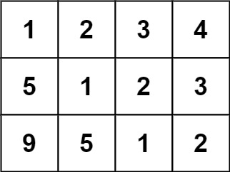
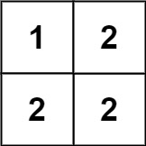

# [766. Toeplitz Matrix](https://leetcode.com/problems/toeplitz-matrix/)

| Category | Difficulty | Likes | Dislikes |
| :------: | :--------: | :---: | :------: |
| Algorithms | Easy | 3700 | 179 |

**Tags:** [`array`](https://leetcode.com/tag/array), [`matrix`](https://leetcode.com/tag/matrix)

**Companies:** `facebook`, `google`, `tcs`

## Description

Given an `m x n` `matrix`, return *`true` if the matrix is Toeplitz. Otherwise, return `false`.*

A matrix is **Toeplitz** if every diagonal from top-left to bottom-right has the same elements.

 

**Example 1:**


```

Input: matrix = [[1,2,3,4],[5,1,2,3],[9,5,1,2]]
Output: true
Explanation:
In the above grid, the&nbsp;diagonals are:
&quot;[9]&quot;, &quot;[5, 5]&quot;, &quot;[1, 1, 1]&quot;, &quot;[2, 2, 2]&quot;, &quot;[3, 3]&quot;, &quot;[4]&quot;.
In each diagonal all elements are the same, so the answer is True.

```

**Example 2:**


```

Input: matrix = [[1,2],[2,2]]
Output: false
Explanation:
The diagonal &quot;[1, 2]&quot; has different elements.

```

 

**Constraints:**

	- `m == matrix.length`

	- `n == matrix[i].length`

	- `1 <= m, n <= 20`

	- `0 <= matrix[i][j] <= 99`

 

**Follow up:**

	- What if the `matrix` is stored on disk, and the memory is limited such that you can only load at most one row of the matrix into the memory at once?

	- What if the `matrix` is so large that you can only load up a partial row into the memory at once?

---

**Links:** [Submissions](https://leetcode.com/problems/toeplitz-matrix/) | [Solutions](https://leetcode.com/problems/toeplitz-matrix/)
