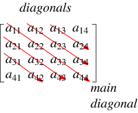
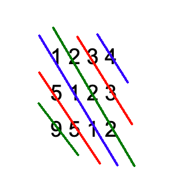
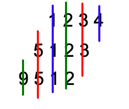
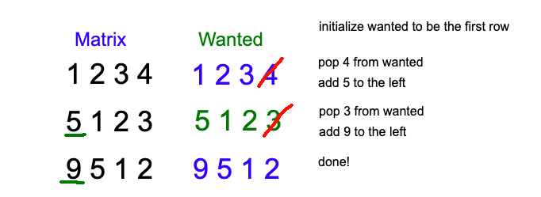

# [Python] Follow-Up 1 with Explanation and Diagrams

**Author:** bshaibu
**Votes:** 80
**Link:** [https://leetcode.com/problems/toeplitz-matrix/solutions/516366/](https://leetcode.com/problems/toeplitz-matrix/solutions/516366/)

---

# Summary
In order to handle the follow-up, we need to rely on the fact that the next element in a diagonal is on the next row in the next column.
We can keep a Deque/LinkedList tracking what value is expected in each row (expected_row).
Evaluate the matrix row by row removing the rightmost element in the deque and adding the current row's first element to the left of the deque.
You can then compare every cell in your expected_row to the current row. The indices will line up.
Initially, the expected row just contains the values from the first row in the matrix.

# Code

```python
############################################################################################
# Follow-Up Solution
#   Runtime: O(MN)
#       Every cell is touched about once.
#   Space: O(N)
#       We need to store a deque of length equal to the number of columns.
# Runtime: 72 ms, faster than 99.85% of Python3 online submissions for Toeplitz Matrix.
# Memory Usage: 12.8 MB, less than 100.00% of Python3 online submissions for Toeplitz Matrix.
############################################################################################
from collections import deque
class Solution:
    def isToeplitzMatrix(self, matrix: List[List[int]]) -> bool:
        # Validate Input
        if not matrix or not matrix[0]:
            return False                
        
        # Create a deque tracking the expected values for the next row
        expected = deque(matrix[0])
        
        # Iterate through all the remaining rows, verifying they align with the
        #   expected row.
        for row_i in range(1, len(matrix)):
            row = matrix[row_i]
            expected.pop()
            expected.appendleft(row[0])
            
			# Only check from index 1 and down as we've just added index 0 to expected
            for col_i in range(1, len(row)):
                if row[col_i] != expected[col_i]:
                    return False
        
        # If we've reached here, all diagonals aligned
        return True
```
Bonus: this solution solves the original problem fairly efficiently as well.


# Extended Breakdown
Grabbing this image from [WolframAlpha](http://mathworld.wolfram.com/Diagonal.html):


We know that a_11 needs to match a_2,2 and a_1,2 needs to match a_2,3 and so on. Instead of comparing each cell to its top right neighbor or tracking a mapping of the diagonals' value , we can persist the value of the top most element in each diagonal.

Working with the matrix from the problem explanation,
```
matrix = [
  [1,2,3,4],
  [5,1,2,3],
  [9,5,1,2]
]
```

the diagonals line up like so:


We can notice that if we shift the previous row to the right it aligns with the next row and we can easily verify if the value in that column matches the next value in the diagonal. 


We also know that the first element in the diagonal should match all other elements in the diagonal so no there's need to change the value/we can keep re-using that element. 

We also know the column that we expect to match our element increments by 1 in every subsequent row (e.g. we know the value 1 should be at col 0 in row 0, col 1 in row 1, col 2 in row 2 and so on). That means we just need to slide each value down one col everytime we go to a new row.

The first element (col 0) of every row is the first element of a new diagonal and should be added to what we're checking for the next row.

Putting that all together, we can just use a deque/linked list to track


Specifically,
* At step 0, we set our buffer to `expected = [1, 2, 3, 4]`
	* we can skip comparing row 0.
* At step 1, we can drop the last element (4) as it has nothing to be compared to anymore. We add 5 to the left of `expected` as it needs to be compared to elements in the next row.
	* so `expected = [5 1 2 3]`
	* We compare that to row 1, `[5 1 2 3]` and it checks out.
	* note: we can start comparing expected to the row from index 1 since we know index 0 is the same.
* At step 2, we drop 3 as it has nothing else to be compared to and add 9 to the left of expected.
	* So `expected = [9 5 1 2]` and that also checks out.
* We're done for this matrix and never saw a mismatch.

# Notes
I didn't come up with a solution to Follow-Up 2, but there's a good high-level explanation here: https://leetcode.com/problems/toeplitz-matrix/discuss/271388/Java-Solution-for-Follow-Up-1-and-2.

Please let me know if you have any other thoughts on Follow Up 2 or suggestions for my Follow Up 1 idea/code!