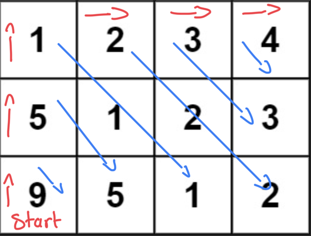

# TypeScript, Time O(n*m), Space O(1)

**Author:** aramfilak
**Votes:** 3
**Link:** [https://leetcode.com/problems/toeplitz-matrix/solutions/5234706/](https://leetcode.com/problems/toeplitz-matrix/solutions/5234706/)

---

# Intuition
<!-- Describe your first thoughts on how to solve this problem. -->

# Approach
<!-- Describe your approach to solving the problem. -->


# Complexity
- Time complexity:  $$O(n*m)$$
<!-- Add your time complexity here, e.g. $$O(n)$$ -->

- Space complexity: $$O(1)$$
<!-- Add your space complexity here, e.g. $$O(n)$$ -->

# Code
```
function diagonalIsSame(matrix: number[][], row: number, col: number): boolean {
    //is movable diagonally right bottom
    while (row + 1 < matrix.length && col + 1 < matrix[row].length) {
        // current cell is not equal to next cell ?
        if (matrix[row][col] !== matrix[row + 1][col + 1]) {
            return false;
        }
        col++;
        row++;
    }

    return true;
}

function isToeplitzMatrix(matrix: number[][]): boolean {
    // Start from the bottom left corner
    let row = matrix.length - 1;
    let col = 0;

    while (row > 0 || col < matrix[row].length) {
        if (!diagonalIsSame(matrix, row, col)) {
            return false;
        }

        // Update start position:
        // move up if possible, otherwise move to the right
        if (row > 0) {
            row--;
        } else {
            col++;
        }
    }

    return true;
}
```