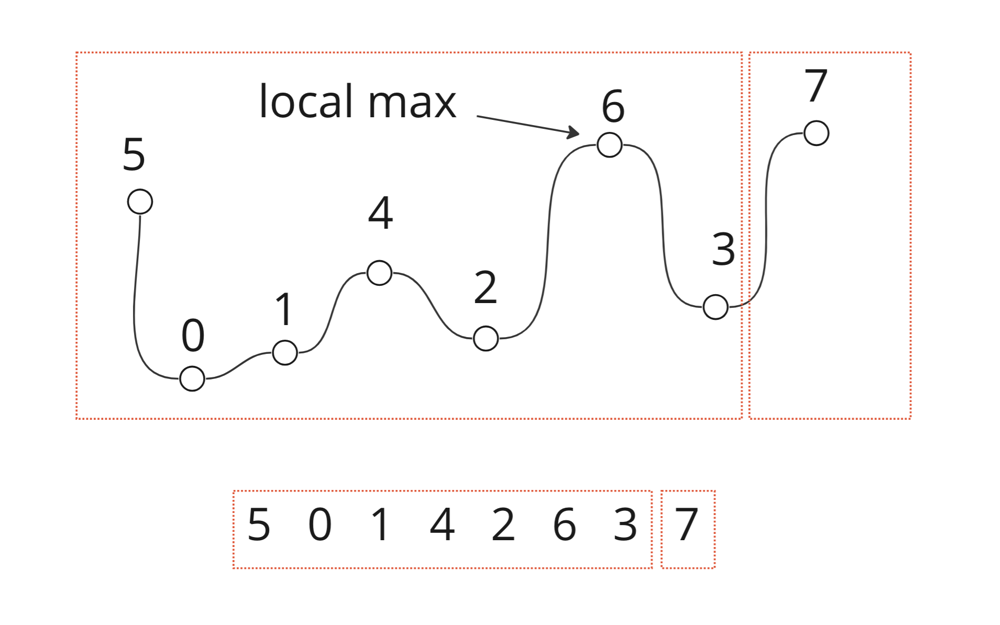

# Easy solution with visualization, O(N) evaluation complexity and O(1) space

**Author:** AleksandrT
**Votes:** 0
**Link:** [https://leetcode.com/problems/max-chunks-to-make-sorted/solutions/3898839/](https://leetcode.com/problems/max-chunks-to-make-sorted/solutions/3898839/)

---

# Intuition
Take a look at the constraints
```
n == arr.length
1 <= n <= 10
0 <= arr[i] < n
All the elements of arr are unique.
```
That means that `arr` contains numbers from `0` to `n - 1`.

# Approach
First of all, we should "linearize" data according to indexes in the array. What does it means? Idealy, if we wanna maximize number of chunks, each chunk should be of size 1 and number in this chunk should be equal to index of the number in the array. But in reallity, we could have unordered data, where index is not equal to the number itself. So, we could simply save local maxima and try to split chunks when local maximum equal to the current index. In other words, we are trying to find a "right place" for our chunk end.




# Complexity
- Time complexity:
O(N)

- Space complexity:
O(1)

# Code
Kotlin
```
class Solution {
    fun maxChunksToSorted(arr: IntArray): Int {
        var chunks = 0
        var localMax = 0
        for (i in 0 until arr.size) {
            localMax = maxOf(localMax, arr[i])
            if (localMax == i)
                chunks++
        }

        return chunks
    }
}
```
Java
```
public class Solution {
    public int maxChunksToSorted(int arr) {
        int chunks = 0;
        int localMax = 0;
        for (int i = 0; i < arr.length; i++) {
            localMax = Math.max(localMax, arri);
            if (localMax == i) {
                chunks++;
            }
        }
        
        return chunks;
    }
}
```
Python
```
class Solution:
    def maxChunksToSorted(self, arr):
        chunks = 0
        localMax = 0
        for i in range(len(arr)):
            localMax = max(localMax, arri)
            if localMax == i:
                chunks += 1
        
        return chunks
```