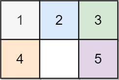
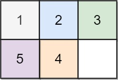
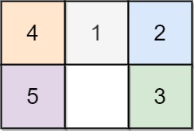

# [773. Sliding Puzzle](https://leetcode.com/problems/sliding-puzzle/)

| Category | Difficulty | Likes | Dislikes |
| :------: | :--------: | :---: | :------: |
| Algorithms | Hard | 2722 | 75 |

**Tags:** [`array`](https://leetcode.com/tag/array), [`dynamic-programming`](https://leetcode.com/tag/dynamic-programming), [`backtracking`](https://leetcode.com/tag/backtracking), [`breadth-first-search`](https://leetcode.com/tag/breadth-first-search), [`memoization`](https://leetcode.com/tag/memoization), [`matrix`](https://leetcode.com/tag/matrix)

**Companies:** `facebook`, `uber`, `nvidia`, `airbnb`, `google`, `microsoft`

## Description

On an `2 x 3` board, there are five tiles labeled from `1` to `5`, and an empty square represented by `0`. A **move** consists of choosing `0` and a 4-directionally adjacent number and swapping it.

The state of the board is solved if and only if the board is `[[1,2,3],[4,5,0]]`.

Given the puzzle board `board`, return *the least number of moves required so that the state of the board is solved*. If it is impossible for the state of the board to be solved, return `-1`.

 

**Example 1:**


```

Input: board = [[1,2,3],[4,0,5]]
Output: 1
Explanation: Swap the 0 and the 5 in one move.

```

**Example 2:**


```

Input: board = [[1,2,3],[5,4,0]]
Output: -1
Explanation: No number of moves will make the board solved.

```

**Example 3:**


```

Input: board = [[4,1,2],[5,0,3]]
Output: 5
Explanation: 5 is the smallest number of moves that solves the board.
An example path:
After move 0: [[4,1,2],[5,0,3]]
After move 1: [[4,1,2],[0,5,3]]
After move 2: [[0,1,2],[4,5,3]]
After move 3: [[1,0,2],[4,5,3]]
After move 4: [[1,2,0],[4,5,3]]
After move 5: [[1,2,3],[4,5,0]]

```

 

**Constraints:**

	- `board.length == 2`

	- `board[i].length == 3`

	- `0 <= board[i][j] <= 5`

	- Each value `board[i][j]` is **unique**.

---

**Links:** [Submissions](https://leetcode.com/problems/sliding-puzzle/) | [Solutions](https://leetcode.com/problems/sliding-puzzle/)
