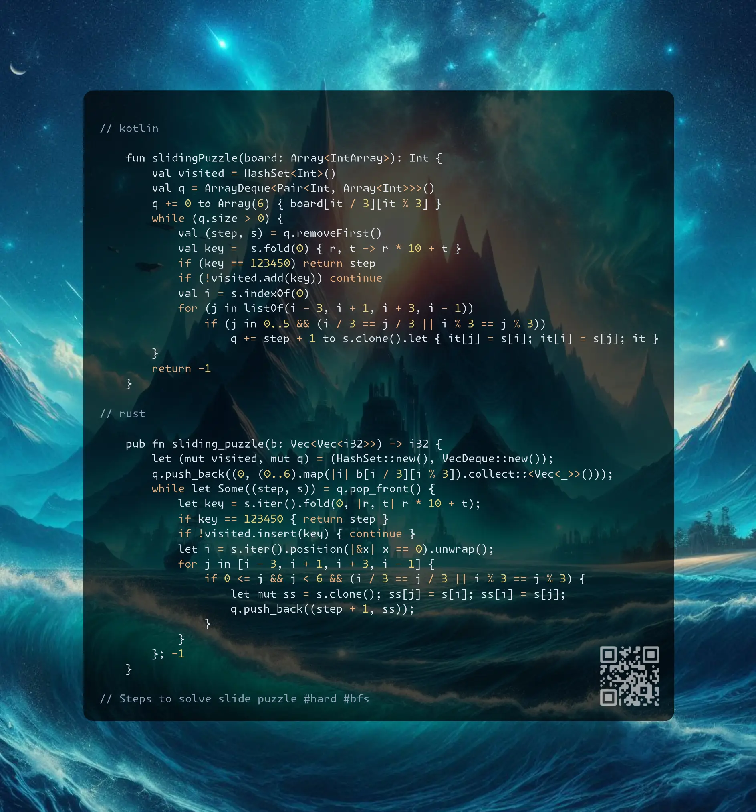

# Kotlin | Rust

**Author:** SamoylenkoDmitry
**Votes:** 2
**Link:** [https://leetcode.com/problems/sliding-puzzle/solutions/6081288/](https://leetcode.com/problems/sliding-puzzle/solutions/6081288/)

---



https://youtu.be/Ghs0MwncH74

#### Join me on Telegram

https://t.me/leetcode_daily_unstoppable/811

#### Problem TLDR

Steps to solve slide puzzle #hard #bfs

#### Intuition

Full search would work. Use BFS to find the shortest path to target state.

* note to myself: DFS with visited set will _not_ find the shortest path

#### Approach

* simplier way to change coordinates and simplify key calculation is a linear array
* careful with illegal jumps in that case

#### Complexity

- Time complexity:
$$O(n!)$$ or 6!, each number can be on any position, it is the number of the permutations https://en.wikipedia.org/wiki/Permutation (6! = 720)

- Space complexity:
$$O(n!)$$

#### Code

```kotlin []

    fun slidingPuzzle(board: Array<IntArray>): Int {
        val visited = HashSet<Int>()
        val q = ArrayDeque<Pair<Int, Array<Int>>>()
        q += 0 to Array(6) { board[it / 3][it % 3] }
        while (q.size > 0) {
            val (step, s) = q.removeFirst() 
            val key =  s.fold(0) { r, t -> r * 10 + t }
            if (key == 123450) return step
            if (!visited.add(key)) continue
            val i = s.indexOf(0)
            for (j in listOf(i - 3, i + 1, i + 3, i - 1)) 
                if (j in 0..5 && (i / 3 == j / 3 || i % 3 == j % 3)) 
                    q += step + 1 to s.clone().let { it[j] = s[i]; it[i] = s[j]; it }
        }
        return -1
    }

```
```rust []

    pub fn sliding_puzzle(b: Vec<Vec<i32>>) -> i32 {
        let (mut visited, mut q) = (HashSet::new(), VecDeque::new());
        q.push_back((0, (0..6).map(|i| b[i / 3][i % 3]).collect::<Vec<_>>()));
        while let Some((step, s)) = q.pop_front() {
            let key = s.iter().fold(0, |r, t| r * 10 + t);
            if key == 123450 { return step }
            if !visited.insert(key) { continue }
            let i = s.iter().position(|&x| x == 0).unwrap();
            for j in [i - 3, i + 1, i + 3, i - 1] {
                if 0 <= j && j < 6 && (i / 3 == j / 3 || i % 3 == j % 3) {
                    let mut ss = s.clone(); ss[j] = s[i]; ss[i] = s[j];
                    q.push_back((step + 1, ss));
                }
            }
        }; -1
    }

```
```c++ []

    int slidingPuzzle(vector<vector<int>>& board) {
        unordered_set<int> seen; vector<int> s(6);
        for (int i = 6; i--;) s[i] = board[i / 3][i % 3];
        queue<pair<int, vector<int>>> q({{0, s}});
        while (q.size()) {
            auto [step, s] = q.front(); q.pop();
            int k = 0; for (int x: s) k = k * 10 + x;
            if (k == 123450) return step;
            if (!seen.insert(k).second) continue;
            int i = find(begin(s), end(s), 0) - begin(s), j;
            for (int d: {-3, 1, 3, -1})
                if ((j = i + d) >= 0 && j < 6 && (i / 3 == j / 3 || i % 3 == j % 3)) 
                    { auto ss = s; swap(ss[i], ss[j]); q.push({step + 1, ss}); }
        } return -1;
    }

```