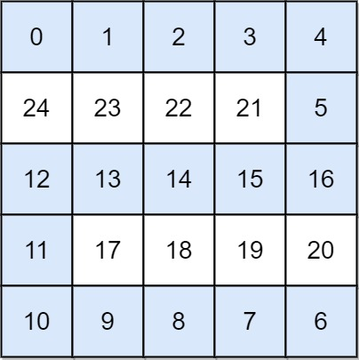

# [778. Swim in Rising Water](https://leetcode.com/problems/swim-in-rising-water/)

| Category | Difficulty | Likes | Dislikes |
| :------: | :--------: | :---: | :------: |
| Algorithms | Hard | 4494 | 310 |

**Tags:** [`array`](https://leetcode.com/tag/array), [`binary-search`](https://leetcode.com/tag/binary-search), [`depth-first-search`](https://leetcode.com/tag/depth-first-search), [`breadth-first-search`](https://leetcode.com/tag/breadth-first-search), [`union-find`](https://leetcode.com/tag/union-find), [`heap-priority-queue`](https://leetcode.com/tag/heap-priority-queue), [`matrix`](https://leetcode.com/tag/matrix)

**Companies:** `facebook`, `google`, `amazon`, `weride`, `doordash`, `de-shaw`, `uber`

## Description

You are given an `n x n` integer matrix `grid` where each value `grid[i][j]` represents the elevation at that point `(i, j)`.

It starts raining, and water gradually rises over time. At time `t`, the water level is `t`, meaning **any** cell with elevation less than equal to `t` is submerged or reachable.

You can swim from a square to another 4-directionally adjacent square if and only if the elevation of both squares individually are at most `t`. You can swim infinite distances in zero time. Of course, you must stay within the boundaries of the grid during your swim.

Return *the minimum time until you can reach the bottom right square *`(n - 1, n - 1)`* if you start at the top left square *`(0, 0)`.

 

**Example 1:**


```

Input: grid = [[0,2],[1,3]]
Output: 3
Explanation:
At time 0, you are in grid location (0, 0).
You cannot go anywhere else because 4-directionally adjacent neighbors have a higher elevation than t = 0.
You cannot reach point (1, 1) until time 3.
When the depth of water is 3, we can swim anywhere inside the grid.

```

**Example 2:**


```

Input: grid = [[0,1,2,3,4],[24,23,22,21,5],[12,13,14,15,16],[11,17,18,19,20],[10,9,8,7,6]]
Output: 16
Explanation: The final route is shown.
We need to wait until time 16 so that (0, 0) and (4, 4) are connected.

```

 

**Constraints:**

	- `n == grid.length`

	- `n == grid[i].length`

	- `1 <= n <= 50`

	- `0 <= grid[i][j] < n^2`

	- Each value `grid[i][j]` is **unique**.

---

**Links:** [Submissions](https://leetcode.com/problems/swim-in-rising-water/) | [Solutions](https://leetcode.com/problems/swim-in-rising-water/)
