# C++ solution with Image explanation

**Author:** lucayan0506
**Votes:** 54
**Link:** [https://leetcode.com/problems/transform-to-chessboard/solutions/1487265/](https://leetcode.com/problems/transform-to-chessboard/solutions/1487265/)

---

## Logic of how check if it a valid board 
To understand if a board can be a chess board (so if it is valid) we can think in opposite way (so from the chess board and get the rules that a chess board **must have.**
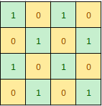
This is our chess board and let we focus on the first row and ignore others (image that other cell just follow the first row).
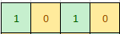
You can notice that however we move these cells (when we move some cells we move the entire column but for now we don't need to care about them) we will always have 2 cells with value `1` and 2 cells with value `0`, 
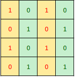
Now we come back to the entire board and we notice that ***cells below the first row*** (so columns) form 2 particular pattern (one equal to the first column and another one completely opposite than first column). So ,from these points we can get the **rules that a chess board has**:
1. **Half of columns have the first pattern and rest have the second pattern**
	* with an exception which is when the board size is equal to an odd number, with this exception **patter1 - patter2 = 1 or -1** (in this case we have 3 column with the first patter and 2 second patter with the second pattern) 	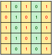
2.  A chess board has only 2 patterns of column 
	* 	**first** one equal to the first column 
	* 	**second** one completely opposite to the first column

	
These rules are the same for rows (just rotate the  board and apply the same concept)

##### E.g. of a valid board (board that can be a chess board)
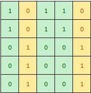    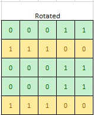
This is valid because if we look column by column we notice that:
*  we have only 2 patters (respect the second rule).
* `N. of pattern1 = 2` `N. of patter2 = 3` (the size of the board is an odd number so `pattern1- pattern2 = -1` and this respect the first rule)
* When we rotate it and apply the same concept we notice that it is still valid.


##### E.g. of a invalid board (board that cannot be a chess board)
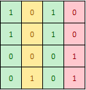
This is invalid because it has 3 pattern (break the first rule)
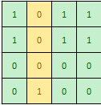
This is invalid because `pattern1 = 3` `pattern2=1` (breaks the second rule)
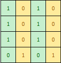  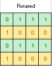
This is invalid because when we rotate it it breaks the first rule

## Calculate how many steps we need to do to get the chess board
* Scan the board(horizontally and vertically
* Image that the board start from 0
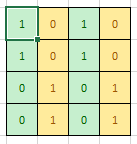
* check if first cell is equal to 0 (in this case it isn't so countRow and countCol +1)
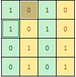
* check next ones, now should be `1` (in this case countCor +1 )
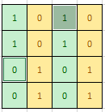
* Check next ones, now should be `0` (in this case  countRow +1)
* and so on,
* Do the same thing imaging that the board start from 1 (there is a faster way to find out that which is `countRow2 = n - countRow`  `countCol2 = n - countCol` 
* if `countRow` or `countRow2` is an odd number choose the another one (it will be even) because if `countRow` or `countRow2` is odd means that it can't be a chess board however you move (because each step you move 2 rows or 2 columns and if `countRow` is odd means that it will be a column that you can't move)
* same for `countCol` and `countCol2`
* `result = (min(countRow,countRow2) + min(countCol,countCol2) ) /2 ` divided by 2 because each step you move 2 columns/rows

```
class Solution {
public:
    int movesToChessboard(vector<vector<int>>& board) {
        int n = board.size();
        
		//////////////////////////////////////////////////////////////////////////////
		//Secon rule
		//////////////////////////////////////////////////////////////////////////////
        //count how many columns we have for type1(column equal to the first column) and type2(column that have each cell different than the first column)
        int countCol_type1 = 1; //this is equal to 1 because we already count the first column
        int countCol_type2 =0;

        //count how many rows we have for type1(rows equal to the first row) and type2(rows that have each cell different than the first row)
        int countRow_type1 = 1; //this is equal to 1 because we already count the first row
        int countRow_type2 = 0;

        //check if the board is a valid board (by valid I mean that it can be a chess board. Scroll above to know the how to know if it's valid)
        for (int j = 1; j < n; j++) {

            //check horizontaly (each columns of the horizontal lane)
            if (board[0][j] == board[0][0]) {
                countCol_type1++;

                //check if all cell of the j column is equal to the first column (if not means that it is a invalid board, so return -1)
                for (int i = 1; i < n; i++) {
                    if (board[i][j] != board[i][0])return -1;
                }
            }
            else {
                countCol_type2++;

                //check if all cell of the j column is different to the first column (if not means that it is a invalid board, so return -1)
                for (int i = 1; i < n; i++) {
                    if (board[i][j] == board[i][0])return -1;
                }
            }

            //check vertically (each rows of the vertical lane)
            if (board[j][0] == board[0][0]) {
                countRow_type1++;

                //check if all cell of the j row is equal to the first row (if not means that it is a invalid board, so return -1)
                for (int i = 1; i < n; i++) {
                    if (board[j][i] != board[0][i])return -1;
                }
            }
            else {
                countRow_type2++;

                //check if all cell of the j row is different to the first row (if not means that it is a invalid board, so return -1)
                for (int i = 1; i < n; i++) {
                    if (board[j][i] == board[0][i])return -1;
                }
            }
        }


		//////////////////////////////////////////////////////////////////////////////
		//first rule
		//////////////////////////////////////////////////////////////////////////////
        //we have to make sure that n. of type1 is equal to type2 of only with 1 of difference (when n = odd number)
        //if it isn't means that the board is invalid) 
        if (abs(countCol_type1 - countCol_type2) > 1) return -1;    // if type1 - type2 != -1,0,1 then return -1
        if (abs(countRow_type1 - countRow_type2) > 1) return -1;
		
		
		//////////////////////////////////////////////////////////////////////////////
		//Calculate how many steps we need to do to get the chess board
		//////////////////////////////////////////////////////////////////////////////
        int countRow = 0;
        int countCol = 0;
        //count how many moves need to make the board as a chessboard that start with 0 
        for (int j = 0; j < n; j++) {
            if (board[0][j] != j % 2)countCol++;
            if (board[j][0] != j % 2)countRow++;
        }

        //count how many moves need to make the board as a chessboard (horizontally) that start with 1 
        int countRow2 = n - countRow;
        int countCol2 = n - countCol;

        int res = 0;
        //if countRow2 is an odd number return countRow/2
        if (countRow2 % 2)res+= countRow / 2;
        //if countRow is an odd number return countRow2/2
        else if (countRow % 2)res+= countRow2 / 2;
        //if countRow and countRow2 are even numbers return the smaller one
        else res += min(countRow, countRow2) / 2;

        //if countCol2 is an odd number return countCol/2
        if (countCol2 % 2)res += countCol / 2;
        //if countCol is an odd number return countCol2/2
        else if (countCol % 2)res += countCol2 / 2;
        //if countCol and countCol2 are even numbers return the smaller one
        else res += min(countCol, countCol2) / 2;

        return res;
    }
};
```