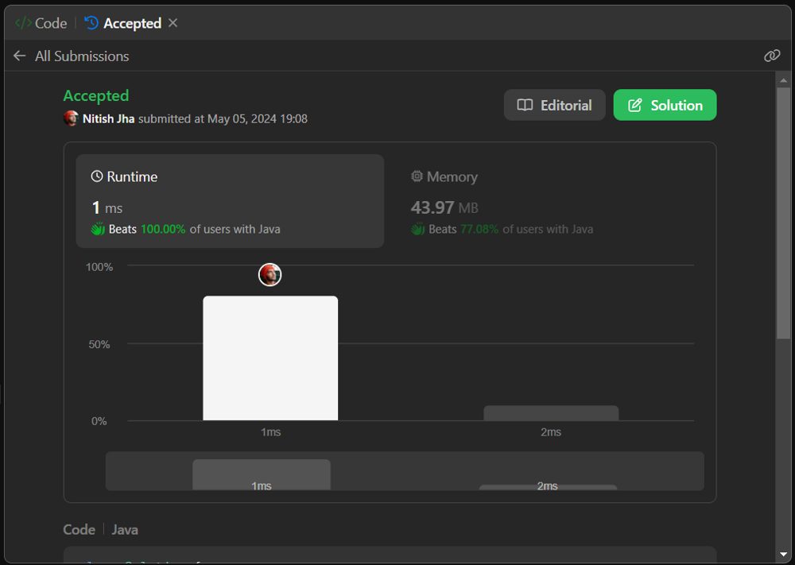

# Java beats 100%

**Author:** deleted_user
**Votes:** 3
**Link:** [https://leetcode.com/problems/transform-to-chessboard/solutions/5204371/](https://leetcode.com/problems/transform-to-chessboard/solutions/5204371/)

---

Java beats 100%



# Code
```
class Solution {
    public int movesToChessboard(int[][] board) {
        int N = board.length, rowSum = 0, colSum = 0, rowSwap = 0, colSwap = 0;
        for (int r = 0; r < N; ++r)
            for (int c = 0; c < N; ++c) {
                if ((board[0][0] ^ board[r][0] ^ board[0][c] ^ board[r][c]) == 1)
                    return -1;
            }
        for (int i = 0; i < N; ++i) {
            rowSum += board[0][i];
            colSum += board[i][0];
            rowSwap += board[i][0] == i % 2 ? 1 : 0;
            colSwap += board[0][i] == i % 2 ? 1 : 0;
        }
        if (N / 2 > rowSum || rowSum > (N + 1) / 2) return -1;
        if (N / 2 > colSum || colSum > (N + 1) / 2) return -1;
        if (N % 2 == 1) {
            if (colSwap % 2 == 1) colSwap = N - colSwap;
            if (rowSwap % 2 == 1) rowSwap = N - rowSwap;
        } else {
            colSwap = Math.min(N - colSwap, colSwap);
            rowSwap = Math.min(N - rowSwap, rowSwap);
        }
        return (colSwap + rowSwap) / 2;
    }
}
```