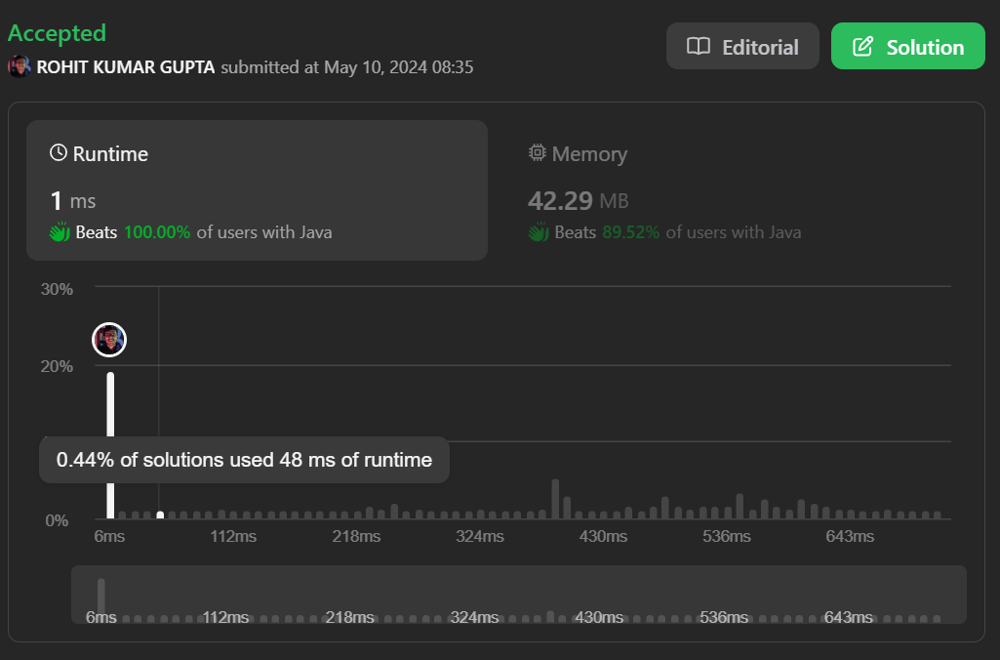

# 👏Beats 100%(1 ms)🔥| Detailed Explanation✅| Pseudo Code for reference✅| Binary Search + Two Pointer

**Author:** rohit_gupta1819
**Votes:** 19
**Link:** [https://leetcode.com/problems/k-th-smallest-prime-fraction/solutions/5137799/](https://leetcode.com/problems/k-th-smallest-prime-fraction/solutions/5137799/)

---



# Approach 1 (Binary Search & Two Pointer)
The problem at hand requires us to find the k^{th} smallest prime fraction from a given array of integers. To solve this efficiently, we'll utilize a combination of binary search and a two-pointer technique. This approach allows us to navigate through the fractions in a systematic manner, narrowing down the search space until we find the desired fraction.

## Intuition

1. **Binary Search Approach**:
   - We begin by setting up a search space for the possible values of the prime fraction. Since the prime fraction will always lie between 0 and 1, we initialize our search space within this range.
   - With binary search, we continuously partition this search space into halves, refining our range based on whether the k^{th} smallest prime fraction lies to the left or right of our mid-point.
   - At each step of the binary search, we examine the number of fractions in the array that are less than or equal to our current target value. This count will help us determine whether to move our search space to the left or right.

2. **Two-Pointer Technique**:
   - As we traverse the array to count the number of fractions less than or equal to the target value, we employ a two-pointer technique.
   - We maintain two pointers, one at the beginning of the array and another that moves forward as we iterate through the array.
   - For each value of the array, we advance the second pointer until the condition for a valid fraction is met: arr[i] <= arr[j] * target.
   - By doing this, we count all the fractions less than or equal to the current target value, and we also update the numerator and denominator of the smallest fraction encountered so far.

3. **Termination Condition**:
   - The binary search continues until our search space has been narrowed down sufficiently. Once the lower bound surpasses the upper bound, we know we have found the k^{th} smallest prime fraction.
   - If the count of fractions less than or equal to the target value matches k, we return the corresponding numerator and denominator, indicating the k^{th} smallest prime fraction.


By employing binary search and a two-pointer technique, we efficiently locate the k^{th} smallest prime fraction within the given array. This approach optimally navigates through the fractions, narrowing down the search space until the desired fraction is found, ensuring both efficiency and accuracy in our solution.

## Pseudo Code

```
function kthSmallestPrimeFraction(arr, k):
    low = 0
    high = 1.0
    
    while low < high:
        mid = (low + high) / 2
        count, num, den = helper(arr, mid)
        
        if k < count:
            high = mid
        else if k > count:
            low = mid
        else:
            return [num, den]
    
    return null

function helper(arr, target):
    count = 0
    i = 0
    num = arr[0]
    den = arr[n-1]
    
    for j from 1 to n-1:
        while arr[i] <= arr[j] * target:
            i++
        count += i
        if i > 0 and arr[i-1] * den > arr[j] * num:
            num = arr[i-1]
            den = arr[j]
    
    return count, num, den

```
## Complexity

- **Time complexity**: *O(n.log(m^2))*
where n is length of the array and m is max value in array
<!-- Add your time complexity here, e.g. $$O(n)$$ -->

- **Space complexity**: *O(1)*
<!-- Add your space complexity here, e.g. $$O(n)$$ -->

## Code

```Java []
class Solution {
    public int[] kthSmallestPrimeFraction(int[] arr, int k) {
        int n = arr.length;
        double low = 0, high = 1.0;

        while(low < high){
            double mid = (low + high) / 2;
            int count[] = helper(arr, mid);
            if(k < count[0]){
                high = mid;
            } else if(k > count[0]){
                low = mid;
            } else{
                return new int[]{count[1], count[2]};
            }
        }
        return null;
    }
    static int[] helper(int[] arr, double target){
        int count = 0, i = 0, n = arr.length, num = arr[0], den = arr[n-1];

        for(int j = 1; j < n; j++){
            while(arr[i] <= arr[j] * target){
                i++;
            }
            count += i;
            if(i>0 && arr[i-1] * den > arr[j] * num){
                num = arr[i-1];
                den = arr[j];
            }
        }
        return new int[]{count, num, den};
    }
}
```
```python []
class Solution(object):
    def kthSmallestPrimeFraction(self, arr, k):
        n = len(arr)
        low, high = 0, 1.0

        while low < high:
            mid = (low + high) / 2
            count, num, den = self.helper(arr, mid)

            if k < count:
                high = mid
            elif k > count:
                low = mid
            else:
                return [num, den]

        return []

    def helper(self, arr, target):
        count, i, n = 0, 0, len(arr)
        num, den = arr[0], arr[n - 1]

        for j in range(1, n):
            while i < j and arr[i] <= arr[j] * target:
                i += 1
            count += i
            if i > 0 and arr[i - 1] * den > arr[j] * num:
                num = arr[i - 1]
                den = arr[j]

        return [count, num, den]
```
```C++ []
class Solution {
public:
    vector<int> kthSmallestPrimeFraction(vector<int>& arr, int k) {
        int n = arr.size();
        double low = 0, high = 1.0;

        while (low < high) {
            double mid = (low + high) / 2;
            vector<int> count = helper(arr, mid);

            if (k < count[0]) {
                high = mid;
            } else if (k > count[0]) {
                low = mid;
            } else {
                return {count[1], count[2]};
            }
        }
        return {};
    }

    vector<int> helper(vector<int>& arr, double target) {
        int count = 0, i = 0, n = arr.size(), num = arr[0], den = arr[n - 1];

        for (int j = 1; j < n; j++) {
            while (i < j && arr[i] <= arr[j] * target) {
                i++;
            }
            count += i;
            if (i > 0 && arr[i - 1] * den > arr[j] * num) {
                num = arr[i - 1];
                den = arr[j];
            }
        }
        return {count, num, den};
    }
};
```
---


