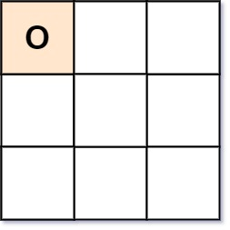
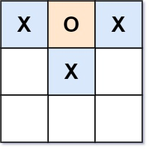
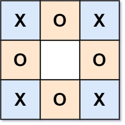

# [794. Valid Tic-Tac-Toe State](https://leetcode.com/problems/valid-tic-tac-toe-state/)

| Category | Difficulty | Likes | Dislikes |
| :------: | :--------: | :---: | :------: |
| Algorithms | Medium | 582 | 1166 |

**Tags:** [`array`](https://leetcode.com/tag/array), [`matrix`](https://leetcode.com/tag/matrix)

**Companies:** `amazon`, `microsoft`

## Description

Given a Tic-Tac-Toe board as a string array `board`, return `true` if and only if it is possible to reach this board position during the course of a valid tic-tac-toe game.

The board is a `3 x 3` array that consists of characters `' '`, `'X'`, and `'O'`. The `' '` character represents an empty square.

Here are the rules of Tic-Tac-Toe:

	- Players take turns placing characters into empty squares `' '`.

	- The first player always places `'X'` characters, while the second player always places `'O'` characters.

	- `'X'` and `'O'` characters are always placed into empty squares, never filled ones.

	- The game ends when there are three of the same (non-empty) character filling any row, column, or diagonal.

	- The game also ends if all squares are non-empty.

	- No more moves can be played if the game is over.

 

**Example 1:**


```

Input: board = [&quot;O  &quot;,&quot;   &quot;,&quot;   &quot;]
Output: false
Explanation: The first player always plays &quot;X&quot;.

```

**Example 2:**


```

Input: board = [&quot;XOX&quot;,&quot; X &quot;,&quot;   &quot;]
Output: false
Explanation: Players take turns making moves.

```

**Example 3:**


```

Input: board = [&quot;XOX&quot;,&quot;O O&quot;,&quot;XOX&quot;]
Output: true

```

 

**Constraints:**

	- `board.length == 3`

	- `board[i].length == 3`

	- `board[i][j]` is either `'X'`, `'O'`, or `' '`.

---

**Links:** [Submissions](https://leetcode.com/problems/valid-tic-tac-toe-state/) | [Solutions](https://leetcode.com/problems/valid-tic-tac-toe-state/)
