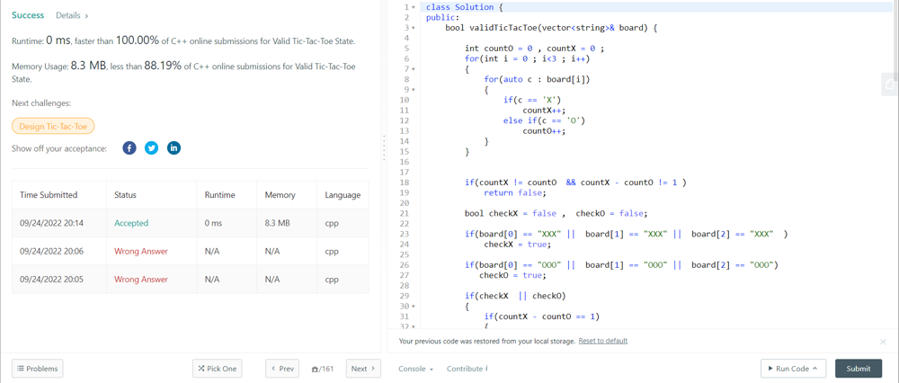

# C++ || 0ms Solution with 10 Testcases Examples ||

**Author:** Khwaja_Abdul_Samad
**Votes:** 4
**Link:** [https://leetcode.com/problems/valid-tic-tac-toe-state/solutions/2618572/](https://leetcode.com/problems/valid-tic-tac-toe-state/solutions/2618572/)

---

```class Solution {
public:
    bool validTicTacToe(vector<string>& board) {
      
        int countO = 0 , countX = 0 ;
        for(int i = 0 ; i<3 ; i++)
        {
            for(auto c : board[i])
            {
                if(c == 'X')
                    countX++;
                else if(c == 'O')
                    countO++;
            }
        }
        
      Observations - 
    1. Number of 'O' > Number of X -> return false
    2. Number of X - Number of Os > 1 -> Return false
    3. If O wins -
        a) Number of Os  == Number of Xs
        b) And X should not be winning
    4. If X wins -
        a) O should not win
        if(countX != countO  && countX - countO != 1 )
            return false;
        
        bool checkX = false ,  checkO = false;
        
        
        // Checking in Horizontal Line having saming digit 
        if(board[0] == "XXX" ||  board[1] == "XXX" ||  board[2] == "XXX"  )
            checkX = true;
    
        if(board[0] == "OOO" ||  board[1] == "OOO" ||  board[2] == "OOO")
           checkO = true;
        
        if(checkX  || checkO)
        {
            if(countX - countO == 1)
            {
                 if(checkX)
                   return !checkO;
                return false;
            } 
            else
            {
                if(checkX)
                    return false;
                return true;
            }
        }
        
        
        string s1 , s2 , s3 ;
        
        s1.push_back(board[0][0]);
        s1.push_back(board[1][0]);
        s1.push_back(board[2][0]);
        
        s2.push_back(board[0][1]);
        s2.push_back(board[1][1]);
        s2.push_back(board[2][1]);
        
        s3.push_back(board[0][2]);
        s3.push_back(board[1][2]);
        s3.push_back(board[2][2]);
        
        // Checking in Vertical Line  having saming digit 
        if(s1 == "XXX" ||  s2 == "XXX" ||  s3 == "XXX"  )
            checkX = true;
        
        if(s1 == "OOO" ||  s2 == "OOO" ||  s3 == "OOO")
           checkO = true;
        
        
        
        if(checkX  || checkO)
        {
            if(countX - countO == 1)
            {
                 if(checkX)
                   return !checkO;
                 return false;
            } 
            else
               if(checkX)
                    return false;
                return true;
        }
        
        
        string diag1 , diag2;
        
        diag1.push_back(board[0][0]);
        diag1.push_back(board[1][1]);
        diag1.push_back(board[2][2]);
        
        diag2.push_back(board[0][2]);
        diag2.push_back(board[1][1]);
        diag2.push_back(board[2][0]);
        
        
        // Checking in Diagonal  having saming digit 
        if(diag1 == "XXX" ||  diag2 == "XXX"  )
            checkX = true;
        
        if(diag1 == "OOO" ||  diag2 == "OOO"  )
            checkO = true;
        
        if(checkX || checkO)
        {
            if(countX - countO == 1)
                return checkX;
            else
                return checkO;
        }
        
        return true;
        
        
    }
};

// ["XO ","XO ","XO "]
// ["XOX"," X ","   "]
// ["XOX","O O","XOX"]
// ["XOX","OOO","XOX"]
// ["XOX","OOO","XXX"]
// ["XOX","XXO","OXO"]
// ["XXX","OOO","   "]
// ["XOX","OOO","XXX"]
// ["XOX","XOO","XOX"]
// ["OXX","XOX","OXO"]


```


