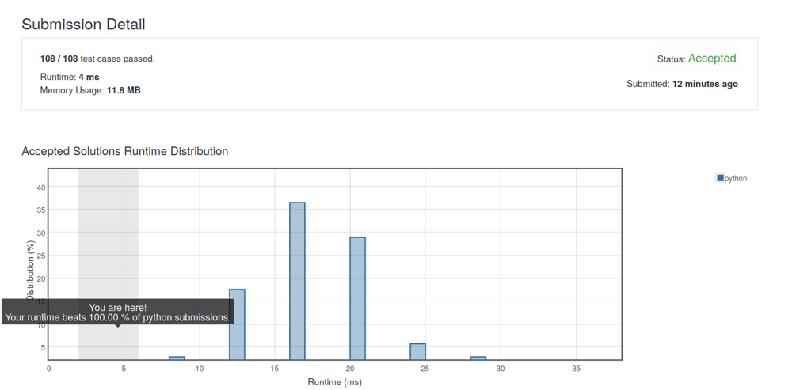

# concise code beat 100% python solution with explanation

**Author:** YTP27
**Votes:** 13
**Link:** [https://leetcode.com/problems/valid-tic-tac-toe-state/solutions/479695/](https://leetcode.com/problems/valid-tic-tac-toe-state/solutions/479695/)

---

There is only four situation that Tic-Tac-Toe is invalid:
1. two players are not taking turns making move
2. "O" player makes move before "X" player
3. "X" player wins but "O" player continues to make move
4. "O" player wins but "X" player continues to make move

```
class Solution(object):
    def validTicTacToe(self, board):
        def win(s): # return True if the player who use s wins
            if board[0][0]==s and board[0][1]==s and board[0][2]==s: return True
            if board[1][0]==s and board[1][1]==s and board[1][2]==s: return True
            if board[2][0]==s and board[2][1]==s and board[2][2]==s: return True
            if board[0][0]==s and board[1][0]==s and board[2][0]==s: return True
            if board[0][1]==s and board[1][1]==s and board[2][1]==s: return True
            if board[0][2]==s and board[1][2]==s and board[2][2]==s: return True
            if board[0][0]==s and board[1][1]==s and board[2][2]==s: return True
            if board[0][2]==s and board[1][1]==s and board[2][0]==s: return True
            return False
        
        xNo, oNo=0, 0
        for row in board:
            xNo+=row.count('X')
            oNo+=row.count('O')
        if oNo>xNo or xNo-oNo>=2: # "X" not making move first or not taking turns making move
            return False
        if xNo>=3:
            if xNo==oNo and win('X'): # put another "O" after "X" player winning
                return False
            if xNo!=oNo and win('O'): # put another "X" after "O" player winning
                return False
        return True
```

