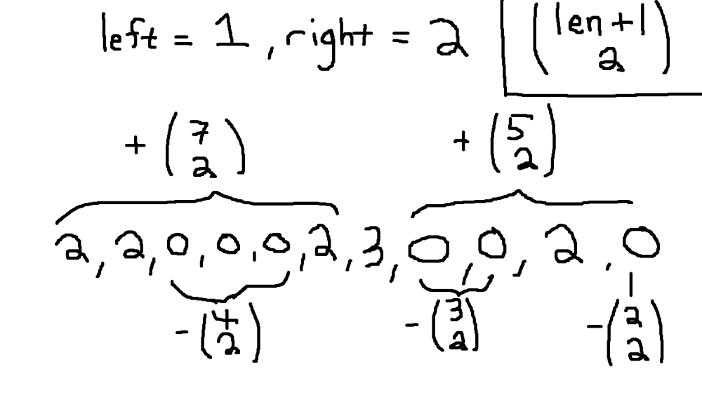

# Simplest approach conceptually? - n Choose 2

**Author:** MoggleToggles
**Votes:** 1
**Link:** [https://leetcode.com/problems/number-of-subarrays-with-bounded-maximum/solutions/4468350/](https://leetcode.com/problems/number-of-subarrays-with-bounded-maximum/solutions/4468350/)

---

# Intuition

Numbers above the maximum bound (right) will never be included in any subarray, so just skip those. 

A number below the minimum (left) can be included in a subarray, but it can't stand by itself, so just compute the total number of subarrays where all values are below the maximum, then subtract the number of subarrays formed exclusively by elements less than the minimum




# Complexity
- Time complexity:
O(n)

- Space complexity:
 O(1)

# Code
```
class Solution {
    fun numSubarrayBoundedMax(nums: IntArray, left: Int, right: Int): Int {
        var subarrayCount = 0L
        var j = 0
        var countBelowMin = 0L
        var countBelowMax = 0L
        while (j <= nums.size) {
            if (j == nums.size || nums[j] > right) {
                subarrayCount += countBelowMax.numberOfSubarrays()
                subarrayCount -= countBelowMin.numberOfSubarrays()
                countBelowMax = 0L
                countBelowMin = 0L
            } else if (nums[j] < left) {
                countBelowMax += 1
                countBelowMin += 1
            } else {
                subarrayCount -= countBelowMin.numberOfSubarrays()
                countBelowMin = 0L
                countBelowMax += 1
            }
            j++
        }

        return subarrayCount.toInt()
    }

    private fun Long.numberOfSubarrays(): Long {
        return (this + 1) * this / 2
    }
}
```