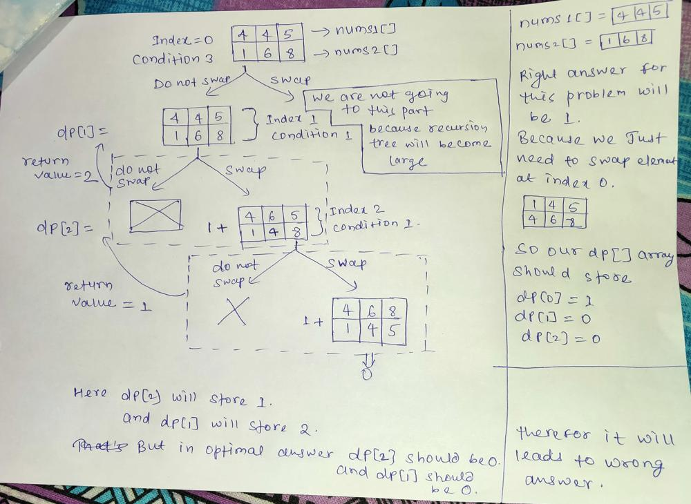

# FULLY EXPLAINED SOLUTION FOR BEGINNER . ( Recursion+Memoization)

**Author:** rahul_81
**Votes:** 45
**Link:** [https://leetcode.com/problems/minimum-swaps-to-make-sequences-increasing/solutions/1849616/](https://leetcode.com/problems/minimum-swaps-to-make-sequences-increasing/solutions/1849616/)

---

The basic idea behind this problem is same what we uses in 0 1 knapsack.
So what is the idea in **0 1 knapsack**. The idea is that we provide some condition during function call, and if condition is satisfied then we have two options (i,e) either include the current element or do not include the current element.But if condition is not satisfied then we have only one option (i,e) we do not include the current element.

We will use that same idea here.
So what are the different conditions here.

Condition 1 - Ok lets suppose we have two arrays as follows :-
	nums1[] = [3,2]
	nums2[] = [1,4]
	and we are at index 1.we can see that for nums1 we have nums1[ind-1]>= nums1[ind], So for this condition we have only one option i,e we have to swap the elements so that array can be made strictly increasing. So we will swap elements and recursively call next functions.
	
	After swapping element at index 1 array will now becomes nums1[] = {3,4} and nums2[] = {1,2} (i,e strictly increasing)
	
Condition 2- lets take another example:-
nums1[] = {1,2}
nums2[] = {3,4}
index = 1;

if we do swapping of the current element then our array will be nums1[] = {1,4} and nums2[] = {3,2}. We can see that the elements in nums2 is not in increasing order.

Therefore if (nums1[ind-1] >= nums2[ind] || nums2[ind-1] >= nums1[ind] ) we cannot swap the current element.

Condition 3 -
Now lets take another example 
nums1[] = {1,5}
nums2[] = {3,4}
index = 1;

Here we have two options either we swap the current element or we do not swap. So here we will take the minimum answer of both the option and return the answer.

Any suggestions are welcome.
Thanks
**Do upvote if you like the explaination !!!**

class Solution {

    public int minSwap(int[] nums1, int[] nums2) {
	
        int dp[] = new int[nums1.length];
        Arrays.fill(dp,-1);
        
        int ans = solve(nums1,nums2,0,dp);
        
        return ans;
    }
    
    public int solve(int nums1[],int nums2[],int ind,int[] dp){
        
        if(ind == nums1.length) return 0;
        
		// Condition 1
		
        if(ind>0 && (nums1[ind-1]>=nums1[ind] || nums2[ind-1]>=nums2[ind])) {
            
				//	nums1[] = [3,2]
				//	nums2[] = [1,4]
				
                int t = nums1[ind];
                nums1[ind] = nums2[ind];
                nums2[ind] = t;
                
               int val = 1+solve(nums1,nums2,ind+1,dp);
            
			// Since after swapping array becomes 
			// nums1[] = [3,4]
			// nums2[] = [1,2]
			// therefore we have to swap it back so that we can have our original array.
			
                t = nums1[ind];
                nums1[ind] = nums2[ind];
                nums2[ind] = t;
            
            return val;
            
        }  
		// Condition 2
		
		else if(ind>0 && (nums1[ind-1]>=nums2[ind] || nums2[ind-1]>=nums1[ind])) {
				return solve(nums1,nums2,ind+1,dp);
        }
		// Condition 3
		
        else {
            if(dp[ind] != -1) return dp[ind];
            
                int tempAns1 = solve(nums1,nums2,ind+1,dp);
        
                int t = nums1[ind];
                nums1[ind] = nums2[ind];
                nums2[ind] = t;
        
                int tempAns2 = 1+solve(nums1,nums2,ind+1,dp);
            
                t = nums1[ind];
                nums1[ind] = nums2[ind];
                nums2[ind] = t;
        
             return dp[ind] = Math.min(tempAns1,tempAns2);
        }
        
    }
}

A pictorial representation of why we are updating dp[] array only in condition 3.
**nums1[] = [4,4,5];
nums2[] = [1,6,8];**

