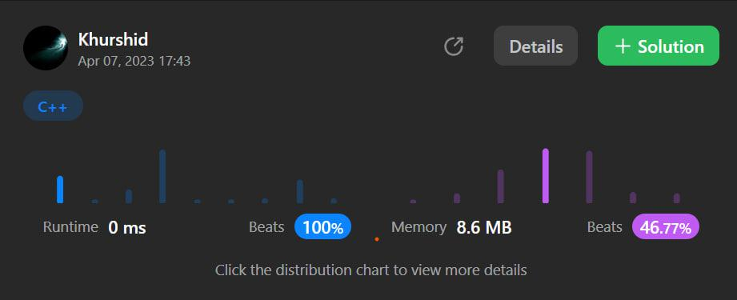

# C# and C++ very easy solution.

**Author:** aloneguy
**Votes:** 7
**Link:** [https://leetcode.com/problems/unique-morse-code-words/solutions/3390327/](https://leetcode.com/problems/unique-morse-code-words/solutions/3390327/)

---




# Complexity
- Time complexity:Beats 49.9% of other solutions in C#.
<!-- Add your time complexity here, e.g. $$O(n)$$ -->

- Space complexity:Beats 94.55% of other solutions in C#.
<!-- Add your space complexity here, e.g. $$O(n)$$ -->

```C++ []
class Solution {
public:
    int uniqueMorseRepresentations(vector<string>& words) {
        vector <string> v={".-","-...","-.-.","-..",".","..-.",
        "--.","....","..",".---","-.-",".-..","--","-.","---",
        ".--.","--.-",".-.","...","-","..-","...-",".--","-..-",
        "-.--","--.."};
        unordered_map <string,int> my;
        string s;
        for(int i=0;i<words.size();i++){
            for(int j=0;j<words[i].length();j++){
                s+=v[words[i][j]-'a'];
            }
            my[s]=1;
            s.clear();
        }
      return my.size();
    }
};
```
```C# []
public class Solution {
    public int UniqueMorseRepresentations(string[] words) {
        Dictionary<char,string> dic=new();
        dic.Add('a',".-");dic.Add('b',"-...");dic.Add('c',"-.-.");
        dic.Add('d',"-..");dic.Add('e',".");dic.Add('f',"..-.");
        dic.Add('g',"--.");dic.Add('h',"....");dic.Add('i',"..");
        dic.Add('j',".---");dic.Add('k',"-.-");dic.Add('l',".-..");
        dic.Add('m',"--");dic.Add('n',"-.");dic.Add('o',"---");
        dic.Add('p',".--.");dic.Add('q',"--.-");dic.Add('r',".-.");
        dic.Add('s',"...");dic.Add('t',"-");dic.Add('u',"..-");
        dic.Add('v',"...-");dic.Add('w',".--");dic.Add('x',"-..-");
        dic.Add('y',"-.--");dic.Add('z',"--..");
        Dictionary<string,char> res=new();
        
        for(int i=0;i<words.Length;i++){
            string s=string.Empty;
            for(int j=0;j<words[i].Length;j++){
             s+=dic[words[i][j]];
            }
            if(!res.ContainsKey(s))
            res.Add(s,'*');
        }
        return res.Count;
    }
}
```
```C# []
public class Solution {
    public int UniqueMorseRepresentations(string[] words) {
         List<string> d =new List<string>() {".-", "-...", "-.-.", "-..", ".", "..-.", "--.", "....", "..", ".---", "-.-", ".-..", "--", "-.", "---", ".--.", "--.-", ".-.", "...", "-", "..-", "...-", ".--", "-..-", "-.--", "--.."};
        HashSet<string> s=new();
        foreach (var w in words) {
            string code="";
            foreach (var c in w) 
            code += d[c - 'a'];
            s.Add(code);
        }
        return s.Count;
    }
}
```


