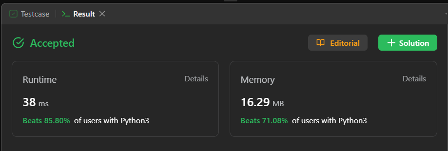

# Easy solution || Line By Line Explanation || Python || Java || C++ || Ruby

**Author:** Pratikk_Rathod
**Votes:** 20
**Link:** [https://leetcode.com/problems/unique-morse-code-words/solutions/4079850/](https://leetcode.com/problems/unique-morse-code-words/solutions/4079850/)

---

# Beats


# Intuition
The problem asks for the number of different transformations among a list of words, where each word can be represented as a concatenation of Morse code representations for its letters. To solve this, we need to convert each letter in a word to its Morse code equivalent and count the unique representations.

# Approach
1. Define the English alphabet and Morse code representations:
   - `letters` stores the lowercase English alphabet from 'a' to 'z'.
   - `morse_code` stores the corresponding Morse code representations for each letter.

2. Create a dictionary mapping letters to Morse code:
   - `morse_dict` is a dictionary created by zipping `letters` and `morse_code` together. It maps each letter to its Morse code representation.

3. Initialize a list to store words converted to Morse code:
   - `words2` is an empty list that will be used to store the Morse code representations of the input words.

4. Iterate through each word in the input list:
   - For each word in `words`, the code initializes an empty string `k` to store the Morse code for the current word.

5. Iterate through each character in the current word:
   - For each character `i` in the current word, the code appends the Morse code representation of that character (retrieved from `morse_dict`) to the string `k`.

6. Append the Morse code for the current word to the list:
   - After converting the entire word to Morse code and building the string `k`, the code appends `k` to the `words2` list.

7. Return the count of unique Morse code representations:
   - The code returns the length of the set of `words2`. This effectively counts the number of unique Morse code representations in the list and returns that count as the result.

# Complexity
- Time complexity: The code iterates through each character in each word, so the time complexity is O(n), where n is the total number of characters in all words.
- Space complexity: The space complexity is O(n) as well because the `words2` list stores Morse code representations for each word.

# Code

```
class Solution:
    def uniqueMorseRepresentations(self, words: List[str]) -> int:
        # Define the English alphabet
        letters = "abcdefghijklmnopqrstuvwxyz"
        
        # Define the corresponding Morse code representations
        morse_code = [".-", "-...", "-.-.", "-..", ".", "..-.", "--.", "....", "..", ".---", "-.-", ".-..", "--", "-.", "---", ".--.", "--.-", ".-.", "...", "-", "..-", "...-", ".--", "-..-", "-.--", "--.."]

        # Create a dictionary that maps letters to Morse code
        morse_dict = dict(zip(letters, morse_code))

        # Initialize a list to store words converted to Morse code
        words2 = []

        # Iterate through each word in the input list
        for word in words:
            # Initialize an empty string to store the Morse code for the current word
            k = ""
            
            # Iterate through each character in the current word
            for i in word:
                # Append the Morse code representation of the character to the string
                k += morse_dict[i]

            # Append the Morse code for the current word to the list
            words2.append(k) 

        # Return the count of unique Morse code representations
        return len(set(words2))

```

# Java
```
import java.util.HashSet;
import java.util.Set;

class Solution {
    public int uniqueMorseRepresentations(String[] words) {
        String[] morseCode = {
            ".-", "-...", "-.-.", "-..", ".", "..-.", "--.", "....", "..", ".---",
            "-.-", ".-..", "--", "-.", "---", ".--.", "--.-", ".-.", "...", "-",
            "..-", "...-", ".--", "-..-", "-.--", "--.."
        };

        Set<String> uniqueMorse = new HashSet<>();

        for (String word : words) {
            StringBuilder morseRepresentation = new StringBuilder();
            for (char c : word.toCharArray()) {
                morseRepresentation.append(morseCode[c - 'a']);
            }
            uniqueMorse.add(morseRepresentation.toString());
        }

        return uniqueMorse.size();
    }
}

```
# C++
```
class Solution {
public:
    int uniqueMorseRepresentations(vector<string>& words) {
        vector<string> morseCode = {
            ".-", "-...", "-.-.", "-..", ".", "..-.", "--.", "....", "..", ".---",
            "-.-", ".-..", "--", "-.", "---", ".--.", "--.-", ".-.", "...", "-",
            "..-", "...-", ".--", "-..-", "-.--", "--.."
        };

        unordered_set<string> uniqueMorse;

        for (const string& word : words) {
            string morseRepresentation = "";
            for (char c : word) {
                morseRepresentation += morseCode[c - 'a'];
            }
            uniqueMorse.insert(morseRepresentation);
        }

        return uniqueMorse.size();
    }
};

```
# Ruby
```
class Solution
  MORSE_CODE = [
    ".-", "-...", "-.-.", "-..", ".", "..-.", "--.", "....", "..", ".---",
    "-.-", ".-..", "--", "-.", "---", ".--.", "--.-", ".-.", "...", "-",
    "..-", "...-", ".--", "-..-", "-.--", "--.."
  ]

  def unique_morse_representations(words)
    unique_morse = Set.new

    words.each do |word|
      morse_representation = ""
      word.each_char do |char|
        morse_representation += MORSE_CODE[char.ord - 'a'.ord]
      end
      unique_morse.add(morse_representation)
    end

    unique_morse.size
  end
end

```
# javascript
```
/**
 * @param {string[]} words
 * @return {number}
 */
var uniqueMorseRepresentations = function (words) {
    const morseCode = [
        ".-", "-...", "-.-.", "-..", ".", "..-.", "--.", "....", "..", ".---",
        "-.-", ".-..", "--", "-.", "---", ".--.", "--.-", ".-.", "...", "-", "..-",
        "...-", ".--", "-..-", "-.--", "--.."
    ];

    const uniqueMorse = new Set();

    for (const word of words) {
        let morseRepresentation = "";
        for (const char of word) {
            morseRepresentation += morseCode[char.charCodeAt(0) - 'a'.charCodeAt(0)];
        }
        uniqueMorse.add(morseRepresentation);
    }

    return uniqueMorse.size;
};

```