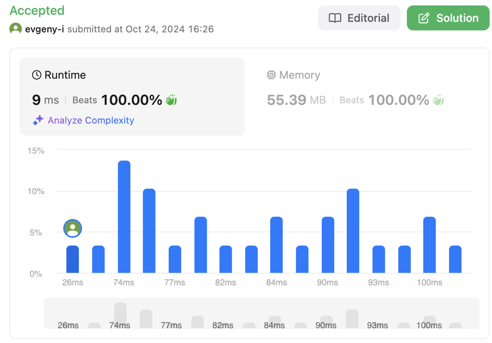

# ✅ ✅ Map Solution with JS/TS, Runtime Beats 100% and Memory beats 100% ✅ ✅

**Author:** evgeny-r9
**Votes:** 0
**Link:** [https://leetcode.com/problems/subdomain-visit-count/solutions/5962602/](https://leetcode.com/problems/subdomain-visit-count/solutions/5962602/)

---

# Approach
<!-- Describe your approach to solving the problem. -->
Use map and split cpdomain strings using regex by groups.




# Complexity
- Time complexity:
<!-- Add your time complexity here, e.g. $$O(n)$$ -->
 $$O(n * m)$$
- Space complexity:
<!-- Add your space complexity here, e.g. $$O(n)$$ -->
 $$O(n)$$

# Code
```typescript []
function subdomainVisits(cpdomains: string[]): string[] {
    const map = new Map<string, number>();
    const regex = /^(\\d+) (\\w+)\\.(\\w+)(?:\\.(\\w+))?$/;

    cpdomains.forEach((domain) => {
        const groups = domain.match(regex);
        const count = parseInt(groups[1], 10);
        const parts: string[] = [
            groups[2],
            groups[3],
        ];
        if (groups[4]) {
            parts.push(groups[4]);
        }

        for (let i = 0; i < parts.length; i++) {
            const subdomain = parts.slice(i).join(".");
            if (map.has(subdomain)) {
                const newCount = map.get(subdomain) + count;
                map.set(subdomain, newCount);
            } else {
                map.set(subdomain, count);
            }
        }
    });

    const result = [];
    map.forEach((count, key) => {
        result.push(`${count} ${key}`);
    });
    return result;
};
```
```javascript []
/**
 * @param {string[]} cpdomains
 * @return {string[]}
 */
var subdomainVisits = function(cpdomains) {
    const map = new Map();
    const regex = /^(\\d+) (\\w+)\\.(\\w+)(?:\\.(\\w+))?$/;

    cpdomains.forEach((domain) => {
        const groups = domain.match(regex);
        const count = parseInt(groups[1], 10);
        const parts = [
            groups[2],
            groups[3],
        ];
        if (groups[4]) {
            parts.push(groups[4]);
        }

        for (let i = 0; i < parts.length; i++) {
            const subdomain = parts.slice(i).join(".");
            if (map.has(subdomain)) {
                const newCount = map.get(subdomain) + count;
                map.set(subdomain, newCount);
            } else {
                map.set(subdomain, count);
            }
        }
    });

    const result = [];
    map.forEach((count, key) => {
        result.push(`${count} ${key}`);
    });
    return result;
};
```