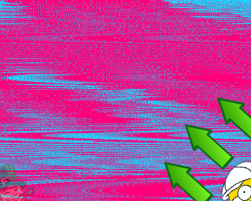

# 🏆🔥✅Gauss Formula🏆🔥✅

**Author:** Manohar_001
**Votes:** 18
**Link:** [https://leetcode.com/problems/largest-triangle-area/solutions/4747995/](https://leetcode.com/problems/largest-triangle-area/solutions/4747995/)

---

# \uD83D\uDE09Don't just watch & move away, also give an Upvote.\uD83D\uDE09

# Complexity
- Time complexity: $$O(n^3)$$
<!-- Add your time complexity here, e.g. $$O(n)$$ -->

- Space complexity: $$O(1)$$
<!-- Add your space complexity here, e.g. $$O(n)$$ -->

# Code
```
class Solution {
public:
    double largestTriangleArea(vector<vector<int>>& p) {
        double maxArea = INT_MIN;
        int n = size(p);

        for(int i=0; i<n; i++)
        {
            for(int j=i+1; j<n; j++)
            {
                for(int k=j+1; k<n; k++)
                {
                    int x1 = p[i][0];
                    int y1 = p[i][1];

                    int x2 = p[j][0];
                    int y2 = p[j][1];

                    int x3 = p[k][0];
                    int y3 = p[k][1];

                    double tempArea = abs((x1*(y2-y3) + x2*(y3-y1) + x3*(y1-y2)));

                    maxArea = max(maxArea, 0.5*tempArea);
                }
            }
        }
        
<!-- \u2705Well before returning don't forget to UPVOTE.\u2705 -->
        return maxArea;
    }
};
```
