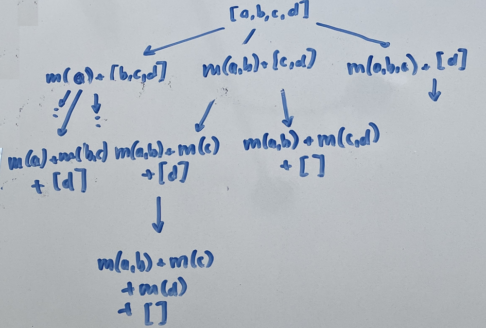

# DFS -> DP Progression With Explanation [O(kn^2)/O(kn)]

**Author:** hansberryjam
**Votes:** 8
**Link:** [https://leetcode.com/problems/largest-sum-of-averages/solutions/916679/](https://leetcode.com/problems/largest-sum-of-averages/solutions/916679/)

---

In this problem, we are trying to find the combination of `k` groups that has the largest sum of averages.  DFS is a great tool to accomplish this as it allows us to look at all possible combinations.  We can think of an instance of a recursive call as a possible state of the problem, and each of the recursive calls as actions we can take to move to another state.
```
def dfs(A, k):
	if not A:
		return 0
	if k == 1:
		return mean(A)
	largest = 0
	for i in range(1, len(A)):
		curr = mean(A[:i]) + dfs(A[i:], k - 1)
		largest = max(largest, curr)
	return largest
return dfs(A, K)
```
Let's take a look at what the DFS tree would look like.

where `m(...)` signifies the mean of those elements.  Notice this isn't the entire DFS tree, but it should give you an idea of how the recursion works.  This DFS will solve the problem, but takes far too long and times out.  Why is that?  Notice that at the second level, we have `m(a) + m(b, c) + [d]` and `m(a, b) + m(c) + [d]`.  Both of these instances have taken the same amount of steps, and are about to make recursive calls to `dfs([d], k - 2))`.  These have the same exact state, and thus will result in the same answer.  Our implementation of DFS does not recognize this, and will take time to recalculate it anyways.  This is where the DP solution comes in.

Instead of solving this problem from the top down `(k -> k - 1 -> ... -> 0)`, let's instead build the solution from the ground up , saving the result at each step.
```
def dp(A, K):
	dp = [[0] * len(A) for _ in range(K)]
	for j in range(len(A)):
		dp[0][j] = mean(A[:j + 1])
	for k in range(1, K):
		for j in range(k, len(A)):
			for i in range(j):
				dp[k][j] = max(dp[k][j], dp[k - 1][i] + mean(A[i + 1:j + 1]))
	return dp[-1][-1]
return dp(A, K)
```
Notice the recursive relation is exactly the same as the DFS approach.  For a given array, we iterate through all combinations of groupings, and keep the largest result.  We do not spend time recalculating combinations, and instead just reference the calculation that was already made.  

