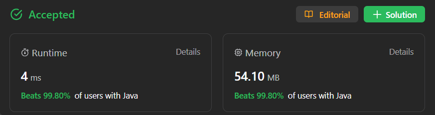

# ✅ Beats 100% - Explained With [ Video ] - Modified Bellman Ford - Visualized Too

**Author:** millenium103
**Votes:** 116
**Link:** [https://leetcode.com/problems/bus-routes/solutions/4277892/](https://leetcode.com/problems/bus-routes/solutions/4277892/)

---



# YouTube Video Explanation:


[https://youtu.be/uvAuQVvGBts](https://youtu.be/uvAuQVvGBts)
**\uD83D\uDD25 Please like, share, and subscribe to support our channel's mission of making complex concepts easy to understand.**

Subscribe Link: https://www.youtube.com/@leetlogics/?sub_confirmation=1

*Current Subscribers: 221*
*Subscribe Goal: 250 Subscribers*
### Example Explanation:

Given Routes: `[[1,2,7],[3,6,7]]`

| Bus Stops (Routes) | Bus Stops Sequence |
|:-------------------:|:------------------:|
| [1, 2, 7]           | 1 -> 2 -> 7 -> 1 -> 2 -> 7 -> ... |
| [3, 6, 7]           | 3 -> 6 -> 7 -> 3 -> 6 -> 7 -> ... |

Source Bus Stop: 1, Target Bus Stop: 6

### Initialization:

| Bus Stop | Min Buses to Reach |
|:--------:|:-------------------:|
|    1     |          0          |
|    2     |         \u221E           |
|    3     |         \u221E           |
|    6     |         \u221E           |
|    7     |         \u221E           |

- Initialize `minBusesToReach` array. The source bus stop (1) has a minimum of 0 buses required.

### Iteration 1:

| Bus Stop | Min Buses to Reach |
|:--------:|:-------------------:|
|    1     |          0          |
|    2     |          1          |
|    3     |          \u221E          |
|    6     |          \u221E          |
|    7     |          1          |

- Update `minBusesToReach` based on the first route ([1, 2, 7]).

### Iteration 2:

| Bus Stop | Min Buses to Reach |
|:--------:|:-------------------:|
|    1     |          0          |
|    2     |          1          |
|    3     |          2          |
|    6     |          2          |
|    7     |          1          |

- Update `minBusesToReach` based on the second route ([3, 6, 7]).

### Result:

| Bus Stop | Min Buses to Reach |
|:--------:|:-------------------:|
|    1     |          0          |
|    2     |          1          |
|    3     |          2          |
|    6     |          2          |
|    7     |          1          |

- The final `minBusesToReach` array after both iterations.

### Conclusion:

- The minimum number of buses required to reach the target bus stop (6) from the source bus stop (1) is 2.

This table-based explanation demonstrates the step-by-step updates in the `minBusesToReach` array, providing a clear visualization of the solution's logic.

# Intuition
<!-- Describe your first thoughts on how to solve this problem. -->
The problem involves finding the least number of buses one must take to travel from a source bus stop to a target bus stop. Each bus travels in a repeating sequence, and you can only travel between bus stops using buses. The task is to determine the minimum number of bus rides needed to reach the target bus stop from the source bus stop.

# Approach
<!-- Describe your approach to solving the problem. -->
1. First, identify the maximum bus stop number (`maxStop`) across all routes. If `maxStop` is less than the target bus stop, it means there is no route to reach the target, and we return -1.

2. Initialize an array `minBusesToReach`, where `minBusesToReach[i]` represents the minimum number of buses needed to reach bus stop `i` from the source. Initialize this array with a value greater than the total number of routes.

3. Use a loop to iteratively update the `minBusesToReach` array. For each route, find the minimum value in `minBusesToReach` for the stops in that route and increment it by 1. Update the `minBusesToReach` array if a smaller number of buses is found.

4. Continue this process until no further updates can be made to `minBusesToReach`. The final value at `minBusesToReach[target]` will represent the minimum number of buses needed to reach the target from the source.

5. Return the result: `minBusesToReach[target]` if it is less than the total number of routes, otherwise, return -1.

# Complexity
- **Time Complexity:**
  - The outer loop runs until no more updates can be made, and in each iteration, we iterate through all routes. Therefore, the time complexity is O(n * m), where n is the number of routes and m is the average number of stops in a route.
  
- **Space Complexity:**
  - The space complexity is O(maxStop), where maxStop is the maximum bus stop number in any route, as we use an array `minBusesToReach` of this size.

# Code
## Java
```
class Solution {
    public int numBusesToDestination(int[][] routes, int source, int target) {
        if (source == target) {
            return 0;
        }
        int maxStop = -1;
        for (int[] route : routes) {
            for (int stop : route) {
                maxStop = Math.max(maxStop, stop);
            }
        }
        if (maxStop < target) {
            return -1;
        }
        int n = routes.length;
        int[] minBusesToReach = new int[maxStop + 1];
        Arrays.fill(minBusesToReach, n + 1);
        minBusesToReach[source] = 0;
        boolean flag = true;
        while (flag) {
            flag = false;
            for (int[] route : routes) {
                int min = n + 1;
                for (int stop : route) {
                    min = Math.min(min, minBusesToReach[stop]);
                }
                min++;
                for (int stop : route) {
                    if (minBusesToReach[stop] > min) {
                        minBusesToReach[stop] = min;
                        flag = true;
                    }
                }
            }
            
        }
        return (minBusesToReach[target] < n + 1 ? minBusesToReach[target] : -1);
    }
}
```
## C++
```
class Solution {
public:
    int numBusesToDestination(vector<vector<int>>& routes, int source, int target) {
        if (source == target) {
            return 0;
        }

        int maxStop = -1;
        for (const auto& route : routes) {
            for (int stop : route) {
                maxStop = max(maxStop, stop);
            }
        }

        if (maxStop < target) {
            return -1;
        }

        int n = routes.size();
        vector<int> minBusesToReach(maxStop + 1, INT_MAX);
        minBusesToReach[source] = 0;

        bool flag = true;
        while (flag) {
            flag = false;
            for (const auto& route : routes) {
                int min = n+1;
                for (int stop : route) {
                    min = std::min(min, minBusesToReach[stop]);
                }
                min++;
                for (int stop : route) {
                    if (minBusesToReach[stop] > min) {
                        minBusesToReach[stop] = min;
                        flag = true;
                    }
                }
            }
        }

        return (minBusesToReach[target] < n+1) ? minBusesToReach[target] : -1;
    }
};
```
## Python
```
class Solution(object):
    def numBusesToDestination(self, routes, source, target):
        if source == target:
            return 0

        max_stop = max(max(route) for route in routes)
        if max_stop < target:
            return -1

        n = len(routes)
        min_buses_to_reach = [float('inf')] * (max_stop + 1)
        min_buses_to_reach[source] = 0

        flag = True
        while flag:
            flag = False
            for route in routes:
                mini = float('inf')
                for stop in route:
                    mini = min(mini, min_buses_to_reach[stop])
                mini += 1
                for stop in route:
                    if min_buses_to_reach[stop] > mini:
                        min_buses_to_reach[stop] = mini
                        flag = True

        return min_buses_to_reach[target] if min_buses_to_reach[target] < float('inf') else -1

```
## JavaScript
```
var numBusesToDestination = function(routes, source, target) {
    if (source === target) {
            return 0;
        }

        let maxStop = -1;
        for (const route of routes) {
            maxStop = Math.max(maxStop, ...route);
        }

        if (maxStop < target) {
            return -1;
        }

        const n = routes.length;
        const minBusesToReach = Array(maxStop + 1).fill(Number.MAX_SAFE_INTEGER);
        minBusesToReach[source] = 0;

        let flag = true;
        while (flag) {
            flag = false;
            for (const route of routes) {
                let mini = Number.MAX_SAFE_INTEGER;
                for (const stop of route) {
                    mini = Math.min(mini, minBusesToReach[stop]);
                }
                mini++;
                for (const stop of route) {
                    if (minBusesToReach[stop] > mini) {
                        minBusesToReach[stop] = mini;
                        flag = true;
                    }
                }
            }
        }

        return (minBusesToReach[target] < Number.MAX_SAFE_INTEGER) ? minBusesToReach[target] : -1;
};
```
---

