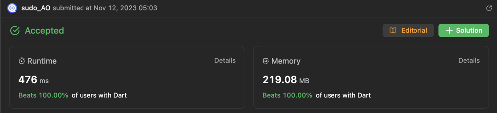

# 🚀Beats 100.00%of users with Python and ✅Beats 100.00%of users with Python

**Author:** deleted_user
**Votes:** 9
**Link:** [https://leetcode.com/problems/bus-routes/solutions/4277851/](https://leetcode.com/problems/bus-routes/solutions/4277851/)

---



# Intuition
The problem involves finding the least number of buses needed to travel    from the source to the target. It can be solved using a Breadth-First Search (BFS) approach. The idea is to treat bus stops as nodes and buses as edges. We explore all possible routes using BFS until we reach the target bus stop.

# Approach
Create a graph where each bus stop is a node, and each bus is an edge.
Use BFS to explore the routes, starting from the source bus stop.
Keep track of the number of buses taken to reach each stop.
Continue BFS until reaching the target bus stop or exploring all possible routes.
Return the least number of buses needed or -1 if no valid route is found.

# Complexity
- Time complexity:
Time complexity: O(N + R), where N is the total number of bus stops and R is the total number of routes. In the worst case, we might visit each bus stop and route once.
Space complexity: O(N + R), where N is the total number of bus stops and R is the total number of routes. We use additional space to store the graph and visited stops.

- Space complexity:
<!-- Add your space complexity here, e.g. $$O(n)$$ -->

# Python 

``` 
class Solution(object):
    def numBusesToDestination(self, routes, source, target):
        if source == target:
            return 0

        # Create a graph where each bus stop is a node and each bus is an edge
        stop_to_routes = defaultdict(set)
        for i, route in enumerate(routes):
            for stop in route:
                stop_to_routes[stop].add(i)

        # Initialize visited set and a queue for BFS
        visited_stops = set()
        queue = deque([(source, 0)])  # (bus stop, number of buses taken)

        while queue:
            current_stop, num_buses = queue.popleft()

            # Check all the buses passing through the current bus stop
            for route_index in stop_to_routes[current_stop]:
                for next_stop in routes[route_index]:
                    if next_stop == target:
                        return num_buses + 1

                    if next_stop not in visited_stops:
                        visited_stops.add(next_stop)
                        queue.append((next_stop, num_buses + 1))

                # Mark the current bus route as visited to avoid duplicate exploration
                routes[route_index] = []

        return -1  # No valid route found
```
# C++
```
#include <vector>
#include <unordered_map>
#include <unordered_set>
#include <queue>

class Solution {
public:
    int numBusesToDestination(std::vector<std::vector<int>>& routes, int source, int target) {
        if (source == target) {
            return 0;
        }

        // Create a graph where each bus stop is a node and each bus is an edge
        std::unordered_map<int, std::unordered_set<int>> stopToRoutes;
        for (int i = 0; i < routes.size(); ++i) {
            for (int stop : routes[i]) {
                stopToRoutes[stop].insert(i);
            }
        }

        // Initialize visited set and a queue for BFS
        std::unordered_set<int> visitedStops;
        std::queue<std::pair<int, int>> queue;  // {bus stop, number of buses taken}

        queue.push({source, 0});

        while (!queue.empty()) {
            auto currentStopAndBuses = queue.front();
            queue.pop();
            int currentStop = currentStopAndBuses.first;
            int numBuses = currentStopAndBuses.second;

            // Check all the buses passing through the current bus stop
            const auto& routesForCurrentStop = stopToRoutes[currentStop];
            for (int routeIndex : routesForCurrentStop) {
                for (int nextStop : routes[routeIndex]) {
                    if (nextStop == target) {
                        return numBuses + 1;
                    }

                    if (visitedStops.find(nextStop) == visitedStops.end()) {
                        visitedStops.insert(nextStop);
                        queue.push({nextStop, numBuses + 1});
                    }
                }

                // Mark the current bus route as visited to avoid duplicate exploration
                routes[routeIndex].clear();
            }
        }

        return -1;  // No valid route found
    }
};
```
# Dart
```
import 'dart:collection';
class Solution {
  int numBusesToDestination(List<List<int>> routes, int source, int target) {
    if (source == target) {
      return 0;
    }

    // Create a graph where each bus stop is a node and each bus is an edge
    var stopToRoutes = Map<int, Set<int>>();
    for (var i = 0; i < routes.length; i++) {
      for (var stop in routes[i]) {
        stopToRoutes.putIfAbsent(stop, () => <int>{});
        stopToRoutes[stop]!.add(i);
      }
    }

    // Initialize visited set and a queue for BFS
    var visitedStops = Set<int>();
    var queue = Queue<List<int>>(); // [bus stop, number of buses taken]

    queue.add([source, 0]);

    while (queue.isNotEmpty) {
      var currentStopAndBuses = queue.removeFirst();
      var currentStop = currentStopAndBuses[0];
      var numBuses = currentStopAndBuses[1];

      // Check all the buses passing through the current bus stop
      var routesForCurrentStop = stopToRoutes[currentStop];
      if (routesForCurrentStop != null) {
        for (var routeIndex in routesForCurrentStop) {
          for (var nextStop in routes[routeIndex]) {
            if (nextStop == target) {
              return numBuses + 1;
            }

            if (!visitedStops.contains(nextStop)) {
              visitedStops.add(nextStop);
              queue.add([nextStop, numBuses + 1]);
            }
          }

          // Mark the current bus route as visited to avoid duplicate exploration
          routes[routeIndex] = [];
        }
      }
    }

    return -1; // No valid route found
  }
}
```
# If you like the answer, please click upvote \u2B06\uFE0F