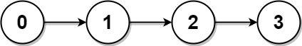
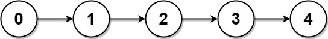

# [817. Linked List Components](https://leetcode.com/problems/linked-list-components/)

| Category | Difficulty | Likes | Dislikes |
| :------: | :--------: | :---: | :------: |
| Algorithms | Medium | 1188 | 2286 |

**Tags:** [`array`](https://leetcode.com/tag/array), [`hash-table`](https://leetcode.com/tag/hash-table), [`linked-list`](https://leetcode.com/tag/linked-list)

**Companies:** `amazon`, `google`

## Description

You are given the `head` of a linked list containing unique integer values and an integer array `nums` that is a subset of the linked list values.

Return *the number of connected components in *`nums`* where two values are connected if they appear **consecutively** in the linked list*.

 

**Example 1:**


```

Input: head = [0,1,2,3], nums = [0,1,3]
Output: 2
Explanation: 0 and 1 are connected, so [0, 1] and [3] are the two connected components.

```

**Example 2:**


```

Input: head = [0,1,2,3,4], nums = [0,3,1,4]
Output: 2
Explanation: 0 and 1 are connected, 3 and 4 are connected, so [0, 1] and [3, 4] are the two connected components.

```

 

**Constraints:**

	- The number of nodes in the linked list is `n`.

	- `1 <= n <= 10^4`

	- `0 <= Node.val < n`

	- All the values `Node.val` are **unique**.

	- `1 <= nums.length <= n`

	- `0 <= nums[i] < n`

	- All the values of `nums` are **unique**.

---

**Links:** [Submissions](https://leetcode.com/problems/linked-list-components/) | [Solutions](https://leetcode.com/problems/linked-list-components/)
