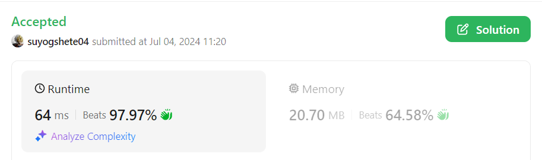

# 🔥Beats 97.97%🔥✅Super Easy (C++/Java/Python) Solution With Detailed Explanation✅

**Author:** suyogshete04
**Votes:** 6
**Link:** [https://leetcode.com/problems/linked-list-components/solutions/5413354/](https://leetcode.com/problems/linked-list-components/solutions/5413354/)

---




## Step-by-Step Explanation

1. **Input and Data Structures:**
   - The function takes in a pointer to the head of a linked list (`head`) and a vector of integers (`nums`).
   - An unordered map `M` is used to store the presence of each number in `nums`.

2. **Populate the Map:**
   ```cpp
   unordered_map<int, int> M;
   for (auto num : nums)
       M[num]++;
   ```
   - Iterate through each number in `nums` and increment its count in the map `M`.
   - This map helps in quickly checking if a number is part of `nums`.

3. **Initialize Variables:**
   ```cpp
   int res = 0;
   bool flag = false;
   ```
   - `res` is used to count the number of connected components.
   - `flag` is a boolean variable to keep track of whether we are currently traversing a component.

4. **Traverse the Linked List:**
   ```cpp
   while (head) {
       if (M[head->val] == 0 && flag) {
           res++;
           flag = false;
       } else if (M[head->val] == 1)
           flag = true;

       head = head->next;
   }
   ```
   - Loop through each node of the linked list using the `head` pointer.
   - If the current node's value is not in `nums` (`M[head->val] == 0`) and `flag` is `true` (indicating the end of a component), increment `res` and set `flag` to `false`.
   - If the current node's value is in `nums` (`M[head->val] == 1`), set `flag` to `true` (indicating the start or continuation of a component).
   - Move to the next node in the list.

5. **Final Check:**
   ```cpp
   if (flag)
       res++;
   ```
   - After the loop, if `flag` is still `true`, it means there was an ongoing component that ended at the last node. Increment `res` to account for this final component.

6. **Return the Result:**
   ```cpp
   return res;
   ```
   - Return the total number of connected components.

### Summary
The code effectively uses a hash map for quick lookups to determine if a node's value is part of the `nums` list. It uses a boolean flag to keep track of whether it's traversing a component and increments the result whenever it encounters the end of a component. The approach ensures that each node is processed in constant time, leading to an overall time complexity of O(N), where N is the number of nodes in the linked list.

# Complexity
- Time complexity: `O(n+k)`

- Space complexity: `O(k)`

# Code
```C++ []
class Solution {
public:
    int numComponents(ListNode* head, vector<int>& nums) {
        unordered_map<int, int> M;
        for (auto num : nums)
            M[num]++;

        int res = 0;
        bool flag = false;
        while (head)
        {
            if (M[head->val] == 0 && flag) {
                res++;
                flag = false;
            }
            else if (M[head->val] == 1)
                flag = true;

            head = head->next;
        }

        if (flag)
            res++;

        return res;
    }
};
```
```Java []
public class Solution {
    public int numComponents(ListNode head, int[] nums) {
        Set<Integer> numSet = new HashSet<>();
        for (int num : nums) {
            numSet.add(num);
        }

        int res = 0;
        boolean flag = false;
        while (head != null) {
            if (!numSet.contains(head.val) && flag) {
                res++;
                flag = false;
            } else if (numSet.contains(head.val)) {
                flag = true;
            }
            head = head.next;
        }

        if (flag) {
            res++;
        }

        return res;
    }
}
```
```Python []

class Solution:
    def numComponents(self, head: Optional[ListNode], nums: List[int]) -> int:
        num_set = set(nums)

        res = 0
        flag = False
        while head:
            if head.val not in num_set and flag:
                res += 1
                flag = False
            elif head.val in num_set:
                flag = True
            head = head.next

        if flag:
            res += 1

        return res 
```
## Please upvote if it helped you !!