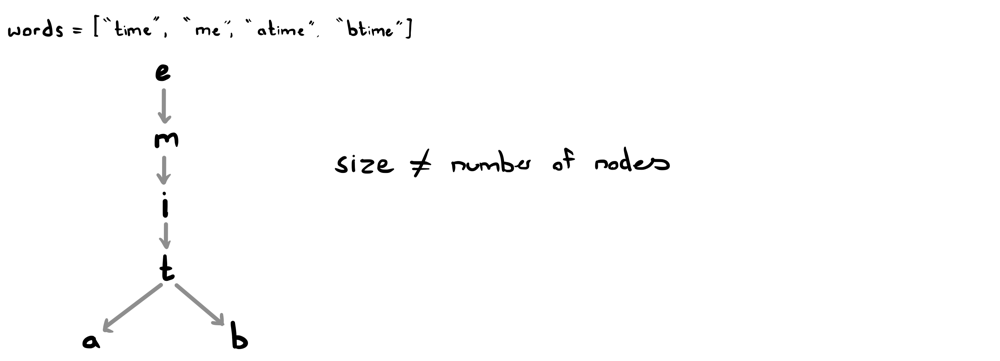
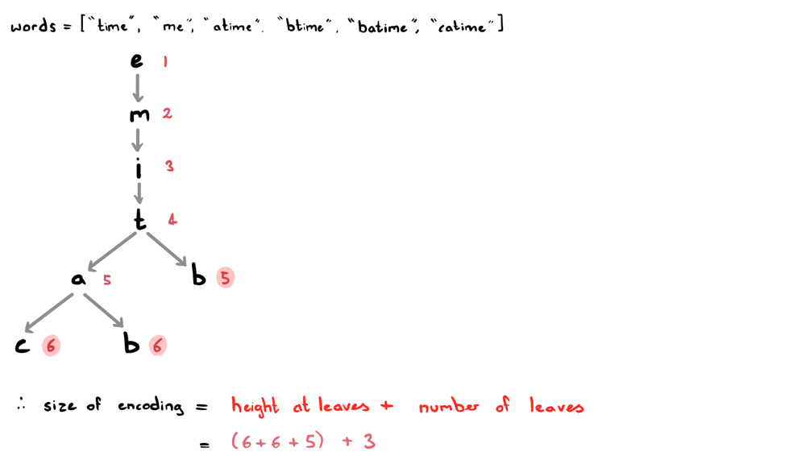

# The Key Observation | JAVA Explanation

**Author:** ciote
**Votes:** 48
**Link:** [https://leetcode.com/problems/short-encoding-of-words/solutions/2172391/](https://leetcode.com/problems/short-encoding-of-words/solutions/2172391/)

---


### Logic:
The main trick here is that words that share a <ins>common suffix</ins> can likely be included in the same encoding. For example, the words "time" and "me" can both fit into "time". 

However, this rule is not always true! For example: "time", "atime", and "btime" cannot all be fit into one encoding. With this in mind, let's just see what would happen if we drew this as a suffix trie:


As you can see, it isn't possible to just take the sum of nodes the nodes. The problem here stems from the fact that we can't always use the same suffix multiple times. Although, notice how if we only had one *leaf node* after 't', we could use the same suffix. Alas, since there's also a 'b', resulting in two leaf nodes, we have to use the suffix "time" at least twice. But hey, isn't that a relationship? Yes, it is! In fact, that's the key to how we'll solve the problem.

**Key Observation:**
The key observation here is that, given a suffix trie of all our words;
> The number of letters in our final encoding is equal to the sum of heights at our leaf nodes.
> The number of #'s needed to split our words is equal to the number of leaf nodes.

Observe this in the below illustration (I've added a couple of extra words to emphasise the point):


___
### How this works in code
It's quite simple! 

**Building the trie:**
First, we'll construct our suffix trie by using a `TrieNode` class and inserting words <ins>backwards</ins> into our trie.
As we build our trie, we'll keep track of heights for each `TrieNode`.

**Depth-first search:**
Once our trie is built, we'll simply traverse the trie using DFS in order to get to the leaf nodes.
Once we're at the leaf nodes, we simply add to our size the current height to account for the number of letters. We'll also add an extra 1 to account for the #s.
We'll do this iteratively using a stack.

That's it! We're ready to start coding :)
___
### Code:
If you have any questions, suggestions or improvements, feel free to let me know!
```java
class TrieNode {
    public TrieNode[] children;
    public int height;
    public TrieNode() {
        children = new TrieNode[26];
        height = 0;
    }
}
```
```java
class Solution {
    public int minimumLengthEncoding(String[] words) {
        TrieNode root = new TrieNode();
        for (String word: words) insert(root, word);
        
        Stack<TrieNode> stack = new Stack<>();
        stack.add(root);
        
        int size = 0;
        while (!stack.isEmpty()) {
            TrieNode node = stack.pop();
            int numOfChildren = 0;
            for (TrieNode child: node.children) {
                if (child == null) continue;
                numOfChildren++;
                stack.add(child);
            }
            if (numOfChildren == 0) size += node.height + 1;
        }
        
        return size;
    }
    
    private void insert(TrieNode root, String word) {
        for (int i=word.length()-1; i>=0; i--) {
            char c = word.charAt(i);
            if (root.children[c - 'a'] == null) 
                root.children[c - 'a'] = new TrieNode();
            int prevHeight = root.height;
            root = root.children[c - 'a'];
            root.height = prevHeight + 1;
        }
    }
}
```
**Time complexity:** `O(C)` where `C` is the total number of characters in the words array.
**Space complexity:** `O(C)` to build the trie.