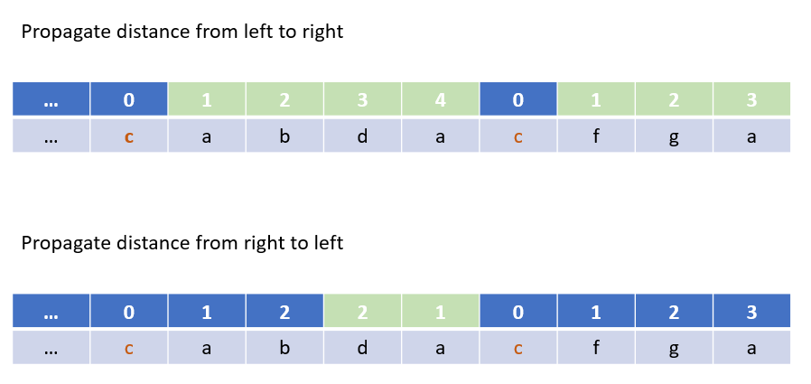

# Python O(n) by propagation 85%+ [w/ Diagram]

**Author:** brianchiang_tw
**Votes:** 19
**Link:** [https://leetcode.com/problems/shortest-distance-to-a-character/solutions/527161/](https://leetcode.com/problems/shortest-distance-to-a-character/solutions/527161/)

---

Python O(n) by propagation

---

**Hint**:

Imagine parameter C as a flag on the line.

Think of propagation technique:
**1st-pass** iteration **propagates distance** from C on the **left hand side**
**2nd-pass** iteration **propagates distance** from C on the **right hand side** with min( 1st-pass result, 2nd-pass propagation distance ) in order to update with shortest path.

---

**Abstract Model**:



---

**Implementation**:

```
class Solution:
    def shortestToChar(self, S: str, C: str) -> List[int]:
        
        shortest_dist = []
        size = len(S)
        
        if size == 1:
            # Quick response for single character test case
            # Description guarantee that character C must exist in string S
            return [0]
        
        
        # Propagate distance from left to right
        for idx, char in enumerate(S):
            
            if char == C:
                shortest_dist.append(0)
            else:
                if idx == 0:
                    shortest_dist.append( size )
                else:
                    # Propagate distance from C on left hand side
                    shortest_dist.append( shortest_dist[-1] + 1)
                
                
                
        # Propagate distance from right to left               
        for idx in range(2, size+1):
            
            # Propagate distance from C on right hand side
            shortest_dist[-idx] = min(shortest_dist[-idx], shortest_dist[-idx+1]+1 )

                
        return shortest_dist
```