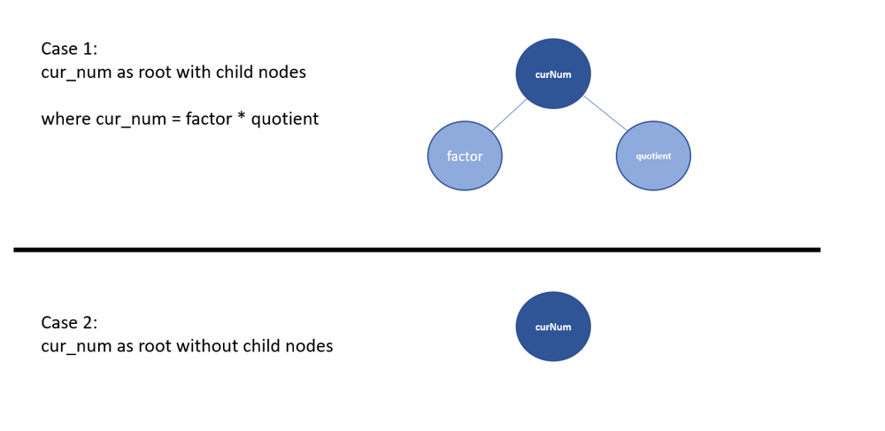

# Python/Go by DP [w/ Diagram]

**Author:** brianchiang_tw
**Votes:** 2
**Link:** [https://leetcode.com/problems/binary-trees-with-factors/solutions/1107357/](https://leetcode.com/problems/binary-trees-with-factors/solutions/1107357/)

---

**Hint**:

1. **Sort** A to make it in **ascending order**

2. **Scan each root** node value, and **decompose it to all possible factors** (i.e., the so-called child node value in binary tree).

3. **Update the number of binary tree** into dp table by dp[ x ] += dp[ y ] * dp[ x / y ]

4. Repeat step 2 and step 3 to build DP table in bottom-up order.

5. Finally, **sum up the DP table's value** and get the total count.

6. **Don't forget to take the mod** (10^9 + 7), which is defined by description.

---

**Diagram**:




---

**Implementation** by classic 2D DP

Python:

```
class Solution:
    def numFactoredBinaryTrees(self, A):
        
        ## dictionary
        # key: root node value
        # value: number of binary tree
        dp = defaultdict(int)
        
        
        # keep A sorted in ascending order
        A.sort()
        
        constant, size = (10**9 + 7), len(A)
        
        
        # scan each possible root node value
        for i, cur_num in enumerate(A):
            
            # Case 1: cur_num as root with child nodes
            
            # scan each potential child node value    
            for j in range(i):
                
                factor = A[j]
                quotient, remainder = divmod(cur_num, factor)
                
                # current (factor, quotient) pair are feasible to be child nodes 
                if remainder == 0:
                    dp[cur_num] += dp[quotient] * dp[factor]
            
            # Case 2: cur_num as root without child nodes
            dp[cur_num] += 1
            
        return sum( dp.values() ) % constant
```

---

Go:

```
import (
    "math"
    "sort"
)

func numFactoredBinaryTrees(arr []int) int {
    
    
    
    // map
    // key: root node value
    // value: number of binary tree
    dp := make( map[int]int) 
    
    constant := (int)(math.Pow(10, 9) + 7)
    
    // keep A sorted in ascending order
    sort.Ints(arr)
    
    // scan each possible root node value
    for i, curNum := range arr{
        
        // Case 1: cur_num as root with child nodes
        
        // scan each potential child node value    
        for j := 0 ; j < i ; j+=1 {
            
            factor := arr[j]
            
            quotient, remainder := curNum / factor, curNum % factor
            
            // current (factor, quotient) pair are feasible to be child nodes 
            if remainder == 0{
                dp[curNum] += dp[factor] * dp[quotient]
            }
            
        }
        
        
        // Case 2: cur_num as root without child nodes
        dp[curNum] += 1
        
    }
    
    
    totalCount := 0
    for _, count := range dp{
        totalCount += count
    }
    
    return totalCount % constant
}
//end of function numFactoredBinaryTrees
```

---

**Implementation** by classic 2D DP with improvement on factor search upperbound

Python:

```
# native bisection module in Python
from bisect import bisect

class Solution:
    def numFactoredBinaryTrees(self, A):
        
        ## dictionary
        # key: root node value
        # value: number of binary tree
        dp = defaultdict(int)
        
        
        # keep A sorted in ascending order
        A.sort()
        
        constant, size = (10**9 + 7), len(A)
        
        
        # scan each possible root node value
        for i, cur_num in enumerate(A):
            
            # upper bound is the index of largest factor to cur_num
            upperbound = bisect(A ,int(sqrt(cur_num)))
            
            # Case 1: cur_num as root with child nodes
            
            # scan each potential child node value    
            for j in range(upperbound):
                
                factor = A[j]
                quotient, remainder = divmod(cur_num, factor)
                
                # current (factor, quotient) pair are feasible to be child nodes 
                if remainder == 0:
                    
                    if quotient == factor:
                        # factor is square root of cur_num
                        dp[cur_num] += dp[quotient] * dp[factor]
                        
                    else:
                        # factor is not square root of cur_num
                        # (factor, quotient) and (quotient, factor) are symmetric, therefore * 2
                        dp[cur_num] += dp[quotient] * dp[factor] * 2
            
            # Case 2: cur_num as root without child nodes
            dp[cur_num] += 1
            
        return sum( dp.values() ) % constant
```

---

Go:

```
import (
    "math"
    "sort"
)

func numFactoredBinaryTrees(arr []int) int {
    
    
    
    // map
    // key: root node value
    // value: number of binary tree
    dp := make( map[int]int) 
    
    constant := (int)(math.Pow(10, 9) + 7)
    
    // keep A sorted in ascending order
    sort.Ints(arr)
    
    // scan each possible root node value
    for _, curNum := range arr{
        
        upperbound := sort.Search( len(arr), func(i int) bool { return arr[i] > int(math.Sqrt( float64(curNum) ) ) } )
        
        // Case 1: cur_num as root with child nodes
        
        // scan each potential child node value    
        for j := 0 ; j < upperbound ; j+=1 {
            
            factor := arr[j]
            
            quotient, remainder := curNum / factor, curNum % factor
            
            // current (factor, quotient) pair are feasible to be child nodes 
            if remainder == 0{
                
                if quotient == factor{
                    
                    // factor is square root of cur_num
                    dp[curNum] += dp[factor] * dp[quotient]    
                    
                }else{
                    
                    // factor is not square root of cur_num
                    // (factor, quotient) and (quotient, factor) are symmetric, therefore * 2
                    dp[curNum] += dp[factor] * dp[quotient] * 2
                }
            }
            
        }
        //end of loop j
        
        // Case 2: cur_num as root without child nodes
        dp[curNum] += 1
        
    }
    //end of loop i
    
    totalCount := 0
    for _, count := range dp{
        totalCount += count
    }
    
    return totalCount % constant
}
//end of function numFactoredBinaryTrees
```

---

Reference:

[1] [MIT OCW: Dynamic Programming](https://youtu.be/OQ5jsbhAv_M)

[2] [Python official docs about bisection module](https://docs.python.org/3/library/bisect.html)

[3] [Golang official docs about sort and search](https://golang.org/pkg/sort/)