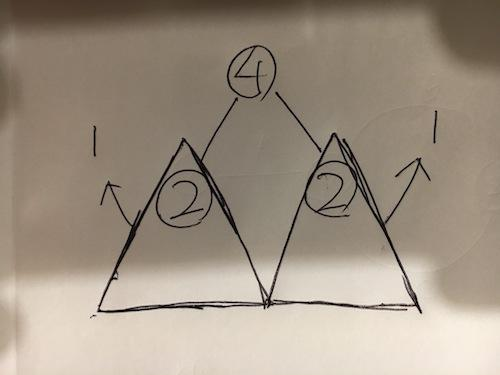

# 【Video】Give me 10 minutes - How we think about a solution - Python, JavaScript, Java, C++

**Author:** niits
**Votes:** 60
**Link:** [https://leetcode.com/problems/binary-trees-with-factors/solutions/4209156/](https://leetcode.com/problems/binary-trees-with-factors/solutions/4209156/)

---

# Intuition
Use Dynamic Programming

---

# Solution Video

https://youtu.be/LrnKFjcjsqo

\u25A0 Timeline of video
`0:04` Understand question exactly and approach to solve this question
`1:33` How can you calculate number of subtrees?
`4:12` Demonstrate how it works
`8:40` Coding
`11:32` Time Complexity and Space Complexity

### \u2B50\uFE0F\u2B50\uFE0F Don't forget to subscribe to my channel! \u2B50\uFE0F\u2B50\uFE0F

**\u25A0 Subscribe URL**
http://www.youtube.com/channel/UC9RMNwYTL3SXCP6ShLWVFww?sub_confirmation=1

Subscribers: 2,831
My initial goal is 10,000
Thank you for your support!

---

# Approach

## How we think about a solution

First of all, Let's understand question exactly.

```
input: [2,3,4]
```
When input is `[2,3,4]`, we can create a binary tree. This is one of examples.
```
   24
  /  \\
 2    12
      / \\
     3   4

Each number may be used for any number of times.
24 comes from 2 * 12
2 comes from 2
12 comes from 3 * 4
3 comes from 3
4 comes from 4
```

All we have to do is to count this kind of tree we can make with input array. But difficulty is we don't know we will have `24` or `12` in the end. Do you calculate them one by one?

Actually, you don't have to calculate them exactly. Then how do we calculate them? We can take another approach.

---

\u2B50\uFE0F Points

We need to calculate number of subtree when each input number is root. 

Let's say we have 3 subtrees for some root number and 5 subtrees for the other root number. In that case, total number of trees are 8. Because each number may be used for any number of times, we can use any number for root or children.

---

- How can you calculate number of subtrees?

We have to multiply both sides of children for each non-leaf node. At least we can say

---

\u2B50\uFE0F Points

The number of the root must be a multiple of the current number. For example, root is `10`, current left child number is `5`. In that case there is possibiilty that we can create one of subtrees.

We can check it easily with 0 remainder.

```[]
if root % factor == 0
```

---

But we have one more important thing. Root is `10` and current left child number is `5`. In that case, what number do we need for right child number? Easy right? It's `2`

So, if we have node of value `2`, we can create at least one of subtrees.

---

\u2B50\uFE0F Points

We need to check if we have a number we need right now. Simply you can calculate it by division.

```[]
root // factor
```

in the end,

**number of subtree of the root = subtree of left side * subtree of right side**

root 10 = number of subtree of 5 * number of subtree of 2 + 1

- Why +1?

That's because we can definitely create subtree of only 10. so in real solution code, we initialize each number of subtree with 1, so we don't write `+1` in solution code. 

---


From the above idea, we need to keep previous numbers for future numbers, so seems like we can use Dynamic Programming.

## How it works

Let's think about this case again.

```
input: [2,3,4]
```

When `2` is root. the rest of numbers are bigger than `2`. so we can create only `[2]`. subtree below is `HashMap`.

```
subtree = {2: 1}

key: root number
value: number of subtrees
```

How about root is `3`. `2` and `4` doesn't meet this codition.

```
if root(3) % factor(2 or 4) == 0
```
So, we will have only `[3]`.
```
subtree = {2: 1, 3: 1}
```

How about root is `4`. `2` meet the codition above, because we can create 

```
   4
  /  \\
 2    2

of course we can create subtree of only 4
```

Do you remember this point?

---

\u2B50\uFE0F Points

number of subtree of the root = subtree of left side * subtree of right side

---

So,

```[]
subtree[root] += subtree[factor] * subtree[root // factor]
\u2193
subtree[4] += subtree[2](=1) * subtree[4 // 2](=1)
\u2193
subtree[4] = 2 

all number of subtrees are initilized with 1,
bacause of subtree of only root itself. We can definitely create it.
In this case, 1 + 1 = 2

```

```
subtree = {2: 1, 3: 1, 4: 2}
```
```
Output: 4 (1 + 1 + 2)
```


---


## Visualization to understand easily and deeply

To understand easily and deeply. Let me explain this.
```[]
subtree[4] += subtree[2](=1) * subtree[4 // 2](=1)
```


 My shadow... lol

When root is `4`, the `4` has two `2` nodes on the left and right side. In that case, Look at each triangle that has root 2 on left and right side.

```
subtree = {2: 1, 3: 1}
```

We know that if we have root 2 node, we can create only 1 subtree when input array is `[2,3,4]`(Look at `HashMap` above), so in the triangle parts, we can create 1 subtree from left triangle and 1 subtree from right triangle. That's why combination of the left side and right side should be `1 * 1 = 1`. Then add `+1` for the case where subtree of only root 4 itself.

In the end `1 + 1 = 2`.

If we have 2 subtrees on the right side. we can create 1 * 2 combinations.
```
left side
subtree A

right side
subtree B
subtree C

all combinations of left and right should be AB and AC (= 1 * 2)
```
If we have 2 subtrees on the left and right side. we can create 2 * 2 combinations.
```
left side
subtree A
subtree D

right side
subtree B
subtree C

all combinations of left and right should be 
AB, AC, DB, DC (= 2 * 2)

```

Easy\uD83D\uDE06


This idea comes from a solution for unique binary search tree problem. I have a video. I took it last year.

https://youtu.be/bTEcK_dh9QM

I hope you understand main idea.
Let's see real algorithm!

I'm rushed a little bit because I have a school event for my kids today. If I mistake something, let me know. Thank you!

##### Algorithm Overview:
The algorithm aims to calculate the number of binary trees that can be formed using the elements in the input list `arr`, considering each element as a potential root. The result should be returned modulo `10^9 + 7`.

##### Detailed Explanation:
1. Sort the input list `arr` in ascending order.
   - This ensures that elements are processed in ascending order, which is crucial for the dynamic programming approach used.

2. Initialize an empty dictionary called `subtree` to keep track of the number of binary trees that can be formed with each element as the root.
   - The keys of this dictionary will be the elements in `arr`, and the values will represent the number of binary trees that can be formed with the respective element as the root.

3. Iterate through the sorted elements in `arr` with the variable `root`:
   a. Initialize the `subtree` count for the current `root` to 1.
      - This accounts for the possibility that the current element itself can be a single-node binary tree.

4. Nested loop: Iterate through the elements in `arr` with the variable `factor`. This loop checks each element as a potential child node for the current `root`:
   a. If `factor` is greater than or equal to the current `root`, exit the loop.
      - This is because factors should be smaller than the root.
   b. Check if the current `root` is divisible by `factor` (i.e., `root % factor == 0`) and if the result of the division (`root // factor`) is already present in the `subtree` dictionary.
      - If both conditions are met, it means `factor` can be a child node of the current `root`.

5. If the conditions in step 4 are met, update the `subtree` count for the current `root`:
   a. Increment the `subtree` count for the current `root` by multiplying the `subtree` count of the `factor` by the `subtree` count of the division result (`root // factor`).
      - This update accounts for the number of binary trees that can be formed with the current `root`.

6. After processing all elements in the nested loop, you have calculated the number of binary trees that can be formed with the current `root` as the root node.

7. The outer loop continues to the next `root` element, and the process repeats.

8. Once all elements in `arr` have been processed, the `subtree` dictionary contains the number of binary trees that can be formed with each element as the root.

9. Calculate the `total_trees` by summing up the values in the `subtree` dictionary.

10. Finally, return `total_trees` modulo `(10^9 + 7)` to ensure the result is within the specified range.

In summary, this code iterates through the elements of `arr` while keeping track of the number of binary trees that can be formed with each element as the root node, taking advantage of previously calculated values for smaller factors.


# Complexity
- Time complexity: $$O(n^2)$$

Sorting the arr list takes $$O(n log n)$$ time, where "n" is the number of elements in the list.

The two nested loops iterate through the elements in arr. In the worst case, both loops will iterate over all elements. Therefore, the time complexity of this part is $$O(n^2)$$.


- Space complexity: $$O(n)$$

The subtree dictionary stores values for each element in arr, so it has a space complexity of $$O(n)$$ to store the results for each element.

The other variables used in the code, such as root, factor, and total_trees, have constant space complexity and do not depend on the input size.

```python []
class Solution:
    def numFactoredBinaryTrees(self, arr: List[int]) -> int:
        arr.sort()
        subtree = {}

        for root in arr:
            subtree[root] = 1

            for factor in arr:
                if factor >= root:
                    break
            
                if root % factor == 0 and root // factor in subtree:
                    subtree[root] += subtree[factor] * subtree[root // factor]

        total_trees = sum(subtree.values())
        return total_trees % (10**9 + 7)       
```
```javascript []
/**
 * @param {number[]} arr
 * @return {number}
 */
var numFactoredBinaryTrees = function(arr) {
    arr.sort((a, b) => a - b);
    const subtreeCount = {};

    for (const root of arr) {
        subtreeCount[root] = 1;

        for (const factor of arr) {
            if (factor >= root) {
                break;
            }

            if (root % factor === 0 && subtreeCount[root / factor]) {
                subtreeCount[root] += subtreeCount[factor] * subtreeCount[root / factor];
            }
        }
    }

    let totalTrees = 0;
    for (const key in subtreeCount) {
        totalTrees += subtreeCount[key];
    }

    return totalTrees % (10 ** 9 + 7);    
};
```
```java []
class Solution {
    public int numFactoredBinaryTrees(int[] arr) {
        Arrays.sort(arr);
        Map<Integer, Long> subtreeCount = new HashMap<>();

        for (int root : arr) {
            subtreeCount.put(root, 1L);

            for (int factor : arr) {
                if (factor >= root) {
                    break;
                }

                if (root % factor == 0 && subtreeCount.containsKey(root / factor)) {
                    subtreeCount.put(root, (subtreeCount.get(root) + subtreeCount.get(factor) * subtreeCount.get(root / factor)));
                }
            }
        }

        long totalTrees = 0L;
        for (int key : subtreeCount.keySet()) {
            totalTrees = (totalTrees + subtreeCount.get(key)) % 1_000_000_007;
        }

        return (int) totalTrees;       
    }
}
```
```C++ []
class Solution {
public:
    int numFactoredBinaryTrees(vector<int>& arr) {
        sort(arr.begin(), arr.end());
        unordered_map<long, long> subtreeCount;

        for (long root : arr) {
            subtreeCount[root] = 1;

            for (long factor : arr) {
                if (factor >= root) {
                    break;
                }

                if (root % factor == 0 && subtreeCount.find(root / factor) != subtreeCount.end()) {
                    subtreeCount[root] += subtreeCount[factor] * subtreeCount[root / factor];
                }
            }
        }

        long totalTrees = 0;
        for (const auto& entry : subtreeCount) {
            totalTrees += entry.second;
        }

        return totalTrees % static_cast<int>(pow(10, 9) + 7);        
    }
};
```

- Why do we sort input array?

Sorting the `arr` is done to comply with the constraints specified in the problem. The given constraint is that "each integer arr[i] is strictly greater than 1," which means that there are no integers in `arr` that are less than or equal to 1, and all integers are greater than or equal to 2.

To satisfy this condition, the array is sorted. Sorting the array ensures that the elements are processed in ascending order, from smaller integers to larger ones, which is essential for the effective application of the dynamic programming algorithm.

By sorting the array, you can solve the problem more efficiently, and it allows you to apply dynamic programming recursively, starting with smaller numbers and gradually progressing to larger numbers. This enables an efficient way to find the solution to the problem.


---


If you are not familar with Dynamic Programming. This video might help you to understand it!

https://youtu.be/MUU6tgywdPY

---

Thank you for reading my post.
\u2B50\uFE0F Please upvote it and don't forget to subscribe to my channel!

\u25A0 Subscribe URL
http://www.youtube.com/channel/UC9RMNwYTL3SXCP6ShLWVFww?sub_confirmation=1

### My previous daily coding challenge post and video.

post
https://leetcode.com/problems/k-th-symbol-in-grammar/solutions/4205721/video-give-me-8-minutes-how-we-think-about-solution-python-javascript-java-c/

video
https://youtu.be/cCN38sMai-c

\u25A0 Timeline of the video
`0:04` Important Rules
`0:17` How can you find the answer
`1:13` How can you find the parent of the target pair
`3:05` How can you know 0 or 1 in the target pair
`3:40` How can you calculate the first position and the second position in the target pair
`5:34` Coding
`7:56` Time Complexity and Space Complexity


