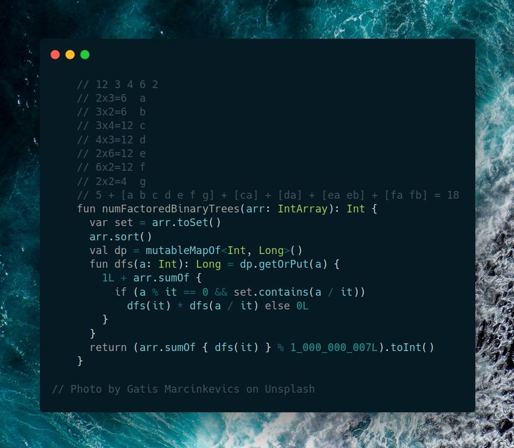

# Kotlin | dfs + memo

**Author:** SamoylenkoDmitry
**Votes:** 1
**Link:** [https://leetcode.com/problems/binary-trees-with-factors/solutions/4209575/](https://leetcode.com/problems/binary-trees-with-factors/solutions/4209575/)

---



#### Join me on Telegram

https://t.me/leetcode_daily_unstoppable/382

#### Problem TLDR

Number of trees from `arr` where each `k` node has `i` and `j` leafs `arr[k]=arr[j]*arr[i]`

#### Intuition

By naive intuition we can walk array in `n^2` manner and collect all the matching multiplications. However, there is a nested depth, and we need a law how to add this to the result.

Let's observe the pattern:

```kotlin
    // 12 3 4 6 2
    // 2x3=6  a
    // 3x2=6  b
    // 3x4=12 c
    // 4x3=12 d
    // 2x6=12 e
    // 6x2=12 f
    // 2x2=4  g
    // 5 + [a b c d e f g] + [ca] + [da] + [ea eb] + [fa fb] = 18
```
If we start from node `e` we must include both `a` and `b`. The equation becomes: `f(k)=SUM(f(i)*f(j))`. For node `e`: `k=12, i=2, j=6, f(12)=f(2)*f(6), f(6)=f(3)*f(2) + f(2)*f(3)=2`

If we sort the array, we will make sure, lower values are calculated.

We can think about this like a graph: `2x3->6->12`

#### Approach

Calculate each array values individually using DFS + memo, then sum.

#### Complexity

- Time complexity:
$$O(n^2)$$

- Space complexity:
$$O(n^2)$$

#### Code

```kotlin

    fun numFactoredBinaryTrees(arr: IntArray): Int {
      var set = arr.toSet()
      arr.sort()
      val dp = mutableMapOf<Int, Long>()
      fun dfs(a: Int): Long = dp.getOrPut(a) {
        1L + arr.sumOf {
          if (a % it == 0 && set.contains(a / it))
            dfs(it) * dfs(a / it) else 0L
        }
      }
      return (arr.sumOf { dfs(it) } % 1_000_000_007L).toInt()
    }

```