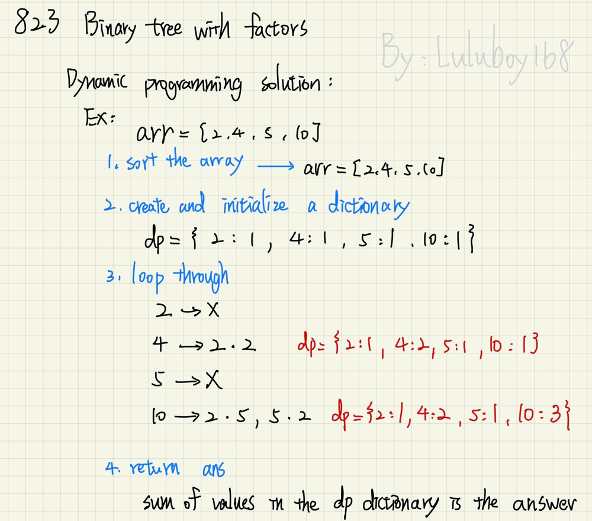
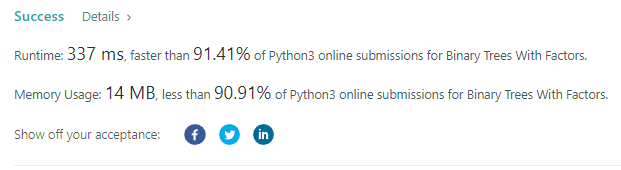

# Python DP detailed explantion | dictionary | T/M: 91.4%/90.9% | easy to understand ^_^

**Author:** luluboy168
**Votes:** 77
**Link:** [https://leetcode.com/problems/binary-trees-with-factors/solutions/2400030/](https://leetcode.com/problems/binary-trees-with-factors/solutions/2400030/)

---

1.sort the array in ascending order
2.create a dictionary and initialize it
3.loop through the data
4.return sum of values

Take this for example:
	`arr = [2, 4, 5, 10] `


Code:
```
class Solution:
    def numFactoredBinaryTrees(self, arr: List[int]) -> int:
        
        arr.sort()
        MOD = 10**9 + 7
        
        # create a dictionary and initialize
        dp = {}
        for n in arr:
            dp[n] = 1
            
        # loop through each number
        for i, n in enumerate(arr):
            for j in range(i):
                if not(n % arr[j]) and n // arr[j] in dp:
                    dp[n] += dp[arr[j]] * dp[n//arr[j]]
                    dp[n] %= MOD
        
        return sum(dp.values()) % MOD
```
**Please UPVOTE if you LIKE !!!**

