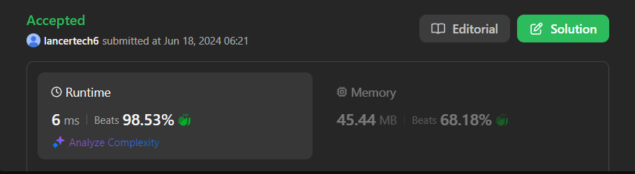

# ✅Beats 100% -Explained with [ Video ] -C++/Java/Python/JS -DP -Interview Solution

**Author:** lancertech6
**Votes:** 142
**Link:** [https://leetcode.com/problems/most-profit-assigning-work/solutions/5329650/](https://leetcode.com/problems/most-profit-assigning-work/solutions/5329650/)

---




# YouTube Video Explanation:

<!-- **If you want a video for this question please write in the comments** -->

https://youtu.be/vL6ZbaP9API


**\uD83D\uDD25 Please like, share, and subscribe to support our channel's mission of making complex concepts easy to understand.**

Subscribe Link: https://www.youtube.com/@leetlogics/?sub_confirmation=1

*Subscribe Goal: 2100 Subscribers*
*Current Subscribers: 2040*

---
# Intuition
<!-- Describe your first thoughts on how to solve this problem. -->
The problem requires assigning the most profitable jobs to workers based on their ability to handle the job difficulty. Each worker can complete only one job, and each job can be completed multiple times by different workers. To maximize the total profit, we need to ensure that each worker is assigned the most profitable job they can complete given their skill level.

# Approach
<!-- Describe your approach to solving the problem. -->
1. **Initialization**: 
   - Determine the maximum job difficulty.
   - Initialize a `maxProfitUpToDifficulty` array to store the maximum profit for each difficulty level up to the maximum difficulty.

2. **Fill the Profit Lookup Table**:
   - For each job, update the `maxProfitUpToDifficulty` array to ensure it holds the maximum profit for the given difficulty.
   - Convert the `maxProfitUpToDifficulty` array to a cumulative maximum profit array, where each index `i` will have the maximum profit possible for difficulties from `0` to `i`.

3. **Calculate Total Profit**:
   - For each worker, use their ability to look up the corresponding maximum profit from the `maxProfitUpToDifficulty` array and sum up the total profit.

# Complexity
- **Time Complexity**: \\( O(n + m + d) \\), where \\( n \\) is the number of jobs, \\( m \\) is the number of workers, and \\( d \\) is the maximum difficulty.
- **Space Complexity**: \\( O(d) \\) for the `maxProfitUpToDifficulty` array.

---

# Step by Step Explanation


#### Step 1: Identify Maximum Difficulty

First, we find the maximum difficulty among all jobs to determine the size of our dynamic programming (DP) array.

```java
int maxDifficulty = 0;
for (int d : difficulty) {
    maxDifficulty = Math.max(maxDifficulty, d);
}
```

| Job | Difficulty |
|-----|------------|
| 1   | 2          |
| 2   | 4          |
| 3   | 6          |
| 4   | 8          |
| 5   | 10         |

- `maxDifficulty = 10`

---

#### Step 2: Create Profit Lookup Table

Create an array `maxProfitUpToDifficulty` where each index represents the maximum profit obtainable for that difficulty.

```java
int[] maxProfitUpToDifficulty = new int[maxDifficulty + 1];
for (int i = 0; i < difficulty.length; i++) {
    maxProfitUpToDifficulty[difficulty[i]] = Math.max(maxProfitUpToDifficulty[difficulty[i]], profit[i]);
}
```

| Difficulty | Profit | maxProfitUpToDifficulty |
|------------|--------|-------------------------|
| 2          | 10     | 10                      |
| 4          | 20     | 20                      |
| 6          | 30     | 30                      |
| 8          | 40     | 40                      |
| 10         | 50     | 50                      |

---

#### Step 3: Convert to Cumulative Maximum Profit

Update the `maxProfitUpToDifficulty` array to ensure each index `i` contains the maximum profit possible for difficulties from `0` to `i`.

```java
for (int i = 1; i <= maxDifficulty; i++) {
    maxProfitUpToDifficulty[i] = Math.max(maxProfitUpToDifficulty[i], maxProfitUpToDifficulty[i - 1]);
}
```

| Difficulty | maxProfitUpToDifficulty (Cumulative) |
|------------|--------------------------------------|
| 0          | 0                                    |
| 1          | 0                                    |
| 2          | 10                                   |
| 3          | 10                                   |
| 4          | 20                                   |
| 5          | 20                                   |
| 6          | 30                                   |
| 7          | 30                                   |
| 8          | 40                                   |
| 9          | 40                                   |
| 10         | 50                                   |

---

#### Step 4: Calculate Total Profit

For each worker, determine the maximum profit they can earn using the `maxProfitUpToDifficulty` array.

```java
int totalProfit = 0;
for (int ability : worker) {
    if (ability > maxDifficulty) {
        totalProfit += maxProfitUpToDifficulty[maxDifficulty];
    } else {
        totalProfit += maxProfitUpToDifficulty[ability];
    }
}
```

| Worker Ability | Max Profit |
|----------------|------------|
| 4              | 20         |
| 5              | 20         |
| 6              | 30         |
| 7              | 30         |

- **Total Profit**: `20 + 20 + 30 + 30 = 100`

---

# Code
```java []
class Solution {
    public int maxProfitAssignment(int[] difficulty, int[] profit, int[] worker) {
        int maxDifficulty = 0;
        for (int d : difficulty) {
            maxDifficulty = Math.max(maxDifficulty, d);
        }

        int[] maxProfitUpToDifficulty = new int[maxDifficulty + 1];
        for (int i = 0; i < difficulty.length; i++) {
            maxProfitUpToDifficulty[difficulty[i]] = Math.max(maxProfitUpToDifficulty[difficulty[i]], profit[i]);
        }

        for (int i = 1; i <= maxDifficulty; i++) {
            maxProfitUpToDifficulty[i] = Math.max(maxProfitUpToDifficulty[i], maxProfitUpToDifficulty[i - 1]);
        }

        int totalProfit = 0;
        for (int ability : worker) {
            if (ability > maxDifficulty) {
                totalProfit += maxProfitUpToDifficulty[maxDifficulty];
            } else {
                totalProfit += maxProfitUpToDifficulty[ability];
            }
        }

        return totalProfit;
    }

}
```
```C++ []
class Solution {
public:
    int maxProfitAssignment(vector<int>& difficulty, vector<int>& profit, vector<int>& worker) {
        int maxDifficulty = *max_element(difficulty.begin(), difficulty.end());
        vector<int> maxProfitUpToDifficulty(maxDifficulty + 1, 0);

        for (int i = 0; i < difficulty.size(); ++i) {
            maxProfitUpToDifficulty[difficulty[i]] = max(maxProfitUpToDifficulty[difficulty[i]], profit[i]);
        }

        for (int i = 1; i <= maxDifficulty; ++i) {
            maxProfitUpToDifficulty[i] = max(maxProfitUpToDifficulty[i], maxProfitUpToDifficulty[i - 1]);
        }

        int totalProfit = 0;
        for (int ability : worker) {
            if (ability > maxDifficulty) {
                totalProfit += maxProfitUpToDifficulty[maxDifficulty];
            } else {
                totalProfit += maxProfitUpToDifficulty[ability];
            }
        }

        return totalProfit;
    }
};
```
```Python []
class Solution(object):
    def maxProfitAssignment(self, difficulty, profit, worker):
        max_difficulty = max(difficulty)
        max_profit_up_to_difficulty = [0] * (max_difficulty + 1)

        for d, p in zip(difficulty, profit):
            max_profit_up_to_difficulty[d] = max(max_profit_up_to_difficulty[d], p)

        for i in range(1, max_difficulty + 1):
            max_profit_up_to_difficulty[i] = max(max_profit_up_to_difficulty[i], max_profit_up_to_difficulty[i - 1])

        total_profit = 0
        for ability in worker:
            if ability > max_difficulty:
                total_profit += max_profit_up_to_difficulty[max_difficulty]
            else:
                total_profit += max_profit_up_to_difficulty[ability]

        return total_profit
        
```
```JavaScript []
/**
 * @param {number[]} difficulty
 * @param {number[]} profit
 * @param {number[]} worker
 * @return {number}
 */
var maxProfitAssignment = function(difficulty, profit, worker) {
    let maxDifficulty = Math.max(...difficulty);
    let maxProfitUpToDifficulty = new Array(maxDifficulty + 1).fill(0);

    for (let i = 0; i < difficulty.length; i++) {
        maxProfitUpToDifficulty[difficulty[i]] = Math.max(maxProfitUpToDifficulty[difficulty[i]], profit[i]);
    }

    for (let i = 1; i <= maxDifficulty; i++) {
        maxProfitUpToDifficulty[i] = Math.max(maxProfitUpToDifficulty[i], maxProfitUpToDifficulty[i - 1]);
    }

    let totalProfit = 0;
    for (let ability of worker) {
        if (ability > maxDifficulty) {
            totalProfit += maxProfitUpToDifficulty[maxDifficulty];
        } else {
            totalProfit += maxProfitUpToDifficulty[ability];
        }
    }

    return totalProfit;
};
```

