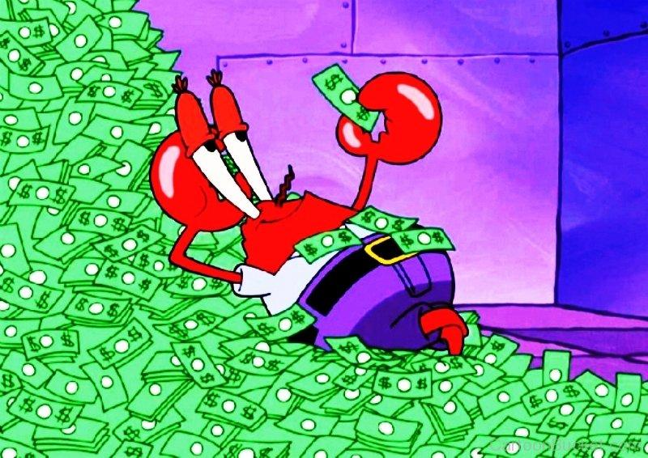

# Greedy | 100% Faster

**Author:** gameboey
**Votes:** 47
**Link:** [https://leetcode.com/problems/most-profit-assigning-work/solutions/5331464/](https://leetcode.com/problems/most-profit-assigning-work/solutions/5331464/)

---


# Intuition
Sort jobs and workers, then iteratively assign the maximum profit each worker can achieve with available jobs, accumulating the total achievable profit.

# Approach
- Pair each job's difficulty with its profit.
- Sort jobs by difficulty and workers by ability.
- Iterate through workers, finding the maximum profit they can achieve with available jobs.
- Accumulate the maximum profits to get the total achievable profit.
- Sorting ensures efficient pairing of workers with jobs based on their abilities and job difficulties.

# Complexity
- Time complexity: O(nlogn)

- Space complexity: O(n)

# Code
```C++ []
#define sort(a) sort(begin(a), end(a))
#define opt() ios::sync_with_stdio(0);cin.tie(0);cout.tie(0);

class Solution {
public:
    int maxProfitAssignment(vector<int>& difficulty, vector<int>& profit, vector<int>& worker) {
        opt();
        int res = 0, j = 0, best = 0;
        vector<pair<int, int>> temp;
        for(int i = 0; i < difficulty.size(); ++i) {
            temp.push_back({difficulty[i], profit[i]});
        }

        sort(temp); sort(worker);
        for(int work : worker) {
            while(j < worker.size() && work >= temp[j].first) {
                best = max(best, temp[j].second);
                j++;
            }
            
            res += best;
        }

        return res;
    }
};
```
```java []
class Solution {
    public int maxProfitAssignment(int[] difficulty, int[] profit, int[] worker) {
        int res = 0, j = 0, best = 0;
        List<Pair<Integer, Integer>> temp = new ArrayList<>();
        
        for (int i = 0; i < difficulty.length; ++i) {
            temp.add(new Pair<>(difficulty[i], profit[i]));
        }
        
        temp.sort((a, b) -> a.getKey() - b.getKey());
        Arrays.sort(worker);
        
        for (int work : worker) {
            while (j < worker.length && work >= temp.get(j).getKey()) {
                best = Math.max(best, temp.get(j++).getValue());
            }
            
            res += best;
        }
        
        return res;
    }
}
```
```python []
class Solution:
    def maxProfitAssignment(self, difficulty: List[int], profit: List[int], worker: List[int]) -> int:
        res, j, best, temp = 0, 0, 0, []
        
        for i in range(len(difficulty)):
            temp.append((difficulty[i], profit[i]))
        
        temp.sort()
        worker.sort()
        
        for work in worker:
            while j < len(worker) and work >= temp[j][0]:
                best = max(best, temp[j][1])
                j += 1
            
            res += best
        
        return res
```
```javascript []
/**
 * @param {number[]} difficulty
 * @param {number[]} profit
 * @param {number[]} worker
 * @return {number}
 */
var maxProfitAssignment = function(difficulty, profit, worker) {
    let res = 0, j = 0, best = 0, temp = [];
    
    for (let i = 0; i < difficulty.length; ++i) {
        temp.push([difficulty[i], profit[i]]);
    }
    
    temp.sort((a, b) => a[0] - b[0]);
    worker.sort((a, b) => a - b);
    
    for (let work of worker) {
        while (j < worker.length && work >= temp[j][0]) {
            best = Math.max(best, temp[j][1]);
            j++;
        }
        
        res += best;
    }
    
    return res;
};
```
```Go []
func maxProfitAssignment(difficulty []int, profit []int, worker []int) int {
    res, j, best := 0, 0, 0
    temp := make([]pair, len(difficulty))

    for i := range difficulty {
        temp[i] = pair{difficulty[i], profit[i]}
    }

    sort.Slice(temp, func(i, j int) bool {
        return temp[i].difficulty < temp[j].difficulty
    })
    sort.Ints(worker)

    for _, work := range worker {
        for j < len(worker) && work >= temp[j].difficulty {
            best = max(best, temp[j].profit)
            j++
        }
        res += best
    }

    return res
}

type pair struct {
    difficulty, profit int
}
```


---

**Arg arg arg arg! You couldn't maximize profit if a dollar walked up and bit you on the nose! Why don't you just stick to counting the pennies in the leave-a-penny tray?**




