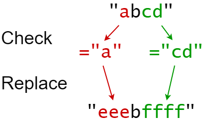
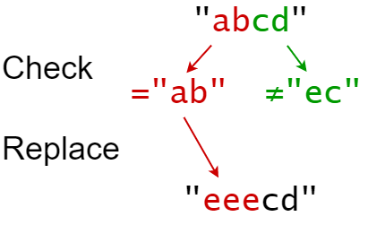

# [833. Find And Replace in String](https://leetcode.com/problems/find-and-replace-in-string/)

| Category | Difficulty | Likes | Dislikes |
| :------: | :--------: | :---: | :------: |
| Algorithms | Medium | 1231 | 1046 |

**Tags:** [`array`](https://leetcode.com/tag/array), [`hash-table`](https://leetcode.com/tag/hash-table), [`string`](https://leetcode.com/tag/string), [`sorting`](https://leetcode.com/tag/sorting)

**Companies:** `google`

## Description

You are given a **0-indexed** string `s` that you must perform `k` replacement operations on. The replacement operations are given as three **0-indexed** parallel arrays, `indices`, `sources`, and `targets`, all of length `k`.

To complete the `i^th` replacement operation:

	- Check if the **substring** `sources[i]` occurs at index `indices[i]` in the **original string** `s`.

	- If it does not occur, **do nothing**.

	- Otherwise if it does occur, **replace** that substring with `targets[i]`.

For example, if `s = "abcd"`, `indices[i] = 0`, `sources[i] = "ab"`, and `targets[i] = "eee"`, then the result of this replacement will be `"eeecd"`.

All replacement operations must occur **simultaneously**, meaning the replacement operations should not affect the indexing of each other. The testcases will be generated such that the replacements will **not overlap**.

	- For example, a testcase with `s = "abc"`, `indices = [0, 1]`, and `sources = ["ab","bc"]` will not be generated because the `"ab"` and `"bc"` replacements overlap.

Return *the **resulting string** after performing all replacement operations on *`s`.

A **substring** is a contiguous sequence of characters in a string.

 

**Example 1:**


```

Input: s = &quot;abcd&quot;, indices = [0, 2], sources = [&quot;a&quot;, &quot;cd&quot;], targets = [&quot;eee&quot;, &quot;ffff&quot;]
Output: &quot;eeebffff&quot;
Explanation:
&quot;a&quot; occurs at index 0 in s, so we replace it with &quot;eee&quot;.
&quot;cd&quot; occurs at index 2 in s, so we replace it with &quot;ffff&quot;.

```

**Example 2:**


```

Input: s = &quot;abcd&quot;, indices = [0, 2], sources = [&quot;ab&quot;,&quot;ec&quot;], targets = [&quot;eee&quot;,&quot;ffff&quot;]
Output: &quot;eeecd&quot;
Explanation:
&quot;ab&quot; occurs at index 0 in s, so we replace it with &quot;eee&quot;.
&quot;ec&quot; does not occur at index 2 in s, so we do nothing.

```

 

**Constraints:**

	- `1 <= s.length <= 1000`

	- `k == indices.length == sources.length == targets.length`

	- `1 <= k <= 100`

	- `0 <= indexes[i] < s.length`

	- `1 <= sources[i].length, targets[i].length <= 50`

	- `s` consists of only lowercase English letters.

	- `sources[i]` and `targets[i]` consist of only lowercase English letters.

---

**Links:** [Submissions](https://leetcode.com/problems/find-and-replace-in-string/) | [Solutions](https://leetcode.com/problems/find-and-replace-in-string/)
