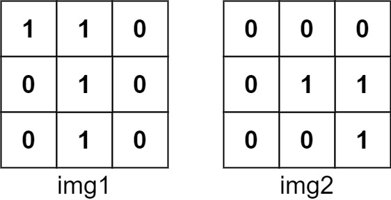

# [835. Image Overlap](https://leetcode.com/problems/image-overlap/)

| Category | Difficulty | Likes | Dislikes |
| :------: | :--------: | :---: | :------: |
| Algorithms | Medium | 1395 | 504 |

**Tags:** [`array`](https://leetcode.com/tag/array), [`matrix`](https://leetcode.com/tag/matrix)

**Companies:** `google`

## Description

You are given two images, `img1` and `img2`, represented as binary, square matrices of size `n x n`. A binary matrix has only `0`s and `1`s as values.

We **translate** one image however we choose by sliding all the `1` bits left, right, up, and/or down any number of units. We then place it on top of the other image. We can then calculate the **overlap** by counting the number of positions that have a `1` in **both** images.

Note also that a translation does **not** include any kind of rotation. Any `1` bits that are translated outside of the matrix borders are erased.

Return *the largest possible overlap*.

 

**Example 1:**


```

Input: img1 = [[1,1,0],[0,1,0],[0,1,0]], img2 = [[0,0,0],[0,1,1],[0,0,1]]
Output: 3
Explanation: We translate img1 to right by 1 unit and down by 1 unit.

The number of positions that have a 1 in both images is 3 (shown in red).


```

**Example 2:**

```

Input: img1 = [[1]], img2 = [[1]]
Output: 1

```

**Example 3:**

```

Input: img1 = [[0]], img2 = [[0]]
Output: 0

```

 

**Constraints:**

	- `n == img1.length == img1[i].length`

	- `n == img2.length == img2[i].length`

	- `1 <= n <= 30`

	- `img1[i][j]` is either `0` or `1`.

	- `img2[i][j]` is either `0` or `1`.

---

**Links:** [Submissions](https://leetcode.com/problems/image-overlap/) | [Solutions](https://leetcode.com/problems/image-overlap/)
