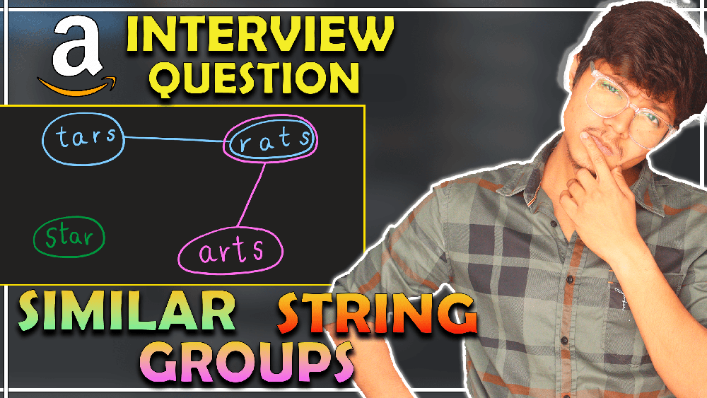
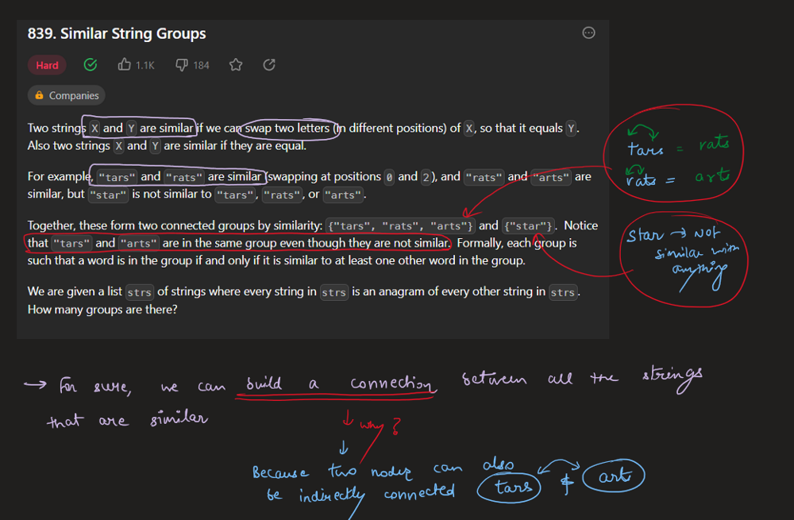
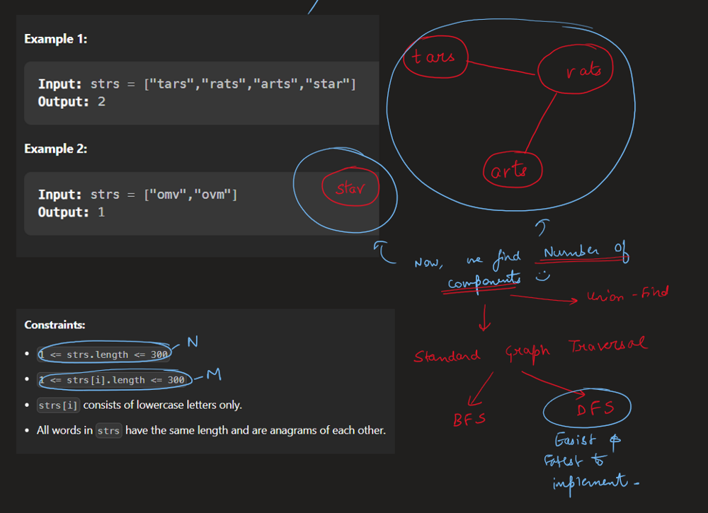
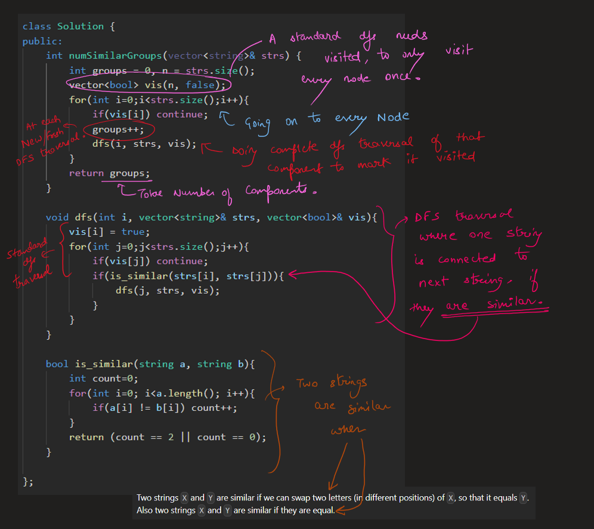
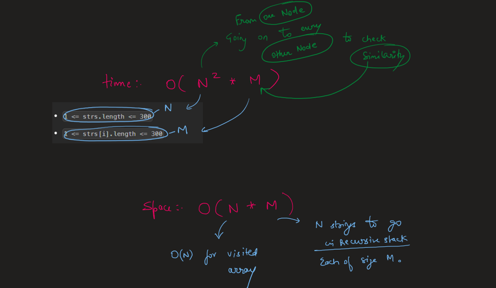

# Image Explanation🏆- [Easy to Understand  & Concise] - C++/Java/Python

**Author:** lc00701
**Votes:** 53
**Link:** [https://leetcode.com/problems/similar-string-groups/solutions/3462133/](https://leetcode.com/problems/similar-string-groups/solutions/3462133/)

---

# Video Solution (`Aryan Mittal`) - Link in LeetCode Profile
`Similar String Groups` by `Aryan Mittal`



# Approach & Intution






# Code
```C++ []
class Solution {
public:
    int numSimilarGroups(vector<string>& strs) {
        int groups = 0, n = strs.size();
        vector<bool> vis(n, false);
        for(int i=0;i<strs.size();i++){
            if(vis[i]) continue;
            groups++;
            dfs(i, strs, vis);
        }
        return groups;
    }

    void dfs(int i, vector<string>& strs, vector<bool>& vis){
        vis[i] = true;
        for(int j=0;j<strs.size();j++){
            if(vis[j]) continue;
            if(is_similar(strs[i], strs[j])){
                dfs(j, strs, vis);
            }
        }
    }

    bool is_similar(string a, string b){
        int count=0;
        for(int i=0; i<a.length(); i++){
            if(a[i] != b[i]) count++;
        }
        return (count == 2 || count == 0);
    }

};
```
```Java []
class Solution {
    public int numSimilarGroups(String[] strs) {
        int groups = 0, n = strs.length;
        boolean[] vis = new boolean[n];
        for(int i = 0; i < strs.length; i++){
            if(vis[i]) continue;
            groups++;
            dfs(i, strs, vis);
        }
        return groups;
    }

    void dfs(int i, String[] strs, boolean[] vis){
        vis[i] = true;
        for(int j = 0; j < strs.length; j++){
            if(vis[j]) continue;
            if(isSimilar(strs[i], strs[j])){
                dfs(j, strs, vis);
            }
        }
    }

    boolean isSimilar(String a, String b){
        int count = 0;
        for(int i = 0; i < a.length(); i++){
            if(a.charAt(i) != b.charAt(i)) count++;
        }
        return (count == 2 || count == 0);
    }
}
```
```Python []
class Solution:
    def numSimilarGroups(self, strs: List[str]) -> int:
        groups = 0
        n = len(strs)
        vis = [False] * n
        for i in range(n):
            if vis[i]: continue
            groups += 1
            self.dfs(i, strs, vis)
        return groups

    def dfs(self, i: int, strs: List[str], vis: List[bool]) -> None:
        vis[i] = True
        for j in range(len(strs)):
            if vis[j]: continue
            if self.is_similar(strs[i], strs[j]):
                self.dfs(j, strs, vis)

    def is_similar(self, a: str, b: str) -> bool:
        count = 0
        for i in range(len(a)):
            if a[i] != b[i]: count += 1
        return count == 2 or count == 0
```
