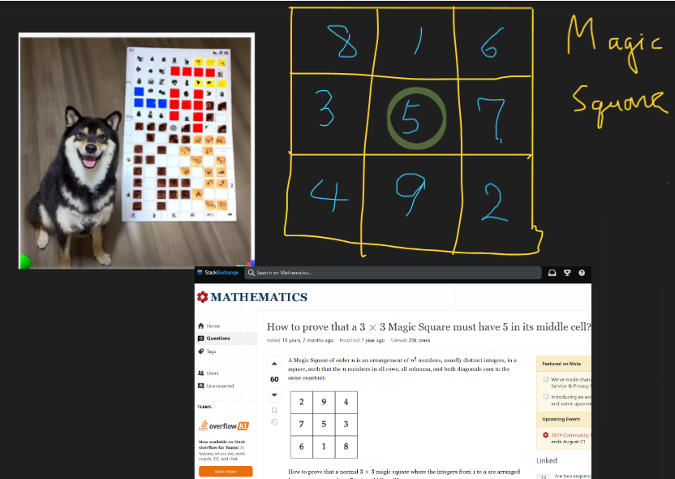

# Magic square has 5 in middle||beats 100%

**Author:** anwendeng
**Votes:** 52
**Link:** [https://leetcode.com/problems/magic-squares-in-grid/solutions/5609811/](https://leetcode.com/problems/magic-squares-in-grid/solutions/5609811/)

---

# Intuition
<!-- Describe your first thoughts on how to solve this problem. -->
3x3 Magic square has 5 in the middle.
Use this fact to save computational time.

2nd approach uses the fact evens must be in corners & center is 5! The code becomes simpler.
# Approach
<!-- Describe your approach to solving the problem. -->
[Please turn English subtitles if necessary]
[https://youtu.be/12AAhXrKhA8?si=6rXF5CfEWyeSXc0g](https://youtu.be/12AAhXrKhA8?si=6rXF5CfEWyeSXc0g)
1. Define the function `bool isMagic(int i, int j, vector<vector<int>>& grid)`to check the submatrix.
3. Using `bitset<10> once` to record whether 1~9 are used just once.
4. Traverse the 3x3 submatrix `grid[i-1:i+2][j-1:j+2]` to compute `rowSum[3], colSum[3]` & to record `once`.
5. Check `once, rowSum[3], colSum[3]`, when not expected, return false.
6. Check if 2 diagonals sum to 15
7. In the function `int numMagicSquaresInside(vector<vector<int>>& grid)`, use loop if grid[i][j]==5, `cnt+=isMagic(i, j, grid)`
8. `cnt` is the answer

# In fact there are only 8 different 3x3 magic squares. 
Each one is either a rotation or reflection of other! Using this fact can give other solutions. Evens are always in the corners.

If the 4 corner numbers are determined, the 3x3 magic square is unique determined. 2nd C++ implements this. 

# Complexity
- Time complexity:
<!-- Add your time complexity here, e.g. $$O(n)$$ -->
$$O(r\\cdot c)$$
- Space complexity:
<!-- Add your space complexity here, e.g. $$O(n)$$ -->
$$O(r\\cdot c)$$
# Code|| C++ 0ms beats 100%
```C++ []
class Solution {
public:
    static bool isMagic(int i, int j, vector<vector<int>>& grid){
    //    if (grid[i][j] != 5) return 0;

        bitset<10> once; // bitset of size 10 to track digits 1-9
        int rowSum[3] = {0}, colSum[3] = {0};

        for(int a=i-1; a <= i+1; a++) {
            for(int b=j-1; b <=j+1; b++) {
                int x= grid[a][b];
                if (x<1 || x>9) return 0; // invalid number for a magic square
                rowSum[a-i+1] += x;
                colSum[b-j+1] += x;
                once.flip(x);
            }
        }
        // numbers 1-9 are present exactly once
        if (once.count() != 9) return 0;

        // all rows and columns sum to 15
        if (!all_of(rowSum, rowSum+3, [](int sum){ return sum == 15; })) return 0;
        if (!all_of(colSum, colSum+3, [](int sum){ return sum == 15; })) return 0;

        // Check if diagonals sum to 15
        return (grid[i-1][j-1]+grid[i+1][j+1]==10 && grid[i+1][j-1]+grid[i-1][j+1]== 10);
    }

    static int numMagicSquaresInside(vector<vector<int>>& grid) {
        const int r = grid.size(), c = grid[0].size();
        if (r < 3 || c < 3) return 0;

        int cnt = 0;
        for(int i = 1; i < r-1; i++) {
            for(int j = 1; j < c-1; j++) {
                if (grid[i][j]==5) 
                    cnt+=isMagic(i, j, grid);
            }
        }
        return cnt;
    }
};


auto init = []() {
    ios::sync_with_stdio(false);
    cin.tie(nullptr);
    cout.tie(nullptr);
    return 'c';
}();
```
```Python []
class Solution:
    def numMagicSquaresInside(self, grid: List[List[int]]) -> int:
        def isMagic(i, j):
            once=[False]*10
            rowSum=[0]*3
            colSum= [0]*3

            for a in range(i-1, i+2):
                for b in range(j-1, j+2):
                    x= grid[a][b]
                    if x < 1 or x > 9: return False
                    rowSum[a-i+1] += x
                    colSum[b-j+1] += x
                    if once[x]: 
                        return False  # it's not unique
                    once[x]=True

            for b in once[1:]: 
                if not b: return False

            for sum in rowSum:
                if sum!=15: return False
            for sum in colSum:
                if sum!=15: return False
            
            return grid[i-1][j-1]+grid[i+1][j+1]==10 and grid[i+1][j-1]+grid[i-1][j+1]==10
        
        r, c = len(grid), len(grid[0])
        if r < 3 or c < 3: 
            return 0

        cnt=0
        for i in range(1, r-1):
            for j in range(1, c-1):
                if grid[i][j] == 5 and isMagic(i, j): 
                    cnt+=1
        return cnt


        
```
# C, C++ using corner number being even & 5 in the middle||0ms beats 100%
```C++ []
class Solution {
public:
    static bool isMagic(int i, int j, int a, int b, int c, int d, 
        vector<vector<int>>& grid){
        // Check sums without through center, In fact like solving linear system
        return (a+grid[i-1][j]+b==15) &&
        (a+grid[i][j-1]+c==15) &&(b+grid[i][j+1]+d==15) &&
        (c+grid[i+1][j]+d==15);
    }

    static int numMagicSquaresInside(vector<vector<int>>& grid) {
        const int r = grid.size(), c = grid[0].size();
        if (r < 3 || c < 3) return 0;

        int cnt = 0;
        for(int i=1; i < r-1; i++) {
            for(int j=1; j < c-1; j++) {
                // center is not 5
                if (grid[i][j]!=5) continue;
                int a=grid[i-1][j-1], b=grid[i-1][j+1], c=grid[i+1][j-1], d=grid[i+1][j+1];
                bitset<16> once=(1<<a)+(1<<b)+(1<<c)+(1<<d)+(1<<5);
                // check diagonals & center, numbers in corner are even
                if (once.count()==5 && (a&1)==0 && a+d==10 && (b&1)==0 && b+c==10 ) 
                    cnt+=isMagic(i, j, a,b,c,d, grid);
            }
        }
        return cnt;
    }
};


auto init = []() {
    ios::sync_with_stdio(false);
    cin.tie(nullptr);
    cout.tie(nullptr);
    return 'c';
}();
```
```C []
#pragma GCC optimize("O3, unroll-loops")
inline bool isMagic(char i, char j, char a, char b, char c, char d, int** grid) {
    // Check sums without through center, In fact like solving linear system
    return (a + grid[i - 1][j] + b == 15) && (a + grid[i][j - 1] + c == 15) &&
           (b + grid[i][j + 1] + d == 15) && (c + grid[i + 1][j] + d == 15);
}

int numMagicSquaresInside(int** grid, int r, int* gridColSize) {
    int c = *gridColSize;
    if (r < 3 || c < 3)
        return 0;

    int cnt = 0;
    for (char i = 1; i < r - 1; i++) {
        for (char j = 1; j < c - 1; j++) {
            // center is not 5
            if (grid[i][j] != 5)
                continue;
            char a = grid[i - 1][j - 1], b = grid[i - 1][j + 1],
                c = grid[i + 1][j - 1], d = grid[i + 1][j + 1];
            uint16_t once = ((1<<2)|(1<<4)|(1<<6)|(1<<8))^
                ((1 << a)|(1 << b) |(1 << c)|(1 << d));
            // check diagonals & center, numbers in corner are even
            if (once==0 && (a & 1) == 0 && a + d == 10 &&
                (b & 1) == 0 && b + c == 10)
                cnt += isMagic(i, j, a, b, c, d, grid);
        }
    }
    return cnt;
}
```