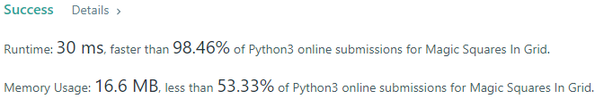
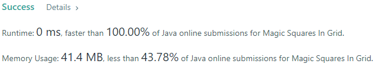
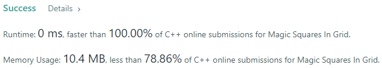
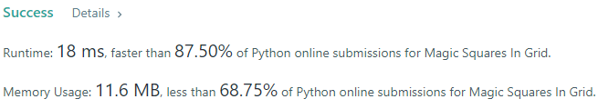
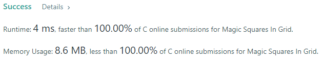
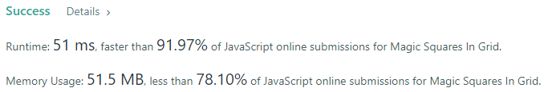

# 💢☠💫Easiest👾Faster✅💯 Lesser🧠 🎯 C++✅Python3🐍✅Java✅C✅Python🐍✅C#✅💥🔥💫Explained☠💥🔥 Beats 💯

**Author:** Edwards310
**Votes:** 4
**Link:** [https://leetcode.com/problems/magic-squares-in-grid/solutions/5614175/](https://leetcode.com/problems/magic-squares-in-grid/solutions/5614175/)

---

# Intuition
<!-- Describe your first thoughts on how to solve this problem. -->







```javascript []
/**
 * @param {number[][]} grid
 * @return {number}
 */
var numMagicSquaresInside = function (grid) {
    const m = grid.length;
    const n = grid[0].length;
    let count = 0;

    if (m < 3 || n < 3) return 0;

    for (let i = 1; i < m - 1; i++) {
        for (let j = 1; j < n - 1; j++) {
            const cortege = new Set([1, 2, 3, 4, 5, 6, 7, 8, 9]);

            const tl = grid[i - 1][j - 1];
            const t = grid[i - 1][j];
            const tr = grid[i - 1][j + 1];
            const r = grid[i][j + 1];
            const br = grid[i + 1][j + 1];
            const b = grid[i + 1][j];
            const bl = grid[i + 1][j - 1];
            const l = grid[i][j - 1];
            const center = grid[i][j];

            cortege.delete(tl);
            cortege.delete(t);
            cortege.delete(tr);
            cortege.delete(r);
            cortege.delete(br);
            cortege.delete(b);
            cortege.delete(bl);
            cortege.delete(l);
            cortege.delete(center);

            if (cortege.size > 0) continue;

            const row1 = tl + t + tr;
            const row2 = l + center + r;
            const row3 = bl + b + br;
            const col1 = tl + l + bl;
            const col2 = t + center + b;
            const col3 = tr + r + br;
            const diagonal1 = tl + center + br;
            const diagonal2 = tr + center + bl;

            if ([row2, row3, col1, col2, col3, diagonal1, diagonal2].every((val) => val === row1)) count++
        }
    }

    return count;
};
```
```C++ []
// Start Of Edwards310's Template...
#pragma GCC optimize("O2")
#include <bits/stdc++.h>
using namespace std;
typedef vector<int> vi;

typedef vector<vi> vvi;

// end of Edwards310's Template
class Solution {
    inline bool isMagic(char i, char j, char a, char b, char c, char d,
                        vvi& grid) {
        return (a + grid[i - 1][j] + b == 15) &&
               (a + grid[i][j - 1] + c == 15) &&
               (b + grid[i][j + 1] + d == 15) && (c + grid[i + 1][j] + d == 15);
    }

public:
    int numMagicSquaresInside(vector<vector<int>>& grid) {
        int r = grid.size();
        int c = grid[0].size();
        if (r < 3 || c < 3)
            return 0;

        int cnt = 0;
        for (char i = 1; i < r - 1; i++) {
            for (char j = 1; j < c - 1; j++) {
                if (grid[i][j] != 5)
                    continue;
                char a = grid[i - 1][j - 1], b = grid[i - 1][j + 1],
                     c = grid[i + 1][j - 1], d = grid[i + 1][j + 1];
                uint16_t once = ((1 << 2) | (1 << 4) | (1 << 6) | (1 << 8)) ^
                                ((1 << a) | (1 << b) | (1 << c) | (1 << d));
                // check diagonals & center, numbers in corner are even
                if (once == 0 && (a & 1) == 0 && a + d == 10 && (b & 1) == 0 &&
                    b + c == 10)
                    cnt += isMagic(i, j, a, b, c, d, grid);
            }
        }
        return cnt;
    }
};
```
```Python3 []
class Solution:
    def numMagicSquaresInside(self, grid: List[List[int]]) -> int:
        size = len(grid)
        possible_grids = [
            [[8, 1, 6], [3, 5, 7], [4, 9, 2]],
            [[6, 1, 8], [7, 5, 3], [2, 9, 4]],
            [[4, 9, 2], [3, 5, 7], [8, 1, 6]],
            [[2, 9, 4], [7, 5, 3], [6, 1, 8]],
            [[8, 3, 4], [1, 5, 9], [6, 7, 2]],
            [[4, 3, 8], [9, 5, 1], [2, 7, 6]],
            [[6, 7, 2], [1, 5, 9], [8, 3, 4]],
            [[2, 7, 6], [9, 5, 1], [4, 3, 8]],
        ]
        ans = 0
        for i in range(0, size - 2):
            for j in range(0, size - 2):
                checking_grid = []
                for k in grid[i : i + 3]:
                    checking_grid.append(k[j : j + 3])
                if checking_grid in possible_grids:
                    ans += 1

        return ans
```
```Java []
class Solution {

    public int numMagicSquaresInside(int[][] grid) {
        int ans = 0;
        int m = grid.length;
        int n = grid[0].length;
        for (int row = 0; row + 2 < m; row++) {
            for (int col = 0; col + 2 < n; col++) {
                if (isMagicSquare(grid, row, col)) {
                    ans++;
                }
            }
        }
        return ans;
    }

    private boolean isMagicSquare(int[][] grid, int row, int col) {
        boolean[] seen = new boolean[10];
        for (int i = 0; i < 3; i++) {
            for (int j = 0; j < 3; j++) {
                int num = grid[row + i][col + j];
                if (num < 1 || num > 9)
                    return false;
                if (seen[num])
                    return false;
                seen[num] = true;
            }
        }

        // check if diagonal sums are same value
        int diagonal1 = grid[row][col] + grid[row + 1][col + 1] + grid[row + 2][col + 2];
        int diagonal2 = grid[row + 2][col] + grid[row + 1][col + 1] + grid[row][col + 2];

        if (diagonal1 != diagonal2)
            return false;

        // check if all row sums share the same value as the diagonal sums
        int row1 = grid[row][col] + grid[row][col + 1] + grid[row][col + 2];
        int row2 = grid[row + 1][col] +
                grid[row + 1][col + 1] +
                grid[row + 1][col + 2];
        int row3 = grid[row + 2][col] +
                grid[row + 2][col + 1] +
                grid[row + 2][col + 2];

        if (!(row1 == diagonal1 && row2 == diagonal1 && row3 == diagonal1)) {
            return false;
        }

        // check if all column sums share same value as the diagonal sums
        int col1 = grid[row][col] + grid[row + 1][col] + grid[row + 2][col];
        int col2 = grid[row][col + 1] +
                grid[row + 1][col + 1] +
                grid[row + 2][col + 1];
        int col3 = grid[row][col + 2] +
                grid[row + 1][col + 2] +
                grid[row + 2][col + 2];

        if (!(col1 == diagonal1 && col2 == diagonal1 && col3 == diagonal2)) {
            return false;
        }

        return true;
    }
}
```
```C []
int numMagicSquaresInside(int** grid, int gridSize, int* gridColSize) {
    int m = gridSize, n = *gridColSize;
    if (m < 3 || n < 3)
        return 0;
    int i, j, k, count = 0;
    for (i = 0; i < m - 2; ++i) {
        for (j = 0; j < n - 2; ++j) {
            count += isMagic(grid, i, j);
        }
    }
    return count;
}
int isMagic(int** grid, int row, int col) {
    bool nums[10] = {};
    int i, j, total, magicTotal = 15;
    for (i = 0; i < 3; ++i) {
        for (j = 0, total = 0; j < 3; ++j) {
            if (grid[i + row][j + col] < 1 || grid[i + row][j + col] > 9 ||
                nums[grid[i + row][j + col]])
                return 0;
            nums[grid[i + row][j + col]] = true;
            total += grid[i + row][j + col];
        }
        if (total != magicTotal)
            return 0;
    }
    for (j = 1; j < 3; ++j) {
        for (i = 0, total = 0; i < 3; ++i) {
            total += grid[i + row][j + col];
        }
        if (total != magicTotal)
            return 0;
    }
    for (i = 0, total = 0; i < 3; ++i) {
        total += grid[i + row][i + col];
    }
    if (total != magicTotal)
        return 0;
    for (i = 0, total = 0; i < 3; ++i) {
        total += grid[i + row][2 - i + col];
    }
    return total == magicTotal;
}
```
```Python []
class Solution(object):
    def numMagicSquaresInside(self, grid):
        """
        :type grid: List[List[int]]
        :rtype: int
        """
        n = len(grid)
        possible_grids = [
            [[8, 1, 6], [3, 5, 7], [4, 9, 2]],
            [[6, 1, 8], [7, 5, 3], [2, 9, 4]],
            [[4, 9, 2], [3, 5, 7], [8, 1, 6]],
            [[2, 9, 4], [7, 5, 3], [6, 1, 8]],
            [[8, 3, 4], [1, 5, 9], [6, 7, 2]],
            [[4, 3, 8], [9, 5, 1], [2, 7, 6]],
            [[6, 7, 2], [1, 5, 9], [8, 3, 4]],
            [[2, 7, 6], [9, 5, 1], [4, 3, 8]],
        ]
        res = 0
        for i in range(0, n - 2):
            for j in range(0, n - 2):
                checking_grid = []
                for k in grid[i : i + 3]:
                    checking_grid.append(k[j : j + 3])
                if checking_grid in possible_grids:
                    res += 1

        return res
```
```C# []
public class Solution {
    private const int _gridSize = 3; // Special values covering the requirements for magic squares.
    private const int _magicSum = 15;
    private const int _minSet = 1;
    private const int _maxSet = 9;

    private const int _rIndex = 0; // Indices for accessing prefix chunk values.
    private const int _cIndex = 1;
    private const int _dIndex = 2;
    private const int _uIndex = 3;
    private const int _entries = 4; //  Total number of entries.
    
    private HashSet<int> _values = new(); // Used during checking if values cover [_minSet, _maxSet] range.

    public int NumMagicSquaresInside(int[][] grid) {
        var rows = grid.Length;
        var cols = grid[0].Length;

        var prefixes = new int[rows + 1, cols + 1][]; // Initialize prefix chunks.
        for(var row = 0; row <= rows; ++row) { prefixes[row, 0] = new int[_entries]; }
        for(var col = 1; col <= cols; ++col) { prefixes[0, col] = new int[_entries]; } // Avoid overlap.

        for(var col = 1; col <= cols; ++col) // Build prefix chunks.
        {
            var cOffset = col - 1;
            for(var row = 1; row <= rows; ++row) // Handle horizontal/vertical/down diag values.
            {
                var rOffset = row - 1;
                var value = grid[rOffset][cOffset];
                var cell = prefixes[row, col] = new int[_entries]; // Create the chunk.
                cell[_rIndex] = prefixes[rOffset, col][_rIndex] + value;
                cell[_cIndex] = prefixes[row, cOffset][_cIndex] + value;
                cell[_dIndex] = prefixes[rOffset, cOffset][_dIndex] + value;
            }
            for(var row = rows - 1; row >= 0; --row) // Need to reverse row direction for up diag values.
            {
                prefixes[row, col][_uIndex] = prefixes[row + 1, cOffset][_uIndex] + grid[row][cOffset];
            }
        }

        var rLim = rows - _gridSize; // Limit the distance the window can be shifted by magic square size.
        var cLim = cols - _gridSize;
        var count = 0;
        for(var row = 0; row <= rLim; ++row) // Iterate over all _gridSize by _gridSize sub-matrices.
        {
            for(var col = 0; col <= cLim; ++col)
            {
                if(IsMagic(row, row + _gridSize, col, col + _gridSize)) { ++count; }
            }
        }
        return count;

        bool IsMagic(int rStart, int rEnd, int cStart, int cEnd)
        {
            // Check if diagonals are valid.
            // (bottom-right - top-left) for down diagonal.
            // (top-right - bottom-left) for up diagonal.
            if(NotMagic(prefixes[rEnd, cEnd], prefixes[rStart, cStart], _dIndex)) { return false; }
            if(NotMagic(prefixes[rStart, cEnd], prefixes[rEnd, cStart], _uIndex)) { return false; }

            // Check if horizontals/verticals are valid.
            for(var row = rStart + 1; row <= rEnd; ++row)
            {
                if(NotMagic(prefixes[row, cEnd], prefixes[row, cStart], _cIndex)) { return  false; }
            }
            for(var col = cStart + 1; col <= cEnd; ++col)
            {
                if(NotMagic(prefixes[rEnd, col], prefixes[rStart, col], _rIndex)) { return  false; }
            }

            _values.Clear(); // Make sure all values are in valid range and not repeated.
            for(var row = rStart; row < rEnd; ++row)
            {
                for(var col = cStart; col < cEnd; ++col)
                {
                    var value = grid[row][col];
                    if(value < _minSet || value > _maxSet || !_values.Add(value)) { return false; }
                }
            }

            return true; // All checks have passed, so the sub-matrix is magic.
        }


        bool NotMagic(int[] prefixEnd, int[] prefixStart, int index)
        {
            return prefixEnd[index] - prefixStart[index] != _magicSum;
        }
    }
}
```

# Approach
<!-- Describe your approach to solving the problem. -->

# Complexity
- Time complexity:
<!-- Add your time complexity here, e.g. $$O(n)$$ -->

- Space complexity:
<!-- Add your space complexity here, e.g. $$O(n)$$ -->

# Code

