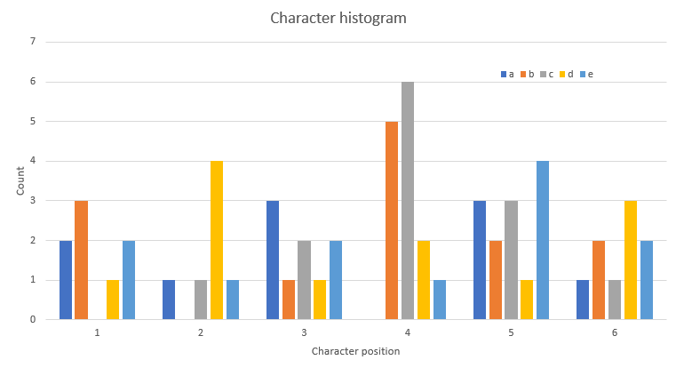
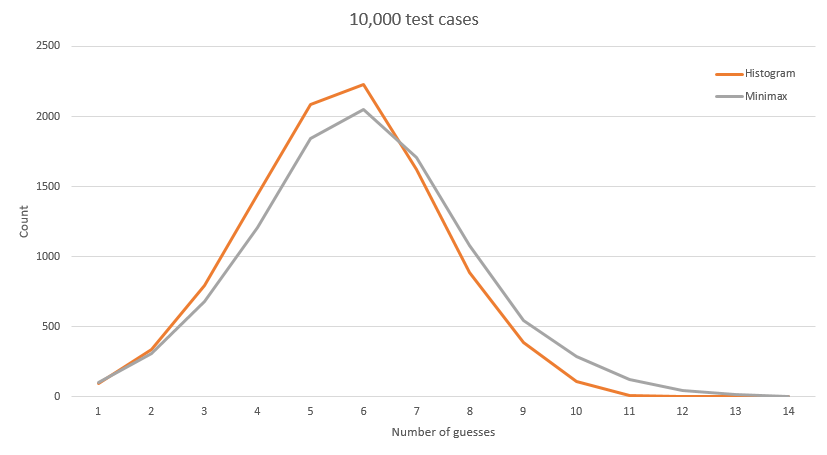

# Elimination histogram

**Author:** votrubac
**Votes:** 166
**Link:** [https://leetcode.com/problems/guess-the-word/solutions/134087/](https://leetcode.com/problems/guess-the-word/solutions/134087/)

---

The basic idea is to get a similarity score between secret and a `guess`. Say, it's `3`. Then, we compute a similarity score between `guess` and all candidates. If a similarity between `guess` and some other candidate is not `3`, this candidate can be eliminated as it cannot be a secret.

An improvement to this idea is to pick a candidate `guess` in a certain way, so that we maximize the number of candidates we can eliminate each turn. For that, we use the elimination histogram. 

#### Solution
We compute a position/character histogram for remaining candidates and use it to select the next word to guess (O(n)). After each guess, we eliminate all words with different similarity and update the histogram.

In order to reduce the number of guesses, the strategy is to pick such a word that would maximize the amount of information we can get per each guess. For example, if 30 words start with 'a', and a guess for ```"a*****"``` returned ```0```, this single turn eliminates 30 words. So, we can build a histogram of how often each character appears for each position. For example, if our words only contain characters from 'a' to 'e', we can get something like this:

According to this histogram, the word that would give us maximum information is "bdaced" - if this word exists in the list, of course. We need to score each word according to this histogram (in my case, multiply count of each character), and use the one with the highest score.

While writing this, I got an idea to use synthetic words ("bdaced" in our example) to maximize the initial elimination. According to my tests, using a synthetic word for the very first turn gives the best result.

I tested the Minimax solution by Lee, and my two solutions when running 10,000 test cases with 100 randombly generated strings, and here are the results:
Metric | Minimax | Histogram | Histogram + Synthetic Turn
--- | --- | --- | ---
Total runtime | 10306 ms | 15 ms | 13 ms
Average attemts | 5.9578 | 5.5857 | 5.4538
Max attemps | 13 | 11 | 11

**C++**
```cpp
int res = 0, probs[6][26] = {};
int match(string &w1, string &w2) {
    return inner_product(begin(w1), end(w1), begin(w2), 0, plus<int>(), equal_to<char>());
}
string bestCandidate(list<string>& words) {
    string best;
    int max_score = 0;
    for (auto w : words) {
        int score = 1;
        for (auto i = 0; i < 6; ++i)
            score *= probs[i][w[i] - 'a'];
        if (score > max_score) {
            max_score = score;
            best = w;
        }
    }
    return best;
}
void findSecretWord(vector<string>& wordlist, Master& master) {
    list<string> remWords(begin(wordlist), end(wordlist));
    auto add_prob = [&](string &w, int d = 1) {
        for (auto i = 0; i < 6; ++i)
            probs[i][w[i] - 'a'] += d;
    };
    for_each(begin(wordlist), end(wordlist), add_prob);
    while (res < 6) {
        auto candidate = bestCandidate(remWords);
        res = master.guess(candidate);
        for (auto it = remWords.begin(); it != remWords.end(); )
            if (match(*it, candidate) != res) {
                add_prob(*it, -1);
                remWords.erase(it++);
            }
            else 
                ++it;
    }
}
```