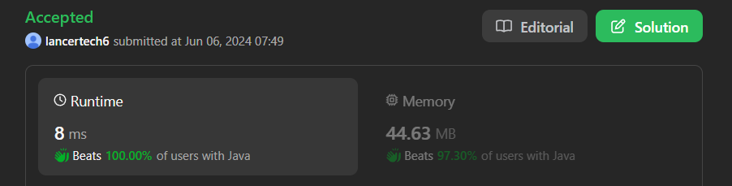

# ✅Beats 100% - Explained with [ Video ] - C++/Java/Python/JS - Sorting - Arrays - Interview Solution

**Author:** lancertech6
**Votes:** 218
**Link:** [https://leetcode.com/problems/hand-of-straights/solutions/5266460/](https://leetcode.com/problems/hand-of-straights/solutions/5266460/)

---



# YouTube Video Explanation:

<!-- **If you want a video for this question please write in the comments** -->

<!-- https://www.youtube.com/watch?v=ujU-jeO1v-k -->

https://youtu.be/WGF2u60GUmM

**\uD83D\uDD25 Please like, share, and subscribe to support our channel's mission of making complex concepts easy to understand.**

Subscribe Link: https://www.youtube.com/@leetlogics/?sub_confirmation=1

*Subscribe Goal: 1900 Subscribers*
*Current Subscribers: 1818*

---

# Intuition
<!-- Describe your first thoughts on how to solve this problem. -->
The problem is about arranging cards into groups of consecutive sequences. The key observation is that, to form valid groups, each smallest number in the group should lead to `groupSize - 1` consecutive numbers following it. If we can always find such sequences starting from the smallest number, then it is possible to arrange the cards into the desired groups.

# Approach
<!-- Describe your approach to solving the problem. -->
1. **Sort the Cards**: The first step is to sort the cards. Sorting helps us to easily identify and form consecutive sequences.

2. **Find Successors**: For each number in the sorted array, if it hasn't already been used in a group (indicated by a value of -1), try to form a group starting with that number. Use a helper function `findSuccessors` to check if it is possible to form a valid group starting from the current number.

3. **Mark Used Cards**: Once a card is used in a group, mark it as -1 to indicate it has been processed.

4. **Check Group Formation**: For each number, use the helper function to see if a group of `groupSize` consecutive numbers can be formed. If at any point, it is not possible to form such a group, return false.

5. **Completion Check**: If all numbers can be grouped correctly, return true.

# Complexity
- **Time Complexity**: Sorting the array takes \\(O(n \\log n)\\). The subsequent grouping operation in the worst case can take \\(O(n \	imes groupSize)\\), leading to an overall time complexity of \\(O(n \\log n + n \	imes groupSize)\\).
- **Space Complexity**: The space complexity is \\(O(1)\\) for the in-place operations (aside from the input array).


### Approach Summary

| Step            | Action                                                         | State of `hand` (example)                 |
|-----------------|----------------------------------------------------------------|------------------------------------------|
| 1. Sort         | Sort the array `hand`                                          | `[1, 2, 2, 3, 3, 4, 6, 7, 8]`            |
| 2. Group Check  | Start from the smallest element and try to form a group        | Current element: `1`                     |
| 3. Find Group   | Try to find `groupSize` consecutive elements starting from `1` | Group found: `[1, 2, 3]`                 |
| 4. Mark Used    | Mark elements used in the group as `-1`                        | `[-1, -1, 2, -1, 3, 4, 6, 7, 8]`         |
| 5. Repeat       | Move to the next unused element and repeat the process         | Current element: `2`, Group found: `[2, 3, 4]` |
| 6. Final Check  | Continue until all elements are processed                      | All groups formed successfully           |
| 7. Result       | If all elements are grouped correctly, return `true`           | `true`                                   |

# Step by Step Example Explanation

**Input**: `hand = [1, 2, 3, 6, 2, 3, 4, 7, 8]`, `groupSize = 3`  
**Output**: `true`  
**Explanation**: Alice's hand can be rearranged as `[1, 2, 3]`, `[2, 3, 4]`, `[6, 7, 8]`.

### Steps

1. **Sort the Array**:
   - Sort the array to facilitate forming consecutive groups.
   - **Example**: After sorting, `hand = [1, 2, 2, 3, 3, 4, 6, 7, 8]`.

2. **Iterate Through the Sorted Array**:
   - Use a helper function to try and form a group starting from the current element if it hasn't been used already.

3. **Helper Function**:
   - This function attempts to form a group of `groupSize` consecutive numbers.
   - Mark elements that are used by setting them to `-1`.

### Detailed Explanation Using Tables

#### Step 1: Sort the Array

| Initial `hand`       | Sorted `hand`            |
|----------------------|--------------------------|
| `[1, 2, 3, 6, 2, 3, 4, 7, 8]` | `[1, 2, 2, 3, 3, 4, 6, 7, 8]` |

#### Step 2: Iterate Through the Sorted Array

| Index `i` | Current Element | Action                              | Updated `hand`                        |
|-----------|------------------|-------------------------------------|---------------------------------------|
| 0         | 1                | Form group `[1, 2, 3]`              | `[-1, -1, 2, -1, 3, 4, 6, 7, 8]`      |
| 1         | 2 (already used) | Skip                                | `[-1, -1, 2, -1, 3, 4, 6, 7, 8]`      |
| 2         | 2                | Form group `[2, 3, 4]`              | `[-1, -1, -1, -1, -1, -1, 6, 7, 8]`   |
| 3         | 3 (already used) | Skip                                | `[-1, -1, -1, -1, -1, -1, 6, 7, 8]`   |
| 4         | 3 (already used) | Skip                                | `[-1, -1, -1, -1, -1, -1, 6, 7, 8]`   |
| 5         | 4 (already used) | Skip                                | `[-1, -1, -1, -1, -1, -1, 6, 7, 8]`   |
| 6         | 6                | Form group `[6, 7, 8]`              | `[-1, -1, -1, -1, -1, -1, -1, -1, -1]`|
| 7         | 7 (already used) | Skip                                | `[-1, -1, -1, -1, -1, -1, -1, -1, -1]`|
| 8         | 8 (already used) | Skip                                | `[-1, -1, -1, -1, -1, -1, -1, -1, -1]`|

### Final Check

All elements have been grouped successfully. Hence, return `true`.


# Code
```java []
class Solution {
    public boolean findsucessors(int[] hand, int groupSize, int i, int n) {
        int f = hand[i] + 1;
        hand[i] = -1;
        int count = 1;
        i += 1;
        while (i < n && count < groupSize) {
            if (hand[i] == f) {
                f = hand[i] + 1;
                hand[i] = -1;
                count++;
            }
            i++;
        }
        if (count != groupSize)
            return false;
        else
            return true;
    }

    public boolean isNStraightHand(int[] hand, int groupSize) {
        int n = hand.length;
        if (n % groupSize != 0)
            return false;
        Arrays.sort(hand);
        int i = 0;
        for (; i < n; i++) {
            if (hand[i] >= 0) {
                if (!findsucessors(hand, groupSize, i, n))
                    return false;
            }
        }
        return true;
    }
}
```
```C++ []
class Solution {
public:
   bool findSuccessors(vector<int>& hand, int groupSize, int i, int n) {
        int next = hand[i] + 1;
        hand[i] = -1;  // Mark as used
        int count = 1;
        i += 1;
        while (i < n && count < groupSize) {
            if (hand[i] == next) {
                next = hand[i] + 1;
                hand[i] = -1;
                count++;
            }
            i++;
        }
        return count == groupSize;
    }

    bool isNStraightHand(vector<int>& hand, int groupSize) {
        int n = hand.size();
        if (n % groupSize != 0) return false;
        std::sort(hand.begin(), hand.end());
        for (int i = 0; i < n; i++) {
            if (hand[i] >= 0) {
                if (!findSuccessors(hand, groupSize, i, n)) return false;
            }
        }
        return true;
    }
};
```
```Python []
class Solution(object):
    def find_successors(self, hand, groupSize, i, n):
        next_val = hand[i] + 1
        hand[i] = -1  # Mark as used
        count = 1
        i += 1
        while i < n and count < groupSize:
            if hand[i] == next_val:
                next_val = hand[i] + 1
                hand[i] = -1
                count += 1
            i += 1
        return count == groupSize

    def isNStraightHand(self, hand, groupSize):
        n = len(hand)
        if n % groupSize != 0:
            return False
        hand.sort()
        for i in range(n):
            if hand[i] >= 0:
                if not self.find_successors(hand, groupSize, i, n):
                    return False
        return True
        
```
```JavaScript []
var findSuccessors = function(hand, groupSize, i, n) {
    let next = hand[i] + 1;
    hand[i] = -1;  // Mark as used
    let count = 1;
    i += 1;
    while (i < n && count < groupSize) {
        if (hand[i] === next) {
            next = hand[i] + 1;
            hand[i] = -1;
            count++;
        }
        i++;
    }
    return count === groupSize;
};

var isNStraightHand = function(hand, groupSize) {
    let n = hand.length;
    if (n % groupSize !== 0) return false;
    hand.sort((a, b) => a - b);
    for (let i = 0; i < n; i++) {
        if (hand[i] >= 0) {
            if (!findSuccessors(hand, groupSize, i, n)) return false;
        }
    }
    return true;
};
```

