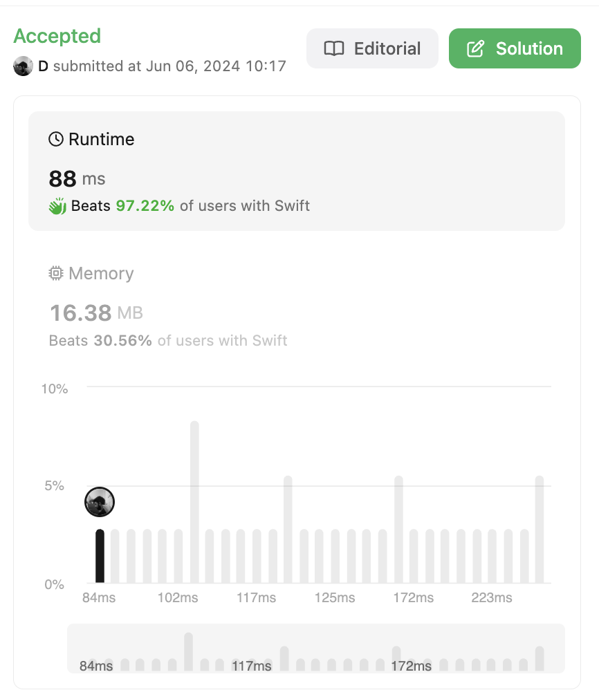

# ✅ [Beats 97%] Accepted solution with hashMap

**Author:** protodimbo
**Votes:** 2
**Link:** [https://leetcode.com/problems/hand-of-straights/solutions/5266552/](https://leetcode.com/problems/hand-of-straights/solutions/5266552/)

---



# Intuition
you can do it simplier with minHeap instead of sorted keys

# Code
```
class Solution {
    func isNStraightHand(_ hand: [Int], _ groupSize: Int) -> Bool {
        guard hand.count % groupSize == 0 else { return false }
        var count = hand.reduce(into: [:]) { $0[$1, default: 0] += 1 }
        let sorted = count.keys.sorted()
        for i in sorted {
            if let cardCount = count[i], cardCount  > 0 {
                for j in 0..<groupSize {
                    let next = i + j
                    if let nextCount = count[next], nextCount >= cardCount {
                        count[next]! -= cardCount
                    } else {
                        return false
                    }
                }
            }
        }
        return true
    }
}
```