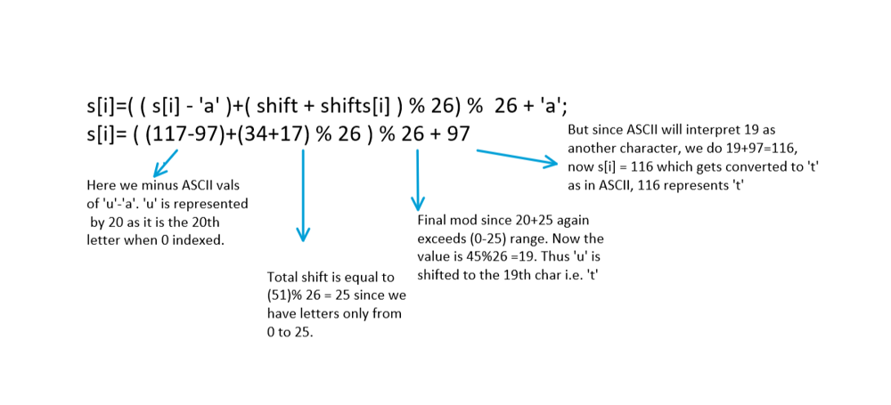

# [C++/Java/Python] Easy Solution (Well Explained with code for reference)

**Author:** jontystanley21
**Votes:** 149
**Link:** [https://leetcode.com/problems/shifting-letters/solutions/1451878/](https://leetcode.com/problems/shifting-letters/solutions/1451878/)

---

**It takes a long time to make this.. Please upvote if it helped you in any way** \uD83D\uDE03
Comment for doubts.

The problem seems easy at the first glance, and actually is, but we have to look out for overflows and ASCII manipulation. 

**Observations:**
We notice that for any input lets say, **"abc"**,

s = **"abc"**, shifts = [3,5,9]
Output: **"rpl"**

After shifting the first 1 letters of s by 3, we have "dbc".
After shifting the first 2 letters of s by 5, we have "igc".
After shifting the first 3 letters of s by 9, we have "rpl", the answer.

This is equivalent to shifting "abc" with **shifts=[3+5+9 , 5+9 , 9 ]** == [17 , 14 , 9]

We observe that we have to maintain a **reverse prefix sum** of the shifts array and this will be equal to the number of shifts for each character.

Note: Jump to ***Steps*** section if you already got it, or else you can read the explanation part if you wish to: 

**Explanation**

This is because by observation, we see that the **1st character** shifts every time for every value of shifts[i] in each iteration. i.e. first 'a' shifts 3 times to form 'd' , then for **second letter** 'b', it again shifts with it 5 more times to give 'i' and with the **last character** 'c' of 'abc' it again shifts 9 more times to give 'r'.

*Thus we conclude 0th char shifts for all shifts [i], 1st char shifts for all shifts[i]-0th shift and so on.*

**Steps:**

* We reverse iterate the string, since want to calculate the prefix sum in reverse and store it in a variable called '**shift**'. Note this has to be of long long type since test cases contain some huge numbers. At each step we accumulate the prefix sum.
								
											shift+=shifts[i];

* Now we use ASCII to get value for the shifted characters  by writng s[i]-'a' (gives us 97-97=0) . 'a' will now be represented by 0, b by 1 and so on.

ASCII values for:
*'a'=**97**      
'b'=**98**
'c'=**99***

* We add the prefix sum shift for every character but **mod it by 26** since its given in the question that after 'z' we **cycle back to 'a'** (i.e 26%26 =0  which is 'a'). 

* We also take a **final mod by 26** so that the value stays inside the (0-25) limit and add an 'a' (i.e. 97) to it so that **s[i]** now contains the character with that ASCII value. 

**Example**

Lets say we have to shift **'u'** by **17** ,it gets converted to '**t'**, then the internal working is:
*ASCII of 'u' = 117*



											

**C++**
```
class Solution {
public:
    string shiftingLetters(string s, vector<int>& shifts) {
        long shift=0;
        for(int i=s.size()-1;i>=0;i--){
            s[i]=((s[i]-'a')+(shift+shifts[i]) % 26) % 26 +'a';
            shift+=shifts[i];
        }
        return s;
    }
};
```

**Java**
```
class Solution {
    public String shiftingLetters(String s, int[] shifts) {
        StringBuilder ans = new StringBuilder(s);
        long shift=0;
        for (int i = s.length()-1; i >=0 ; i--){
            ans.setCharAt(i, (char)((s.charAt(i) - 'a' + (shift+shifts[i]) % 26) % 26 + 'a'));
            shift+=shifts[i];
        }
        return ans.toString();
    }
}
```

**Python**
```
class Solution:
    def shiftingLetters(self, s: str, shifts: List[int]) -> str:
        ans, shift = '', 0
        for i in range(len(shifts) -1, -1, -1):
            ans += chr((ord(s[i]) - ord('a') + shift+shifts[i]) % 26 + ord('a'))
            shift += shifts[i]
        
        return ans[::-1]
```

***Time Complexity***: O(N)
***Space Complexity*** : O(1) for C++ , O(N)  for Python, Java if StringBuilder is cosidered

Which of the 3 languages do you prefer? , comment below \uD83D\uDE43