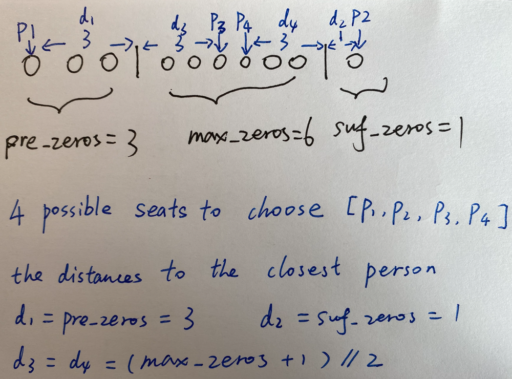

# ✅ [C++/Java/Python] One-Pass O(N) || Count Zeros || Image Explained

**Author:** linfq
**Votes:** 90
**Link:** [https://leetcode.com/problems/maximize-distance-to-closest-person/solutions/1693404/](https://leetcode.com/problems/maximize-distance-to-closest-person/solutions/1693404/)

---

**PLEASE UPVOTE if you like** \uD83D\uDE01 **If you have any question, feel free to ask.** 

* All your need is to count the `pre_zeros`, `suf_zeros`, `max_zeros`
* `return max(pre_zeros, suf_zeros, (max_zeros + 1) // 2)`
* all done



**C++**
```
class Solution {
public:
    int maxDistToClosest(vector<int>& seats) {     
        int pre_zeros = -1, suf_zeros = -1, max_zeros = -1, zeros = 0;
        for (int i = 0; i < seats.size(); i ++) {
            if (seats[i] == 0) {
                zeros ++;
            } else {
                if (pre_zeros == -1) {
                    pre_zeros = zeros;
                } else {
                    max_zeros = max(max_zeros, zeros);
                }
                zeros = 0;
            }
        } 
        suf_zeros = zeros;
        return max(max(pre_zeros, suf_zeros), (max_zeros + 1) / 2);
    }
};
```

**Python**
```
class Solution(object):
    def maxDistToClosest(self, seats):
        pre_zeros, suf_zeros, max_zeros, zeros = -1, -1, -1, 0
        for seat in seats:
            if seat == 0: zeros += 1
            else:
                if pre_zeros == -1: 
                    pre_zeros = zeros
                else:
                    max_zeros = max(max_zeros, zeros)
                zeros = 0
        suf_zeros = zeros
        return max(pre_zeros, suf_zeros, (max_zeros + 1) // 2)
```

**Java**
```
class Solution {
    public int maxDistToClosest(int[] seats) {
        int pre_zeros = -1, suf_zeros = -1, max_zeros = -1, zeros = 0;
        for (int i = 0; i < seats.length; i ++) {
            if (seats[i] == 0) {
                zeros ++;
            } else {
                if (pre_zeros == -1) {
                    pre_zeros = zeros;
                } else {
                    max_zeros = Math.max(max_zeros, zeros);
                }
                zeros = 0;
            }
        } 
        suf_zeros = zeros;
        return Math.max(Math.max(pre_zeros, suf_zeros), (max_zeros + 1) / 2);
    }
}
```

**PLEASE UPVOTE if you like** \uD83D\uDE01 **If you have any question, feel free to ask.**