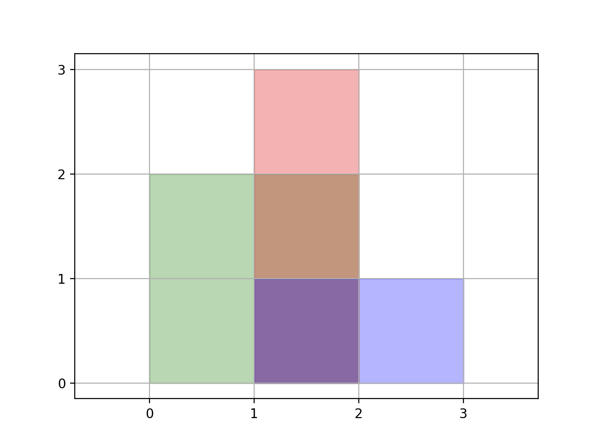

# [850. Rectangle Area II](https://leetcode.com/problems/rectangle-area-ii/)

| Category | Difficulty | Likes | Dislikes |
| :------: | :--------: | :---: | :------: |
| Algorithms | Hard | 1025 | 64 |

**Tags:** [`array`](https://leetcode.com/tag/array), [`segment-tree`](https://leetcode.com/tag/segment-tree), [`line-sweep`](https://leetcode.com/tag/line-sweep), [`ordered-set`](https://leetcode.com/tag/ordered-set)

**Companies:** `flipkart`, `google`

## Description

You are given a 2D array of axis-aligned `rectangles`. Each `rectangle[i] = [x_i1, y_i1, x_i2, y_i2]` denotes the `i^th` rectangle where `(x_i1, y_i1)` are the coordinates of the **bottom-left corner**, and `(x_i2, y_i2)` are the coordinates of the **top-right corner**.

Calculate the **total area** covered by all `rectangles` in the plane. Any area covered by two or more rectangles should only be counted **once**.

Return *the **total area***. Since the answer may be too large, return it **modulo** `10^9 + 7`.

 

**Example 1:**


```

Input: rectangles = [[0,0,2,2],[1,0,2,3],[1,0,3,1]]
Output: 6
Explanation: A total area of 6 is covered by all three rectangles, as illustrated in the picture.
From (1,1) to (2,2), the green and red rectangles overlap.
From (1,0) to (2,3), all three rectangles overlap.

```

**Example 2:**

```

Input: rectangles = [[0,0,1000000000,1000000000]]
Output: 49
Explanation: The answer is 1018 modulo (109 + 7), which is 49.

```

 

**Constraints:**

	- `1 <= rectangles.length <= 200`

	- `rectanges[i].length == 4`

	- `0 <= x_i1, y_i1, x_i2, y_i2 <= 10^9`

	- `x_i1 <= x_i2`

	- `y_i1 <= y_i2`

	- All rectangles have non zero area.

---

**Links:** [Submissions](https://leetcode.com/problems/rectangle-area-ii/) | [Solutions](https://leetcode.com/problems/rectangle-area-ii/)
